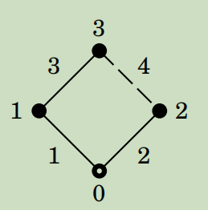
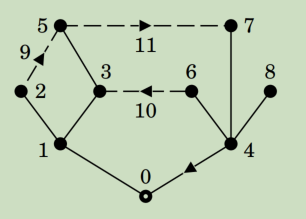
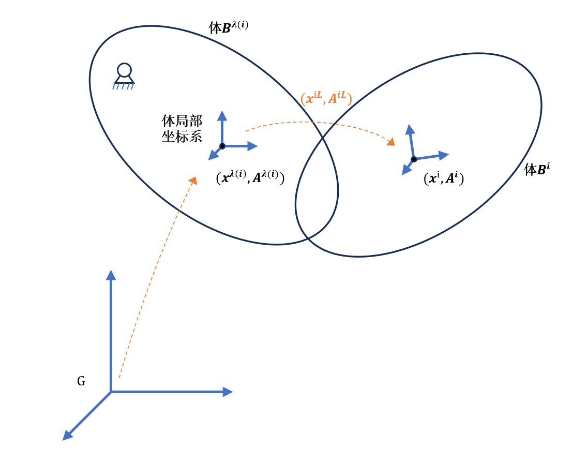
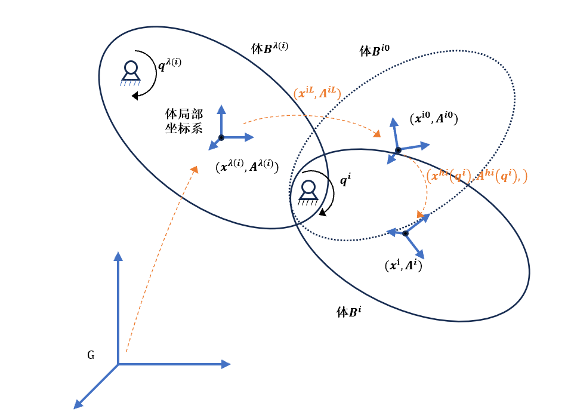
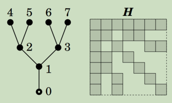
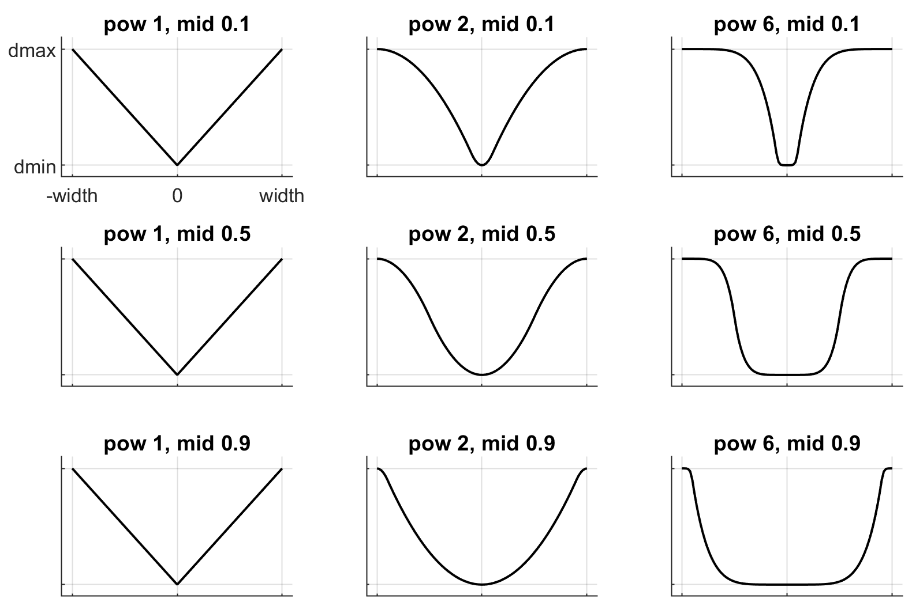
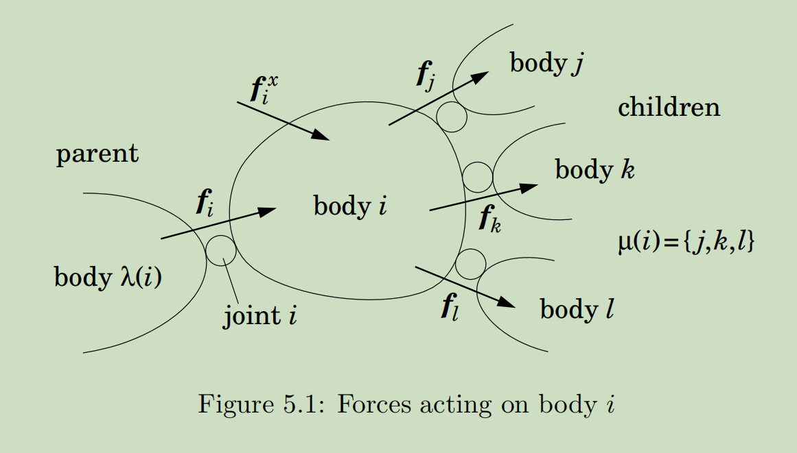
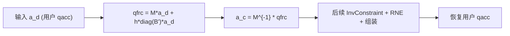
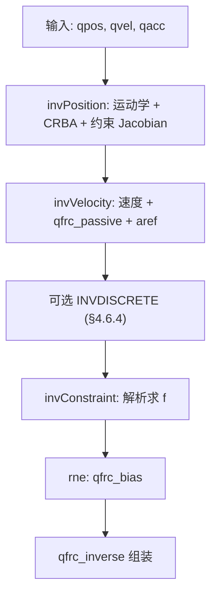

# MuJoCo 多体动力学理论

> 来源：`多体动力学开源库-mujoco-理论算法整理 (已自动恢复).docx`（外部同步盘，不入 git）

## 1. 符号说明

| 符号 | 含义 |
|------|------|
| $\widehat{v}_O$, $\widehat{f}_O$ | 参考点 $O$ 的空间速度、空间力（6 维） |
| $\times$, $\times^*$ | 空间叉乘算子及其对偶 |
| $\lambda(i)$, $\mu(i)$, $\kappa(i)$, $\nu(i)$ | 父体、子体、祖先链、影响链集合 |
| $S_i$, $\dot{S}_i$ | 关节 $i$ 的运动子空间及其时间导数 |
| $H$, $I_i^c$ | 广义质量矩阵、复合刚体空间惯性 |V
| $J$, $\dot{J}$ | 约束 Jacobian 及其时间导数 |
| $R$, $a_{ref}$ | 约束阻抗对角阵、参考约束加速度 |
| solref, solimp | MuJoCo 约束求解参数（时间常数/阻尼比或刚度/阻尼） |

## 2. 与 GDS 的关系

本文是 GDS 动力学模块所参考的 **MuJoCo 通用理论基线**（空间算子代数、递推运动学、CRB/RNE、软化约束与求解流程）。GDS 相对 MuJoCo 的实现差异见 [`multibody-dynamics.md`](multibody-dynamics.md)。

# 3. 摘要

Mujoco相关的理论，结合了mujoco理论文档以及代码实现进行整理，补充了一些其中没明确说明的内容，补充了一些理论的来源和推导过程，补充了一些对物理和数值意义的理解。

# 4. 多体动力学

## 4.1 空间算子代数（spacial operator algebra）

Mujoco中使用到的空间算子操作：

空间算子叉乘，空间速度×motion

空间算子叉乘，空间速度×\*Force

空间惯性乘空间速度

### 4.1.1 空间算子叉乘，空间速度$\mathbf{\times}$motion

定义，空间速度${\widehat{\mathbf{v}}}_{O} = \begin{bmatrix} \boldsymbol{\omega} \\ \mathbf{v}_{O} \end{bmatrix}$叉乘空间运动${\widehat{\mathbf{m}}}_{O} = \begin{bmatrix} m \\ m_{O} \end{bmatrix}$，叉乘算子$\times$为：

$${\widehat{\mathbf{v}}}_{O} \times = \left[ \begin{array}{r}
\mathbf{\omega} \\
\mathbf{v}_{O}
\end{array} \right] \times = \begin{bmatrix}
\mathbf{\omega} \times & \mathbf{0} \\
\mathbf{v}_{O} \times & \mathbf{\omega} \times 
\end{bmatrix}$$

那么

$$\left[ \begin{array}{r}
\omega \\
v_{O}
\end{array} \right] \times \left[ \begin{array}{r}
m \\
m_{O}
\end{array} \right] = \left[ \begin{array}{r}
\omega \times m \\
\omega \times m_{O} + v_{O} \times m
\end{array} \right]$$

### 4.1.2 空间算子叉乘，空间速度$\mathbf{\times}^{\mathbf{*}}$Force

定义，空间速度${\widehat{\mathbf{v}}}_{O} = \begin{bmatrix} \boldsymbol{\omega} \\ \mathbf{v}_{O} \end{bmatrix}$叉乘空间力${\widehat{\mathbf{f}}}_{O} = \begin{bmatrix} f_{O} \\ f \end{bmatrix}$，叉乘算子$\times^{*}$为：

$${\widehat{\mathbf{v}}}_{O} \times^{*} = \left[ \begin{array}{r}
\mathbf{\omega} \\
\mathbf{v}_{O}
\end{array} \right] \times^{*} = \begin{bmatrix}
\mathbf{\omega} \times & \mathbf{v}_{O} \times \\
\mathbf{0} & \mathbf{\omega} \times 
\end{bmatrix} = - ({\widehat{\mathbf{v}}}_{O} \times )^{T}$$

注意到$\times^{*}$与$\times$算子之间是对偶的关系，类似反对称矩阵的转置相反。

那么：

$$\left[ \begin{array}{r}
\omega \\
v_{O}
\end{array} \right] \times^{*}\left[ \begin{array}{r}
f_{O} \\
f
\end{array} \right] = \left[ \begin{array}{r}
\omega \times f_{O} + v_{O} \times f \\
\omega \times f
\end{array} \right]$$

### 4.1.3 Spacial量的坐标变换

#### 4.1.3.1 旋转变换

#### 4.1.3.2 平动变换

令O和P为空间中2个点，2个方向相同的坐标系分别位于O和P点，那么，

#### 4.1.3.3 一般变换

### 4.1.4 spacial速度变换

#### 4.1.4.1 原始表达

体上O点处的速度为$v_{O}$，P点的速度为$v_{P}$，而体上点的角速度相同$\omega = \omega_{O} = \omega_{p}$，速度的变换可以写为：

$$v_{p} = v_{o} + \omega \times OP$$

### 4.1.5 空间算子：空间惯性乘空间速度，得到（空间）动量

方向参考全局系、位置参考某点$O$表达的空间惯性阵：

$$\mathbf{I}_{O} = \begin{bmatrix}
{\overline{\mathbf{I}}}_{C} + m\mathbf{c} \times \mathbf{c} \times^{T} & m\mathbf{c} \times \\
m\mathbf{c} \times^{T} & m\mathbf{1}
\end{bmatrix} = \begin{bmatrix}
{\overline{\mathbf{I}}}_{o} & m\mathbf{c} \times \\
m\mathbf{c} \times^{T} & m\mathbf{1}
\end{bmatrix}$$

其中$\mathbf{c} = \overrightarrow{OC}$，为O点到质心C点的向量，表达在全局系下

其与O点处的空间速度$v_{o6} = \left[ \begin{array}{r}
w \\
v_{o}
\end{array} \right]$的空间乘及其矩阵乘形式写为：

$$h_{0} = I_{0}v_{o6} = \begin{bmatrix}
{\overline{\mathbf{I}}}_{C} + m\mathbf{c} \times \mathbf{c} \times^{T} & m\mathbf{c} \times \\
m\mathbf{c} \times^{T} & m\mathbf{1}
\end{bmatrix}\left[ \begin{array}{r}
\omega \\
v_{o}
\end{array} \right] = \left[ \begin{array}{r}
\left( {\overline{\mathbf{I}}}_{C} - m\widetilde{\mathbf{c}}\widetilde{\mathbf{c}} \right)\omega + m\ \widetilde{c}v_{0} \\
 - m\ \widetilde{\mathbf{c}}\omega + mv_{o}
\end{array} \right]$$

#### 4.1.5.1 刚体的动量计算，一般表达式

刚体的线动量等于刚体的总质量和质心的速度相乘（此处认为参考全局系G表达，实际可以参考任意惯性系）

$$p = mv_{c}$$

刚体对空间任意一点$O$的角动量（$L_{o}$），由两部分叠加而成：

1.  **随质心平动的角动量（**$L_{OCt}$**）**：这部分可理解为，将刚体全部质量集中于质心C时，该质点相对于点O的角动量。计算式为$\mathbf{L}_{\text{OCt}} = \mathbf{r}_{C} \times m\mathbf{v}_{C}$
    ，其中$\mathbf{r}_{C}$是从点O指向质心C的位置矢量。

2.  **绕质心转动的角动量（**$L_{OCr}$**）**：这部分是刚体绕其自身质心C旋转所固有的角动量，计算公式为
    。其中，是刚体相对于其质心的转动惯量（或更一般的惯量张量），是刚体的角速度矢量。

## 4.2 多体系统的图表示和编号规则

Mujoco的多体系统编号和图表示，主要参考featherstone的书rigid body
dynamics algorithm的chapter 4，另外也有少数与书中定义不一致的情况。

铰接的多体系统，用一个图表示：

1.点表示体，线表示joint，箭头表示joint连接方向；

2.体编号$0 - N_{B}$，其中base体用0表示，父体的编号必须小于子体

3.铰编号$1 - N_{j}$，

Featherstone规则：其中$1 - N_{B}$铰分别为$1 - N_{B}$体连接其父体的铰，其余铰任意编号

Mujoco规则：A.
mujoco支持体与其父体之间定义多个joint，每个joint提供一部分自由度，不存在类似featherstone的铰与体的编号关系；B.
父子体之间fix连接，对应mujoco中父子之间无joint，此时mujoco没有该joint（然而父子仍然分别为2个体）；C.
当不存在父子间多个joint或无joint的情况时，即父子间只有单个joint，此时mujoco的joint0连接body1与其父体，那么$0\sim(N_{B} - 1)$铰为$1 - N_{B}$体连接父体的关节）

如图所示：

此外还可以用一些向量表示系统的连接关系，如下图

​前接体数组$p$，后接体数组 $s$，父节点数组 λ：

$$\begin{aligned}
 & p = [ 0,1,1,4,3,4,4,4,2,6,5] \\
 & s = [ 1,2,3,0,5,6,7,8,5,3,7] \\
 & \lambda = [ 0,1,1,0,3,4,4,4]
\end{aligned}$$

支撑集 κ(i)，子集 μ(i)，子树集 ν(i)：

$$\begin{aligned}
 & \kappa(1) = \{ 1\} \\
\kappa(2) = \{ 1,2\} \\
\kappa(3) = \left\{ 1,3 \right\} \\
 \vdots \\
\kappa(8) = \{ 4,8\}
\end{aligned}\ \ \ \ \ \ \ \ \ \ \ \begin{aligned}
 & \mu(0) = \{ 1,4\} & & \\
\mu(1) = \{ 2,3\} \\
\mu(2) = \{\} \\
 \vdots \\
\mu(8) = \{\}
\end{aligned}\ \ \ \ \ \ \ \ \ \ \ \ \ \ \ \ \ \begin{aligned}
 & \nu(0) = \{ 0,1,2,\ldots,8\} \\
\nu(1) = \{ 1,2,3,5\} \\
\nu(2) = \{ 2\} \\
 \vdots \\
\nu(8) = \{ 8\}
\end{aligned}$$

各个数组的解释：

​​1. 前接体数组 p(Predecessor Array)​​, p(i)=关节 i的​​前驱体编号​​

图示例值：$p = [ 0,1,1,4,3,4,4,4,2,6,5]$

p(1)=0：关节1的前驱是体0

p(11)=5：关节11的前驱是体5

​​2. 后接体数组 s(Successor Array)​​，​s(i)=关节 i的​​后继物体编号​​

​​图示例值​​：$s = [ 1,2,3,0,5,6,7,8,5,3,7]$

s(1)=1：关节1的后继是物体1

s(11)=7：关节11的后继是物体7

3\. 父节点数组 λ(Parent Array)​​，λ(i)= 物体 i的父节点编号

​​计算规则​​：λ(i)=min(p(i),s(i))

λ(1)=0（物体1的父节点是基座0）

λ(5)=3（物体5的父节点是物体3）

2\. 支撑集 κ(i)(Support Set)​​，从物体 i到基座路径上的​​树关节集合​​

​​图示例值​​：

κ(8)：链接体8→4→0，路径关节编号为 {4,8}

​​3. 子集 μ(i)(Child Set)​​，物体 i的​​直接子节点集合​​

$\mu(0) = \{ 1,4\}$，体(0)的子节点：体1和4

​​

4\. 子树集 ν(i)(Subtree Set)​​：

以体 i为根的子树中​​所有体的集合​​（含i自身）==体 i及其所有后代==所有被关节i支撑的体的集合

ν(1)：包含体1及其所有后代 {1,2,3,5}

### 4.2.1 多体系统图示向量的关系

支撑集 κ(i)与子树集 ν(i)的对偶关系：j是i的支撑元等效于i是j子树元

$$j \in \kappa(i)\  \Rightarrow \ i \in \nu(j)$$

## 4.3 铰接体系统的递推运动学关系

下面整理和推导mujoco程序计算中所使用的运动递推关系，涉及Mujoco中支持的4类关节类型：Free，Hinge，Slide，ball，以及无关节的情况。

### 4.3.1 Mujoco的关节运动建模和广义坐标选取

mujoco中没有使用CAE软件间流行的通用的关节连接关系（关节通过内接点I
marker与外接点J
marker进行通用连接），而是认为关节是属于子体的（为子体提供运动自由度），是直接在子体坐标系中建立关节的参数与运动自由度的表达。

初始配置下，体$B^{i}$的体坐标系（参考父体坐标系）为$(x^{iL},A^{iL})$,
为体$B^{i}$提供自由度的关节，其安装位置和方向用jnt_pos和jnt_axis来标识（这两个量参考体系）。这些是表征模型的量，分析中保持不变。

Mujoco的各类关节广义坐标和广义速度定义：

Ball：广义坐标为子体系相对初始配置的旋转四元数（表达在未发生关节运动的子体系下）；广义速度为（子体系下的）角速度

Hinge：广义坐标为子体绕jnt_axis（表达在本体系下）的单向旋转角度；广义速度为该角度的时间导数

Slide：广义坐标为子体系沿jnt_axis（表达在本体系下）的平动位置；广义速度为该位置的时间导数

Free：由于mujoco仅支持体与worldbody之间的连接使用free关节，free关节的父体必定为world，所以其广义坐标就是子体局部系的位置和四元数（四元数表达在父体系下）

mujoco中的还配置了各个关节自由度的初值$q0$:

Free关节，自由度初值为初始配置下的子体相对父体的位形$(x^{iL},A^{iL})$，后续似乎不使用

Ball关节，自由度初值为单位四元数$1\ 0\ 0\ 0$

hinge关节和slide关节，初值可以在建模时设置，通过"ref"设置，否则为0

### 4.3.2 位置递推关系

#### 4.3.2.1 无关节的情况

如果体i与父体之间无关节连接，则没有自由度，即为固定，那么对于体i的位形$x^{i},A^{i}$由父体的位形$(x^{\lambda(i)},A^{\lambda(i)})$和初始配置时其参考父体的位形$(x^{iL},A^{iL})$叠加得到：

$$x^{i} = x^{\lambda(i)} + A^{\lambda(i)}x^{iL}$$

$$A^{i} = A^{\lambda(i)}A^{iL}$$

#### 4.3.2.2 Free关节

Free关节，仅可用于体与worldbody之间的直接连接，所以free关节连的父体必定为world，其自由度选取为子体局部系的位置和四元数，若子体编号为$i$，则自由度为$x^{i},q^{i}$，体局部系姿态为$A^{i}$，不需要递推关系

#### 4.3.2.3 Hinge，Slide，ball关节

而对于Hinge，Slide，ball关节，其关节运动关系如下图所示：

这里的运动是

隐含，$A^{hi}(q^{i})$是相对子体系的旋转（表达在未发生关节运动的子体系下），$x^{hi}(q^{i})$是相对子体系的平动，表达在全局系下

##### 4.3.2.3.1 姿态递推：

体坐标系的位形用$x^{i},A^{i}$表达。那么$B_{i}$的体坐标系的位形为：

$$A^{i} = A^{\lambda(i)}A^{iL}A^{hi}(q^{i})$$

物理意义：父体系姿态+joint无运动时子系随体旋转+
joint运动导致的随体旋转，注意是旋转随体叠加

对于slide，没有旋转，$A^{hi}\left( q^{i} \right) = I$

对于hinge，旋转为绕点$jntpos$和轴$jntaxis$转$q^{i}$，$A^{hi}\left( q^{i} \right) = A(jntaxis\ ,(q^{i} - q^{i0}))$，注意这里$jntaxis$表达在子体系下，所以得到的A也是在子体系下的

对于ball，与hinge一样，只是$q^{i}$不是转角而是相对子系的四元数，$A^{hi}\left( q^{i} \right) = A(q^{i})$。

$B_{i}$上的关节点的位置(参考全局系)为：

$$x^{hiG} = x^{\lambda(i)} + A^{\lambda(i)}x^{iL} + A^{\lambda(i)}A^{iL}$$

##### 4.3.2.3.2 平动位置递推：

$$x^{i} = x^{\lambda(i)} + A^{\lambda(i)}x^{iL} + A^{\lambda(i)}A^{iL}x^{hi}(q^{i})$$

物理意义：父体系原点+joint无运动时子系原点+
joint运动导致的变化，注意是全局系向量相加，$x^{hi}(q^{i})$是表达在joint未运动的子体坐标系的位移。

对于slide，沿jnt_axis进行平移导致体系原点偏移量为：$x^{hi}\left( q^{i} \right) = jntaxis(q^{i} - q^{i0})$

对于hinge，绕jnt_pos进行单向旋转导致体系原点偏移量为：旋转后的系原点相对旋转点的位置（全局系下）-旋转前的系原点相对旋转点的位置（全局系下），等于负的旋转后的旋转点相对系原点的位置：$x^{hi}\left( q^{i} \right) = A^{hi}\left( q^{i} \right)( - jntpos) - ( - jntpos) = jntpos - A^{hi}\left( q^{i} \right)jntpos$

对于ball，与hinge类似地，也是绕jnt_pos进行旋转，只是$A^{hi}\left( q^{i} \right)$的形式有所不同，那么体系原点偏移量与上面形式一致：$x^{hi}\left( q^{i} \right) = jntpos - A^{hi}\left( q^{i} \right)jntpos$

##### 4.3.2.3.3 位置递推总结

$$A^{i} = A^{\lambda(i)}A^{iL}A^{hi}\left( q^{i} \right)$$

$$A^{hi}\left( q^{i} \right) = \left\{ \begin{array}{r}
I_{(3)},\ \ \ \ \ \ \ \ \ \ \ \ \ \ \ \ \ \ \ \ \ \ \ \ \ \ \ \ \ \ \ \ \ \ \ \ \ \ \ \ \ \ \ \ \ \ \ \ slide \\
A\left( jntaxis\ ,\left( q^{i} - q^{i0} \right) \right),\ \ hinge \\
A(q^{i}),\ \ \ \ \ \ \ \ \ \ \ \ \ \ \ \ \ \ \ \ \ \ \ \ \ \ \ \ \ \ \ \ \ \ \ \ \ \ \ \ \ \ \ \ ball\ \ \ 
\end{array} \right.$$

$$x^{i} = x^{\lambda(i)} + A^{\lambda(i)}x^{iL} + A^{\lambda(i)}A^{iL}x^{hi}\left( q^{i} \right)$$

$$x^{hi}\left( q^{i} \right) = \left\{ \begin{array}{r}
jntaxis(q^{i} - q^{i0}),\ \ \ \ \ \ \ \ \ \ \ \ \ \ \ \ \ \ \ \ \ \ \ \ \ \ \ \ \ \ \ \ \ \ \ \ \ \ slide \\
jntpos - A^{hi}\left( q^{i} \right)jntpos,\ \ \ \ \ \ \ \ \ \ \ \ \ \ \ \ \ \ \ \ \ \ \ \ \ hinge \\
x^{hi}\left( q^{i} \right) = jntpos - A^{hi}\left( q^{i} \right)jntpos,\ \ \ \ \ \ ball\ \ \ 
\end{array} \right.$$

### 4.3.3 速度递推关系：

#### 4.3.3.1 Free关节

Mujoco中Free使用广义速度为$\left[ \begin{array}{r} v^{i} \\ \omega^{'i} \end{array} \right]$，角速度是在体系下表达的。

接下来考虑Bi上一点的速度和角速度：

Bi体的角速度为

$$\omega^{i} = A^{i}\omega^{'i}$$

考虑Bi上固结的任一点$P^{i} = x^{p}$(参考全局系)，若点Pi表达在体系的位置是$x^{piL}$(常量)，其全局位置与局部位置之间有关系

$$x^{pi} = x^{i} + A^{i}x^{piL}$$

则Bi上的p点的速度为

$${\dot{x}}^{pi} = v^{i} + {\dot{A}}^{i}x^{piL} = v^{i} + A^{i}{\widetilde{\omega}}^{'i}x^{piL} = v^{i} - A^{i}{\widetilde{x}}^{piL}\omega^{'i} = v^{i} - A^{i}{\widetilde{x}}^{piL}A^{iT}A^{i}\omega^{'i} = v^{i} - \widetilde{\left( {A^{i}x}^{piL} \right)}A^{i}\omega^{'i} = v^{i} - \widetilde{\left( {A^{i}x}^{piL} \right)}A^{i}\omega^{'i} = v^{i} - \widetilde{\left( x^{pi} - x^{i} \right)}A^{i}\omega^{'i}$$

角速度与速度联立写为：

$$\omega^{i} = \begin{bmatrix}
0 & A^{i}
\end{bmatrix}\left[ \begin{array}{r}
v^{i} \\
\omega^{'i}
\end{array} \right] = S^{R}\left[ \begin{array}{r}
v^{i} \\
\omega^{'i}
\end{array} \right],\ \ S^{R} = \begin{bmatrix}
0 & A^{i}
\end{bmatrix}$$

$${\dot{x}}^{pi} = \begin{bmatrix}
I & - A^{i}{\widetilde{x}}^{piL}
\end{bmatrix}\left[ \begin{array}{r}
v^{i} \\
\omega^{'i}
\end{array} \right] = \begin{bmatrix}
I & - \widetilde{\left( x^{pi} - x^{i} \right)}A^{i}
\end{bmatrix}\left[ \begin{array}{r}
v^{i} \\
\omega^{'i}
\end{array} \right] = S^{T}\left[ \begin{array}{r}
v^{i} \\
\omega^{'i}
\end{array} \right],\ \ S^{T} = \begin{bmatrix}
I & - A^{i}{\widetilde{x}}^{piL}
\end{bmatrix} = \begin{bmatrix}
I & - \widetilde{\left( x^{pi} - x^{i} \right)}A^{i}
\end{bmatrix}$$

#### 4.3.3.2 关节速度关系

关节运动导致的位置改变为$\left( x^{hi}\left( q^{i} \right),A^{hi}\left( q^{i} \right) \right)$（都是参考未发生关节运动的体i的坐标系表达）如下：

姿态关系：

对于slide，没有旋转，$A^{hi}\left( q^{i} \right) = I$

对于hinge，旋转为绕点$jntpos$和轴$jntaxis$转$q^{i}$，$A^{hi}\left( q^{i} \right) = A(jntaxis\ ,(q^{i} - q^{i0}))$，注意这里$jntaxis$表达在子体系下，所以得到的A也是在子体系下的

对于ball，与hinge一样，只是$q^{i}$不是转角而是相对子系的四元数，$A^{hi}\left( q^{i} \right) = A(q^{i})$。

平移关系：

对于slide，沿jnt_axis进行平移导致体系原点偏移量为：$x^{hi}\left( q^{i} \right) = jntaxis(q^{i} - q^{i0})$

对于hinge，绕jnt_pos进行单向旋转导致体系原点偏移量为：旋转后的系原点相对旋转点的位置（全局系下）-旋转前的系原点相对旋转点的位置（全局系下），等于负的旋转后的旋转点相对系原点的位置：$x^{hi}\left( q^{i} \right) = A^{hi}\left( q^{i} \right)( - jntpos) - ( - jntpos) = jntpos - A^{hi}\left( q^{i} \right)jntpos$

对于ball，与hinge类似地，也是绕jnt_pos进行旋转，只是$A^{hi}\left( q^{i} \right)$的形式有所不同，那么体系原点偏移量与上面形式一致：$x^{hi}\left( q^{i} \right) = jntpos - A^{hi}\left( q^{i} \right)jntpos$

对它们求导就能得到关节运动导致的速度变换

##### 4.3.3.2.1 旋转

求导：

Slide:

$${\dot{A}}^{hi}\left( q^{i} \right) = \dot{I} = 0$$

hinge:

$$A^{hi}\left( q^{i} \right) = A\left( jntaxis\ ,\left( q^{i} - q^{i0} \right) \right)$$

思路1，应用角速度关系${\dot{A}}^{hi}\left( q^{i} \right) = {\widetilde{\omega}}^{hi}A^{hi}\left( q^{i} \right)$，这里$\omega^{hi}$是关节运动导致的角速度（在未运动本体系的表达），可知$\omega^{hi} = jntaxis\ {\dot{q}}^{i}$可知${\widetilde{\omega}}^{hi} = \widetilde{jntaxis}\ {\dot{q}}^{i}$，所以${\dot{A}}^{hi}\left( q^{i} \right) = \widetilde{jntaxis}\ {\dot{q}}^{i}A^{hi}\left( q^{i} \right)$

思路2，应用罗德里德公式：

$$A^{hi}\left( q^{i} \right) = A\left( jntaxis\ ,\left( q^{i} - q^{i0} \right) \right) = I + \left( 1 - \cos\left( q^{i} - q^{i0} \right) \right){\widetilde{jntaxis\ }}^{2} + \widetilde{jntaxis\ }\sin\left( q^{i} - q^{i0} \right)$$

$${\dot{A}}^{hi}\left( q^{i} \right) = - \dot{\left( \cos\left( q^{i} - q^{i0} \right) \right)}{\widetilde{jntaxis\ }}^{2} + \widetilde{jntaxis\ }\dot{\left( \sin\left( q^{i} - q^{i0} \right) \right)} = - \left( - \sin\left( q^{i} - q^{i0} \right){\dot{q}}^{i} \right){\widetilde{jntaxis\ }}^{2} + \widetilde{jntaxis\ }\left( \cos\left( q^{i} - q^{i0} \right){\dot{q}}^{i} \right) = {\dot{q}}^{i}\left( \left( \sin\left( q^{i} - q^{i0} \right) \right){\widetilde{jntaxis\ }}^{2} + \widetilde{jntaxis}\left( \cos\left( q^{i} - q^{i0} \right) \right) \right) = {\dot{q}}^{i}\widetilde{jntaxis}\left( \left( \sin\left( q^{i} - q^{i0} \right) \right)\widetilde{jntaxis\ } + I\left( \cos\left( q^{i} - q^{i0} \right) \right) \right)$$

$${\dot{A}}^{hi}\left( q^{i} \right)A^{hiT}\left( q^{i} \right) = {\dot{q}}^{i}\left( \left( \sin\left( q^{i} - q^{i0} \right) \right){\widetilde{jntaxis\ }}^{2} + \widetilde{jntaxis}\left( \cos\left( q^{i} - q^{i0} \right) \right) \right)\left( I + \left( 1 - \cos\left( q^{i} - q^{i0} \right) \right){\widetilde{jntaxis\ }}^{2} - \widetilde{jntaxis\ }\sin\left( q^{i} - q^{i0} \right) \right)$$

$$= {\dot{q}}^{i}\left( \left( \sin\left( q^{i} - q^{i0} \right) \right){\widetilde{jntaxis\ }}^{2} + \widetilde{jntaxis}\left( \cos\left( q^{i} - q^{i0} \right) \right) + \left( \sin\left( q^{i} - q^{i0} \right) \right){\widetilde{jntaxis\ }}^{2}\left( 1 - \cos\left( q^{i} - q^{i0} \right) \right){\widetilde{jntaxis\ }}^{2} + \widetilde{jntaxis}\left( \cos\left( q^{i} - q^{i0} \right) \right)\left( 1 - \cos\left( q^{i} - q^{i0} \right) \right){\widetilde{jntaxis\ }}^{2} - \widetilde{jntaxis\ }\sin\left( q^{i} - q^{i0} \right)\left( \sin\left( q^{i} - q^{i0} \right) \right){\widetilde{jntaxis\ }}^{2} - \widetilde{jntaxis\ }\sin\left( q^{i} - q^{i0} \right)\widetilde{jntaxis}\left( \cos\left( q^{i} - q^{i0} \right) \right) \right)$$

$$= {\dot{q}}^{i}\left( \left( \sin\left( q^{i} - q^{i0} \right) \right){\widetilde{jntaxis\ }}^{2} + \widetilde{jntaxis}\left( \cos\left( q^{i} - q^{i0} \right) \right) + \left( \sin\left( q^{i} - q^{i0} \right) \right)\left( 1 - \cos\left( q^{i} - q^{i0} \right) \right){\widetilde{jntaxis\ }}^{4} + \left( \cos\left( q^{i} - q^{i0} \right) \right)\left( 1 - \cos\left( q^{i} - q^{i0} \right) \right){\widetilde{jntaxis}}^{3} - sin\left( q^{i} - q^{i0} \right)\sin\left( q^{i} - q^{i0} \right){\widetilde{jntaxis\ }}^{3} - {\widetilde{jntaxis}}^{2}\sin\left( q^{i} - q^{i0} \right)\cos\left( q^{i} - q^{i0} \right) \right)$$

$$= {\dot{q}}^{i}\left( \left( \sin\left( q^{i} - q^{i0} \right) \right){\widetilde{jntaxis\ }}^{2} + \widetilde{jntaxis}\left( \cos\left( q^{i} - q^{i0} \right) \right) + \left( \sin\left( q^{i} - q^{i0} \right) \right)\left( 1 - \cos\left( q^{i} - q^{i0} \right) \right){\widetilde{jntaxis\ }}^{4} + \left( \cos\left( q^{i} - q^{i0} \right) - cos\left( q^{i} - q^{i0} \right)\cos\left( q^{i} - q^{i0} \right) - sin\left( q^{i} - q^{i0} \right)\sin\left( q^{i} - q^{i0} \right) \right){\widetilde{jntaxis}}^{3} - {\widetilde{jntaxis}}^{2}\sin\left( q^{i} - q^{i0} \right)\cos\left( q^{i} - q^{i0} \right) \right)$$

$$= {\dot{q}}^{i}\left( \left( \sin\left( q^{i} - q^{i0} \right) \right){\widetilde{jntaxis\ }}^{2} + \widetilde{jntaxis}\left( \cos\left( q^{i} - q^{i0} \right) \right) + \left( \sin\left( q^{i} - q^{i0} \right) \right)\left( 1 - \cos\left( q^{i} - q^{i0} \right) \right){\widetilde{jntaxis\ }}^{4} + \left( \cos\left( q^{i} - q^{i0} \right) - 1 \right){\widetilde{jntaxis}}^{3} - {\widetilde{jntaxis}}^{2}\sin\left( q^{i} - q^{i0} \right)\cos\left( q^{i} - q^{i0} \right) \right)$$

引入${\widetilde{e}}^{3} = - \widetilde{e},\ \ {\widetilde{e}}^{4} = - {\widetilde{e}}^{2}$

$$= {\dot{q}}^{i}\left( \left( \sin\left( q^{i} - q^{i0} \right) \right){\widetilde{jntaxis\ }}^{2} + \widetilde{jntaxis}\left( \cos\left( q^{i} - q^{i0} \right) \right) + \left( \sin\left( q^{i} - q^{i0} \right) \right)\left( \cos\left( q^{i} - q^{i0} \right) - 1 \right){\widetilde{jntaxis\ }}^{2} + \left( 1 - cos\left( q^{i} - q^{i0} \right) \right)\widetilde{jntaxis} - {\widetilde{jntaxis}}^{2}\sin\left( q^{i} - q^{i0} \right)\cos\left( q^{i} - q^{i0} \right) \right)$$

$$= {\dot{q}}^{i}\left( \left( \sin\left( q^{i} - q^{i0} \right) \right){\widetilde{jntaxis\ }}^{2} + \left( \sin\left( q^{i} - q^{i0} \right) \right)\left( \cos\left( q^{i} - q^{i0} \right) - 1 \right){\widetilde{jntaxis\ }}^{2} + \widetilde{jntaxis} - {\widetilde{jntaxis}}^{2}\sin\left( q^{i} - q^{i0} \right)\cos\left( q^{i} - q^{i0} \right) \right)$$

$$= {\dot{q}}^{i}\left( \left( \sin\left( q^{i} - q^{i0} \right) + \left( \sin\left( q^{i} - q^{i0} \right) \right)\left( \cos\left( q^{i} - q^{i0} \right) - 1 \right) - sin\left( q^{i} - q^{i0} \right)\cos\left( q^{i} - q^{i0} \right) \right){\widetilde{jntaxis\ }}^{2} + \widetilde{jntaxis} \right)$$

$$= {\dot{q}}^{i}\left( \widetilde{jntaxis} \right)$$

$$\left( \left( \sin\left( q^{i} - q^{i0} \right) \right){\widetilde{jntaxis\ }}^{2} + \widetilde{jntaxis}\left( \cos\left( q^{i} - q^{i0} \right) \right) \right)\left( I + \left( 1 - \cos\left( q^{i} - q^{i0} \right) \right){\widetilde{jntaxis\ }}^{2} - \widetilde{jntaxis\ }\sin\left( q^{i} - q^{i0} \right) \right)$$

与思路一结果一致，所以

$${\dot{A}}^{hi}\left( q^{i} \right) = \widetilde{jntaxis}\ {\dot{q}}^{i}A^{hi}\left( q^{i} \right)$$

Ball:

$$A^{hi}\left( q^{i} \right) = A(q^{i})$$

$${\dot{A}}^{hi}\left( q^{i} \right) = {\widetilde{\omega}}^{hi}A^{hi}\left( q^{i} \right) = A^{hi}\left( q^{i} \right){\widetilde{\omega}}^{hi'}$$

这里$\omega^{hi}$和$\omega^{hi'}$是关节运动导致的角速度（$\omega^{hi}$表达在未运动本体系下，$\omega^{hi'}$表达在本体系下）。后续我们使用的是后一个表达${\dot{A}}^{hi}\left( q^{i} \right) = A^{hi}\left( q^{i} \right){\widetilde{\omega}}^{hi'}$

结合3个关节的旋转速度关系，可以写出通用式：

$${\dot{A}}^{hi}\left( q^{i} \right) = \left\{ \begin{array}{r}
0 \\
\widetilde{jntaxis}\ A^{hi}\left( q^{i} \right){\dot{q}}^{i} \\
A^{hi}\left( q^{i} \right){\widetilde{\omega}}^{hi'}
\end{array} \right.$$

##### 4.3.3.2.2 平动

让$x^{hi}\left( q^{i} \right)$表达在Bi未发生关节运动的体系下，并求导

slide：

$$x^{hi}\left( q^{i} \right) = jntaxis(q^{i} - q^{i0})$$

$${\dot{x}}^{hi}\left( q^{i} \right) = jntaxis\ {\dot{q}}^{i}$$

对于hinge，

$$x^{hi}\left( q^{i} \right) = jntpos - A^{hi}\left( q^{i} \right)jntpos$$

$${\dot{x}}^{hi}\left( q^{i} \right) = - {\dot{A}}^{hi}\left( q^{i} \right)jntpos$$

引入${\dot{A}}^{hi}\left( q^{i} \right) = \widetilde{jntaxis}\ {\dot{q}}^{i}A^{hi}\left( q^{i} \right)$

$${\dot{x}}^{hi}\left( q^{i} \right) = - \widetilde{jntaxis}\ {\dot{q}}^{i}A^{hi}\left( q^{i} \right)\ jntpos = - \widetilde{jntaxis}\ A^{hi}\left( q^{i} \right)\ jntpos\ {\dot{q}}^{i} = \widetilde{\left( A^{hi}\left( q^{i} \right)jntpos \right)}\ jntaxis\ {\dot{q}}^{i}$$

对于ball，与hinge一样

$$x^{hi}\left( q^{i} \right) = jntpos - A^{hi}\left( q^{i} \right)jntpos$$

$${\dot{x}}^{hi}\left( q^{i} \right) = - {\dot{A}}^{hi}\left( q^{i} \right)jntpos = - A^{hi}\left( q^{i} \right){\widetilde{\omega}}^{hi'}jntpos = A^{hi}\left( q^{i} \right)\widetilde{jntpos}\ \omega^{hi'}$$

写成通用表达式为：

$${\dot{x}}^{hi}\left( q^{i} \right) = \left\{ \begin{array}{r}
jntaxis\ {\dot{q}}^{i} \\
\widetilde{\left( A^{hi}\left( q^{i} \right)jntpos \right)}\ jntaxis\ {\dot{q}}^{i} \\
A^{hi}\left( q^{i} \right)\widetilde{jntpos}\ \omega^{hi'}
\end{array} \right.$$

#### 4.3.3.3 体的角速度递推式

位置递推关系为：

$$A^{i} = A^{\lambda(i)}A^{iL}A^{hi}(q^{i})$$

$$x^{i} = x^{\lambda(i)} + A^{\lambda(i)}x^{iL} + A^{\lambda(i)}A^{iL}x^{hi}(q^{i})$$

可以求导得到系的速度递推关系。

姿态

对姿态求导：

$${\dot{A}}^{i} = {\dot{A}}^{\lambda(i)}A^{iL}A^{hi}\left( q^{i} \right) + A^{\lambda(i)}A^{iL}{\dot{A}}^{hi}\left( q^{i} \right)$$

对${\dot{A}}^{i}$，如果引入系的随体角速度得到

$$A^{i}{\widetilde{\omega}}^{i'} = A^{\lambda(i)}{\widetilde{\omega}}^{\lambda(i)'}A^{iL}A^{hi}\left( q^{i} \right) + A^{\lambda(i)}A^{iL}{\dot{A}}^{hi}\left( q^{i} \right)$$

$${\widetilde{\omega}}^{i'} = \left( A^{\lambda(i)}A^{iL}A^{hi}\left( q^{i} \right) \right)^{T}A^{\lambda(i)}{\widetilde{\omega}}^{\lambda(i)'}A^{iL}A^{hi}\left( q^{i} \right) + \left( A^{\lambda(i)}A^{iL}A^{hi}\left( q^{i} \right) \right)^{T}A^{\lambda(i)}A^{iL}{\dot{A}}^{hi}\left( q^{i} \right)$$

$$= A^{hiT}\left( q^{i} \right)A^{iLT}A^{\lambda(i)T}A^{\lambda(i)}{\widetilde{\omega}}^{\lambda(i)'}A^{iL}A^{hi}\left( q^{i} \right) + A^{hiT}\left( q^{i} \right)A^{iLT}A^{\lambda(i)T}A^{\lambda(i)}A^{iL}{\dot{A}}^{hi}\left( q^{i} \right)$$

$$= A^{hiT}\left( q^{i} \right)A^{iLT}{\widetilde{\omega}}^{\lambda(i)'}A^{iL}A^{hi}\left( q^{i} \right) + A^{hiT}\left( q^{i} \right){\dot{A}}^{hi}\left( q^{i} \right)$$

对${\dot{A}}^{i}$，如果引入系的全局角速度得到

$${\widetilde{\omega}}^{i}A^{i} = {\widetilde{\omega}}^{\lambda(i)}A^{\lambda(i)}A^{iL}A^{hi}\left( q^{i} \right) + A^{\lambda(i)}A^{iL}{\dot{A}}^{hi}\left( q^{i} \right)$$

$${\widetilde{\omega}}^{i} = {\widetilde{\omega}}^{\lambda(i)}A^{\lambda(i)}A^{iL}A^{hi}\left( q^{i} \right)\left( A^{\lambda(i)}A^{iL}A^{hi}\left( q^{i} \right) \right)^{T} + A^{\lambda(i)}A^{iL}{\dot{A}}^{hi}\left( q^{i} \right)\left( A^{\lambda(i)}A^{iL}A^{hi}\left( q^{i} \right) \right)^{T}$$

$${\widetilde{\omega}}^{i} = {\widetilde{\omega}}^{\lambda(i)} + A^{\lambda(i)}A^{iL}{\dot{A}}^{hi}\left( q^{i} \right)\left( A^{\lambda(i)}A^{iL}A^{hi}\left( q^{i} \right) \right)^{T} = {\widetilde{\omega}}^{\lambda(i)} + A^{\lambda(i)}A^{iL}{\dot{A}}^{hi}\left( q^{i} \right)A^{hiT}\left( q^{i} \right)A^{iLT}A^{\lambda(i)T}$$

引入上面的关节速度关系通用式：
$${\dot{A}}^{hi}\left( q^{i} \right) = \left\{ \begin{array}{r}
0 \\
\widetilde{jntaxis}\ A^{hi}\left( q^{i} \right){\dot{q}}^{i} \\
A^{hi}\left( q^{i} \right){\widetilde{\omega}}^{hi'}
\end{array} \right.$$

$${\widetilde{\omega}}^{i} = \left\{ \begin{array}{r}
{\widetilde{\omega}}^{\lambda(i)} + 0 \\
{\widetilde{\omega}}^{\lambda(i)} + A^{\lambda(i)}A^{iL}\widetilde{jntaxis}\ A^{hi}\left( q^{i} \right)A^{hiT}\left( q^{i} \right)A^{iLT}A^{\lambda(i)T}{\dot{q}}^{i} \\
{\widetilde{\omega}}^{\lambda(i)} + A^{\lambda(i)}A^{iL}A^{hi}\left( q^{i} \right){\widetilde{\omega}}^{hi'}A^{hiT}\left( q^{i} \right)A^{iLT}A^{\lambda(i)T}
\end{array} \right.\  = \left\{ \begin{array}{r}
{\widetilde{\omega}}^{\lambda(i)} \\
{\widetilde{\omega}}^{\lambda(i)} + A^{\lambda(i)}A^{iL}\widetilde{jntaxis}A^{iLT}A^{\lambda(i)T}{\dot{q}}^{i} \\
{\widetilde{\omega}}^{\lambda(i)} + \widetilde{\left( A^{\lambda(i)}A^{iL}A^{hi}\left( q^{i} \right)\omega^{hi'} \right)}
\end{array} \right.\  = \left\{ \begin{array}{r}
{\widetilde{\omega}}^{\lambda(i)} \\
{\widetilde{\omega}}^{\lambda(i)} + \widetilde{\left( A^{\lambda(i)}A^{iL}\ jntaxis{\ \dot{q}}^{i} \right)} \\
{\widetilde{\omega}}^{\lambda(i)} + \widetilde{\left( A^{\lambda(i)}A^{iL}A^{hi}\left( q^{i} \right)\omega^{hi'} \right)}
\end{array} \right.$$

写为运动子空间S乘广义速度的形式：

$$\omega^{i} = \omega^{\lambda(i)} + S^{R}v^{i}$$

其中广义速度
$$v^{i} = \left\{ \begin{array}{r}
{\dot{q}}^{i},\ \ \ \ \ \ \ slide \\
{\dot{q}}^{i},\ \ \ \ \ \ \ \ hinge \\
\omega^{hi'},\ \ \ ball\ \ \ 
\end{array} \right.$$
，注意ball关节存储的角速度，是参考本体系的

运动子空间为：

$$S^{R} = \left\{ \begin{array}{r}
0_{(3 \times 1)},\ \ \ \ \ \ \ \ \ \ \ \ \ \ \ \ \ \ \ \ \ \ \ \ \ \ \ \ slide \\
A^{\lambda(i)}A^{iL}jntaxis,\ \ hinge \\
A^{\lambda(i)}A^{iL}A^{hi}\left( q^{i} \right),\ \ \ \ \ \ \ \ \ \ \ \ \ \ \ \ \ \ \ \ \ \ ball\ \ \ 
\end{array} \right.\ \ \ \ \ \$$

#### 4.3.3.4 P点的速度递推

考虑Bi上固结的任一点$P^{i} = x^{p}$(参考全局系)，若点Pi表达在体系的位置是$x^{piL}$，其全局位置与局部位置之间有关系

$$x^{pi} = x^{i} + A^{i}x^{piL}$$

而Bi的父体上同位置的点$P^{\lambda(i)} = x^{p}$（参考全局系），点$P^{\lambda(i)}$是固定在Bi-1上的，所以

$$x^{p\lambda(i)} = x^{\lambda(i)} + A^{\lambda(i)}x^{p\lambda(i)L}$$

$x^{pi}$和$x^{p\lambda(i)}$相等，但只是瞬时相等，其速度并不等。根据位置相等关系：

$$x^{\lambda(i)} + A^{\lambda(i)}x^{p\lambda(i)L} = x^{i} + A^{i}x^{piL}$$

$$x^{\lambda(i)} - x^{i} + A^{\lambda(i)}x^{p\lambda(i)L} = A^{i}x^{piL}$$

$$x^{piL} = A^{iT}x^{\lambda(i)} - A^{iT}x^{i} + A^{iT}A^{\lambda(i)}x^{p\lambda(i)L}$$

求导计算点pi处的速度：

$${\dot{x}}^{pi} = {\dot{x}}^{i} + {\dot{A}}^{i}x^{piL}$$

推导思路：

$${\dot{x}}^{pi} = {\dot{x}}^{i} + {\dot{A}}^{i}x^{piL} = {\dot{x}}^{i} + {\widetilde{\omega}}^{i}A^{i}x^{piL} = {\dot{x}}^{i} + {\widetilde{\omega}}^{i}\left( x^{pi} - x^{i} \right)$$

引入旋转递推关系：$\omega^{i} = \omega^{\lambda(i)} + S^{R}v^{i}$

$$= {\dot{x}}^{i} + \widetilde{\left( \omega^{\lambda(i)} + S^{R}v^{i} \right)}\left( x^{pi} - x^{i} \right) = {\dot{x}}^{i} + {\widetilde{\omega}}^{\lambda(i)}\left( x^{pi} - x^{i} \right) + \widetilde{\left( S^{R}v^{i} \right)}\left( x^{pi} - x^{i} \right)}$$

对于中间项${\widetilde{\omega}}^{\lambda(i)}\left( x^{pi} - x^{i} \right)$，引入关系：$x^{pi} = x^{p\lambda(i)} = x^{\lambda(i)} + A^{\lambda(i)}x^{p\lambda(i)L}$

$$= {\dot{x}}^{i} + {\widetilde{\omega}}^{\lambda(i)}\left( x^{\lambda(i)} + A^{\lambda(i)}x^{p\lambda(i)L} - x^{i} \right) + \widetilde{\left( S^{R}v^{i} \right)}\left( x^{pi} - x^{i} \right) = {\dot{x}}^{i} + {\widetilde{\omega}}^{\lambda(i)}(x^{\lambda(i)} - x^{i}) + {\widetilde{\omega}}^{\lambda(i)}A^{\lambda(i)}x^{p\lambda(i)L} + \widetilde{\left( S^{R}v^{i} \right)}\left( x^{pi} - x^{i} \right) = {\dot{x}}^{i} + {\widetilde{\omega}}^{\lambda(i)}(x^{\lambda(i)} - x^{i}) + {\dot{A}}^{\lambda(i)}x^{p\lambda(i)L} + \widetilde{\left( S^{R}v^{i} \right)}\left( x^{pi} - x^{i} \right)}$$

后面的项处理完了，下面处理前面的项${\dot{x}}^{i}$，引入关系：$x^{i} = x^{\lambda(i)} + A^{\lambda(i)}x^{iL} + A^{\lambda(i)}A^{iL}x^{hi}(q^{i})$

$${\dot{x}}^{i} = {\dot{x}}^{\lambda(i)} + {\dot{A}}^{\lambda(i)}x^{iL} + {\dot{A}}^{\lambda(i)}A^{iL}x^{hi}\left( q^{i} \right) + A^{\lambda(i)}A^{iL}{\dot{x}}^{hi}\left( q^{i} \right) = {\dot{x}}^{\lambda(i)} + \omega^{\lambda(i)}A^{\lambda(i)}x^{iL} + \omega^{\lambda(i)}A^{\lambda(i)}A^{iL}x^{hi}\left( q^{i} \right) + A^{\lambda(i)}A^{iL}{\dot{x}}^{hi}\left( q^{i} \right) = {\dot{x}}^{\lambda(i)} + \omega^{\lambda(i)}\left( A^{\lambda(i)}x^{iL} + A^{\lambda(i)}A^{iL}x^{hi}\left( q^{i} \right) \right) + A^{\lambda(i)}A^{iL}{\dot{x}}^{hi}\left( q^{i} \right)$$

其中高亮部分可以还原为位置关系：$x^{i} - x^{\lambda(i)} = A^{\lambda(i)}x^{iL} + A^{\lambda(i)}A^{iL}x^{hi}\left( q^{i} \right)$,
，所以

$${\dot{x}}^{i} = {\dot{x}}^{\lambda(i)} + \omega^{\lambda(i)}\left( x^{i} - x^{\lambda(i)} \right) + A^{\lambda(i)}A^{iL}{\dot{x}}^{hi}\left( q^{i} \right)$$

代回：

$$= {\dot{x}}^{\lambda(i)} + \omega^{\lambda(i)}\left( x^{i} - x^{\lambda(i)} \right) + A^{\lambda(i)}A^{iL}{\dot{x}}^{hi}\left( q^{i} \right) + {\widetilde{\omega}}^{\lambda(i)}(x^{\lambda(i)} - x^{i}) + {\dot{A}}^{\lambda(i)}x^{p\lambda(i)L} + \widetilde{\left( S^{R}v^{i} \right)}\left( x^{pi} - x^{i} \right) = {\dot{x}}^{\lambda(i)} + A^{\lambda(i)}A^{iL}{\dot{x}}^{hi}\left( q^{i} \right) + {\dot{A}}^{\lambda(i)}x^{p\lambda(i)L} + \widetilde{\left( S^{R}v^{i} \right)}\left( x^{pi} - x^{i} \right) = {\dot{x}}^{\lambda(i)} + {\dot{A}}^{\lambda(i)}x^{p\lambda(i)L} + A^{\lambda(i)}A^{iL}{\dot{x}}^{hi}\left( q^{i} \right) + \widetilde{\left( S^{R}v^{i} \right)}\left( x^{pi} - x^{i} \right)}$$

其中高亮部分满足${\dot{x}}^{p\lambda(i)} = {\dot{x}}^{\lambda(i)} + {\dot{A}}^{\lambda(i)}x^{p\lambda(i)L}$：

所以

$${\dot{x}}^{pi} = {\dot{x}}^{p\lambda(i)} + A^{\lambda(i)}A^{iL}{\dot{x}}^{hi}\left( q^{i} \right) + \widetilde{\left( S^{R}v^{i} \right)}\left( x^{pi} - x^{i} \right)$$

稍微变换：

$${\dot{x}}^{pi} = {\dot{x}}^{p\lambda(i)} + A^{\lambda(i)}A^{iL}{\dot{x}}^{hi}\left( q^{i} \right) - \widetilde{\left( x^{pi} - x^{i} \right)}S^{R}v^{i}$$

引入${\dot{x}}^{hi}\left( q^{i} \right)$的形式：

$${\dot{x}}^{hi}\left( q^{i} \right) = \left\{ \begin{array}{r}
jntaxis\ {\dot{q}}^{i} \\
\widetilde{\left( A^{hi}\left( q^{i} \right)jntpos \right)}\ jntaxis\ {\dot{q}}^{i} \\
\widetilde{\left( A^{hi}\left( q^{i} \right)jntpos \right)}\omega^{hi}
\end{array} \right.$$

得到：

$${\dot{x}}^{pi} = {\dot{x}}^{p\lambda(i)} + A^{\lambda(i)}A^{iL}S^{TL}v^{i} - \widetilde{\left( x^{pi} - x^{i} \right)}S^{R}v^{i} = {\dot{x}}^{p\lambda(i)} + \left( A^{\lambda(i)}A^{iL}S^{TL} - \widetilde{\left( x^{pi} - x^{i} \right)}S^{R} \right)v^{i} = = {\dot{x}}^{p\lambda(i)} + S^{T}v^{i}$$

$$S^{T} = A^{\lambda(i)}A^{iL}S^{TL} - \widetilde{\left( x^{pi} - x^{i} \right)}S^{R} = \left\{ \begin{array}{r}
A^{\lambda(i)}A^{iL}jntaxis\  - \widetilde{\left( x^{pi} - x^{i} \right)}S^{R} \\
A^{\lambda(i)}A^{iL}\widetilde{\left( A^{hi}\left( q^{i} \right)jntpos \right)}\ jntaxis - \widetilde{\left( x^{pi} - x^{i} \right)}S^{R}\  \\
A^{\lambda(i)}A^{iL}\widetilde{\left( A^{hi}\left( q^{i} \right)jntpos \right)} - \widetilde{\left( x^{pi} - x^{i} \right)}S^{R}
\end{array} \right.$$

另一种球关节的形式：

$$S^{T} = A^{\lambda(i)}A^{iL}S^{TL} - \widetilde{\left( x^{pi} - x^{i} \right)}S^{R} = \left\{ \begin{array}{r}
A^{\lambda(i)}A^{iL}jntaxis\  - \widetilde{\left( x^{pi} - x^{i} \right)}S^{R} \\
A^{\lambda(i)}A^{iL}\widetilde{\left( A^{hi}\left( q^{i} \right)jntpos \right)}\ jntaxis - \widetilde{\left( x^{pi} - x^{i} \right)}S^{R}\  \\
A^{\lambda(i)}A^{iL}A^{hi}\left( q^{i} \right)\widetilde{jntpos}\  - \widetilde{\left( x^{pi} - x^{i} \right)}S^{R}
\end{array} \right.$$

对于hinge：

$$S^{T} = A^{\lambda(i)}A^{iL}\widetilde{\left( A^{hi}\left( q^{i} \right)jntpos \right)}\ jntaxis - \widetilde{\left( x^{pi} - x^{i} \right)}S^{R} = - A^{\lambda(i)}A^{iL}\widetilde{(jntaxis)}\ A^{hi}\left( q^{i} \right)jntpos + \widetilde{S^{R}}\left( x^{pi} - x^{i} \right) = - A^{\lambda(i)}A^{iL}\widetilde{(jntaxis)}\ A^{hi}\left( q^{i} \right)jntpos + \widetilde{\left( A^{\lambda(i)}A^{iL}jntaxis \right)}\left( x^{pi} - x^{i} \right) = - \widetilde{\left( A^{\lambda(i)}A^{iL}\ jntaxis \right)}A^{\lambda(i)}A^{iL}A^{hi}\left( q^{i} \right)jntpos + \widetilde{\left( A^{\lambda(i)}A^{iL}jntaxis \right)}\left( x^{pi} - x^{i} \right) = \widetilde{\left( A^{\lambda(i)}A^{iL}\ jntaxis \right)}\left( - A^{\lambda(i)}A^{iL}A^{hi}\left( q^{i} \right)jntpos + \left( x^{pi} - x^{i} \right) \right) = \widetilde{\left( A^{\lambda(i)}A^{iL}\ jntaxis \right)}\left( x^{pi} - (x^{i} + A^{\lambda(i)}A^{iL}A^{hi}\left( q^{i} \right)jntpos) \right)$$

其中$(x^{i} + A^{\lambda(i)}A^{iL}A^{hi}\left( q^{i} \right)jntpos)$正是关节点的全局位置

对于ball，按照另一种球关节的形式推导，$S^{R} = A^{\lambda(i)}A^{iL}A^{hi}\left( q^{i} \right)$，

$$S^{T} = A^{\lambda(i)}A^{iL}A^{hi}\left( q^{i} \right)\widetilde{jntpos}\  - \widetilde{\left( x^{pi} - x^{i} \right)}S^{R} = A^{\lambda(i)}A^{iL}A^{hi}\left( q^{i} \right)\widetilde{jntpos} - \widetilde{\left( x^{pi} - x^{i} \right)}A^{\lambda(i)}A^{iL}A^{hi}\left( q^{i} \right) = A^{\lambda(i)}A^{iL}A^{hi}\left( q^{i} \right)\widetilde{jntpos} - (A^{\lambda(i)}A^{iL}A^{hi}\left( q^{i} \right))\left( A^{\lambda(i)}A^{iL}A^{hi}\left( q^{i} \right) \right)^{T}\widetilde{\left( x^{pi} - x^{i} \right)}A^{\lambda(i)}A^{iL}A^{hi}\left( q^{i} \right) = A^{\lambda(i)}A^{iL}A^{hi}\left( q^{i} \right)\widetilde{jntpos} - \left( A^{\lambda(i)}A^{iL}A^{hi}\left( q^{i} \right) \right)\widetilde{\left( \left( A^{\lambda(i)}A^{iL}A^{hi}\left( q^{i} \right) \right)^{T}\left( x^{pi} - x^{i} \right) \right)} = A^{\lambda(i)}A^{iL}A^{hi}\left( q^{i} \right)\left( \widetilde{jntpos} - \widetilde{\left( \left( A^{\lambda(i)}A^{iL}A^{hi}\left( q^{i} \right) \right)^{T}\left( x^{pi} - x^{i} \right) \right)} \right)$$

对于ball，按照另一种球关节的形式推导，另一种路径$S^{R} = A^{\lambda(i)}A^{iL}A^{hi}\left( q^{i} \right)$

$$S^{T} = A^{\lambda(i)}A^{iL}A^{hi}\left( q^{i} \right)\widetilde{jntpos}\  - \widetilde{\left( x^{pi} - x^{i} \right)}S^{R} = A^{\lambda(i)}A^{iL}A^{hi}\left( q^{i} \right)\widetilde{jntpos}\left( A^{\lambda(i)}A^{iL}A^{hi}\left( q^{i} \right) \right)^{T}\left( A^{\lambda(i)}A^{iL}A^{hi}\left( q^{i} \right) \right) - \widetilde{\left( x^{pi} - x^{i} \right)}A^{\lambda(i)}A^{iL}A^{hi}\left( q^{i} \right) = \widetilde{\left( A^{\lambda(i)}A^{iL}A^{hi}\left( q^{i} \right)jntpos \right)}\left( A^{\lambda(i)}A^{iL}A^{hi}\left( q^{i} \right) \right) - \widetilde{\left( x^{pi} - x^{i} \right)}A^{\lambda(i)}A^{iL}A^{hi}\left( q^{i} \right) = \left( \widetilde{\left( A^{\lambda(i)}A^{iL}A^{hi}\left( q^{i} \right)jntpos \right)} - \widetilde{\left( x^{pi} - x^{i} \right)} \right)A^{\lambda(i)}A^{iL}A^{hi}\left( q^{i} \right) = \widetilde{\left( A^{\lambda(i)}A^{iL}A^{hi}\left( q^{i} \right)jntpos - \left( x^{pi} - x^{i} \right) \right)}A^{\lambda(i)}A^{iL}A^{hi}\left( q^{i} \right) = - \widetilde{\left( x^{pi} - \left( A^{\lambda(i)}A^{iL}A^{hi}\left( q^{i} \right)jntpos + x^{i} \right) \right)}A^{\lambda(i)}A^{iL}A^{hi}\left( q^{i} \right)$$

$${\dot{x}}^{pi} = {\dot{x}}^{p\lambda(i)} + S^{T}v^{i}$$

$$S^{T} = \left\{ \begin{array}{r}
A^{\lambda(i)}A^{iL}jntaxis\  - \widetilde{\left( x^{pi} - x^{i} \right)}S^{R} \\
A^{\lambda(i)}A^{iL}\widetilde{\left( A^{hi}\left( q^{i} \right)jntpos \right)}\ jntaxis - \widetilde{\left( x^{pi} - x^{i} \right)}S^{R}\  \\
A^{\lambda(i)}A^{iL}A^{hi}\left( q^{i} \right)\widetilde{jntpos}\  - \widetilde{\left( x^{pi} - x^{i} \right)}S^{R}
\end{array} \right.\  = \left\{ \begin{array}{r}
A^{\lambda(i)}A^{iL}jntaxis\ \ \ \ \ \ \ \ \ \  \\
\widetilde{\left( A^{\lambda(i)}A^{iL}\ jntaxis \right)}\left( x^{pi} - (x^{i} + A^{\lambda(i)}A^{iL}A^{hi}\left( q^{i} \right)jntpos) \right)\  \\
 - \widetilde{\left( x^{pi} - \left( A^{\lambda(i)}A^{iL}A^{hi}\left( q^{i} \right)jntpos + x^{i} \right) \right)}A^{\lambda(i)}A^{iL}A^{hi}\left( q^{i} \right)
\end{array} \right.$$

#### 4.3.3.5 Mujoco的速度递推总结：

角速度递推，

$$\omega^{i} = \omega^{\lambda(i)} + S^{R}v^{i}$$

$$S^{R} = \left\{ \begin{array}{r}
0_{(3 \times 1)},\ \ \ \ \ \ \ \ \ \ \ \ \ \ \ \ \ \ \ \ \ \ \ slide\  \\
A^{\lambda(i)}A^{iL}jntaxis,\ \ \ \ \ \ hinge \\
A^{\lambda(i)}A^{iL}A^{hi}\left( q^{i} \right),\ \ \ \ \ \ \ ball\ \ \ 
\end{array} \right.$$

线速度递推（各个体上，处于全局系下P点处的点的速度）：

$${\dot{x}}^{pi} = {\dot{x}}^{p\lambda(i)} + S^{T}v^{i}$$

$$S^{T} = \left\{ \begin{array}{r}
A^{\lambda(i)}A^{iL}jntaxis\  - \widetilde{\left( x^{pi} - x^{i} \right)}S^{R},\ \ \ \ \ \ \ \ \ \ \ \ \ \ \ \ \ \ \ \ \ \ \ \ \ \ \ \ \ \ \ \ \ \ \ \ slide\ \  \\
A^{\lambda(i)}A^{iL}\widetilde{\left( A^{hi}\left( q^{i} \right)jntpos \right)}\ jntaxis - \widetilde{\left( x^{pi} - x^{i} \right)}S^{R},\ \ \ \ \ hinge\  \\
A^{\lambda(i)}A^{iL}A^{hi}\left( q^{i} \right)\widetilde{jntpos}\  - \widetilde{\left( x^{pi} - x^{i} \right)}S^{R},\ \ \ \ \ \ \ \ \ \ \ \ \ \ \ \ \ \ \ \ \ \ \ ball\ \ \ \ 
\end{array} \right.\  = \left\{ \begin{array}{r}
A^{\lambda(i)}A^{iL}jntaxis\ \ \ \ \ \ \ \ \ \  \\
\widetilde{\left( A^{\lambda(i)}A^{iL}\ jntaxis \right)}\left( x^{pi} - (x^{i} + A^{\lambda(i)}A^{iL}A^{hi}\left( q^{i} \right)jntpos) \right)\  \\
 - \widetilde{\left( x^{pi} - \left( A^{\lambda(i)}A^{iL}A^{hi}\left( q^{i} \right)jntpos + x^{i} \right) \right)}A^{\lambda(i)}A^{iL}A^{hi}\left( q^{i} \right)
\end{array} \right.$$

分别是对slide，hinge和ball

### 4.3.4 加速度递推关系

#### 4.3.4.1 Free关节

Mujoco中Free使用广义加速度为$\left[ \begin{array}{r} a^{i} \\ \varepsilon^{'i} \end{array} \right]$，角加速度是在体系下表达的。

考虑Bi上一点P的速度与角速度：

$$\omega^{i} = \begin{bmatrix}
0 & A^{i}
\end{bmatrix}\left[ \begin{array}{r}
v^{i} \\
\omega^{'i}
\end{array} \right] = S^{R}\left[ \begin{array}{r}
v^{i} \\
\omega^{'i}
\end{array} \right],\ \ S^{R} = \begin{bmatrix}
0 & A^{i}
\end{bmatrix}$$

$${\dot{x}}^{pi} = \begin{bmatrix}
I & - A^{i}{\widetilde{x}}^{piL}
\end{bmatrix}\left[ \begin{array}{r}
v^{i} \\
\omega^{'i}
\end{array} \right] = \begin{bmatrix}
I & - \widetilde{\left( x^{pi} - x^{i} \right)}A^{i}
\end{bmatrix}\left[ \begin{array}{r}
v^{i} \\
\omega^{'i}
\end{array} \right] = S^{T}\left[ \begin{array}{r}
v^{i} \\
\omega^{'i}
\end{array} \right],\ \ S^{T} = \begin{bmatrix}
I & - A^{i}{\widetilde{x}}^{piL}
\end{bmatrix} = \begin{bmatrix}
I & - \widetilde{\left( x^{pi} - x^{i} \right)}A^{i}
\end{bmatrix}$$

考虑Bi上一点P的加速度和角加速度：

$${\dot{\omega}}^{i} = S^{R}\left[ \begin{array}{r}
{\dot{v}}^{i} \\
{\dot{\omega}}^{'i}
\end{array} \right] + {\dot{S}}^{R}\left[ \begin{array}{r}
v^{i} \\
\omega^{'i}
\end{array} \right]$$

$${\ddot{x}}^{pi} = S^{T}\left[ \begin{array}{r}
{\dot{v}}^{i} \\
{\dot{\omega}}^{'i}
\end{array} \right] + {\dot{S}}^{T}\left[ \begin{array}{r}
v^{i} \\
\omega^{'i}
\end{array} \right]$$

感觉freejoint这样推有点蠢

$${\dot{S}}^{R} = \begin{bmatrix}
0 & {\dot{A}}^{i}
\end{bmatrix} = \begin{bmatrix}
0 & \widetilde{\omega}A^{i}
\end{bmatrix}$$

$${\dot{S}}^{T} = \begin{bmatrix}
0 & - \widetilde{\left( {\dot{x}}^{pi} - {\dot{x}}^{i} \right)}A^{i} - \widetilde{\left( x^{pi} - x^{i} \right)}{\dot{A}}^{i}
\end{bmatrix} = \begin{bmatrix}
0 & - \widetilde{\left( {\dot{x}}^{pi} - {\dot{x}}^{i} \right)}A^{i} - \widetilde{\left( x^{pi} - x^{i} \right)}{\dot{A}}^{i}
\end{bmatrix}$$

Bi体的角加速度为

$$\varepsilon^{i} = A^{i}\varepsilon^{'i}$$

考虑Bi上固结的任一点$P^{i} = x^{p}$(参考全局系)，若点Pi表达在体系的位置是$x^{piL}$(常量)，其全局位置与局部位置之间有关系

$$x^{pi} = x^{i} + A^{i}x^{piL}$$

则Bi上的p点的速度为

$${\dot{x}}^{pi} = v^{i} + {\dot{A}}^{i}x^{piL} = v^{i} + A^{i}{\widetilde{\omega}}^{'i}x^{piL} = v^{i} - A^{i}{\widetilde{x}}^{piL}\omega^{'i}$$

加速度为：

$${\ddot{x}}^{pi} = S^{T}\left[ \begin{array}{r}
{\dot{v}}^{i} \\
{\dot{\omega}}^{'i}
\end{array} \right] + {\dot{S}}^{T}\left[ \begin{array}{r}
v^{i} \\
\omega^{'i}
\end{array} \right]$$

#### 4.3.4.2 其他关节

对速度递推关系

$$\omega^{i} = \omega^{\lambda(i)} + S^{R}v^{i}$$

$${\dot{x}}^{pi} = {\dot{x}}^{p\lambda(i)} + S^{T}v^{i}$$

求导，得到加速度递推关系：

$$\varepsilon^{i} = \varepsilon^{\lambda(i)} + S^{R}{\dot{v}}^{i} + {\dot{S}}^{R}v^{i}$$

$${\ddot{x}}^{pi} = {\ddot{x}}^{p\lambda(i)} + S^{T}{\dot{v}}^{i} + {\dot{S}}^{T}v^{i}$$

这里，${\dot{v}}^{i}$是广义加速度。${\dot{S}}^{R}$和${\dot{S}}^{T}$是运动子空间的导数。

#### 4.3.4.3 运动子空间的时间导数

Mujoco中还计算了cdofdot，即为运动子空间的时间导数，

转动：

$$S^{R} = \left\{ \begin{array}{r}
0_{(3 \times 1)},\ \ \ \ \ \ \ \ \ \ \ \ \ \ \ \ \ \ \ \ \ \ \ slide\  \\
A^{\lambda(i)}A^{iL}jntaxis,\ \ \ \ \ \ hinge \\
A^{\lambda(i)}A^{iL}A^{hi}\left( q^{i} \right),\ \ \ \ \ \ \ ball\ \ \ 
\end{array} \right.$$

求导：

对于slide

$${\dot{S}}^{R} = 0_{(3 \times 1)}$$

对于hinge：

$${\dot{S}}^{R} = {\dot{A}}^{\lambda(i)}A^{iL}jntaxis$$

考虑

对于ball：

$${\dot{S}}^{R} = {\dot{A}}^{\lambda(i)}A^{iL}A^{hi}\left( q^{i} \right) + A^{\lambda(i)}A^{iL}{\dot{A}}^{hi}\left( q^{i} \right)$$

Mujoco使用的计算式：

$$\dot{S} = cvel \times S$$

## 4.4 前向动力学Forward Dynamics ，The Composite-Rigid-Body Algorithm

The Composite-Rigid-Body method计算Forward
Dynamics，先构造系统的动力学方程，然后求解$H\ddot{q} + C = \tau$。算法时间复杂度为$O(n^{3})$。这部分参考featherstone的书中的chapter
6，同时对mujoco中对此算法的实现进行说明。

### 4.4.1 CRB算法

复合刚体算法，CRB，用于计算铰接多刚体系统的铰空间的质量矩阵。其推导与笛卡尔空间质量阵的推导类似，可以从动能开始，考虑一个树状铰接体系统，系统动能为每个体的动能和：

$$T = \frac{1}{2}\sum_{k = 1}^{N_{B}}\mathbf{v}_{k}^{T}\mathbf{I}_{k}\mathbf{v}_{k}.$$

该式是spatial
vector表达的，其中的$\mathbf{I}_{k}$是spatial惯性（6×6），$\mathbf{v}_{k}$是spatial速度（6×1），

这里可以认为$I_{k}$是参考全局系原点的、$v_{k}$是参考全局系的刚体的速度（全局系的速度匹配全局系的惯性）。这个spatial
vector式使用矩阵表达为：

$$T = \frac{1}{2}\sum_{k = 1}^{N_{B}}\mathbf{v}_{k}^{T}\mathbf{I}_{k}\mathbf{v}_{k}$$

$$\mathbf{v}_{k} = \begin{bmatrix} \boldsymbol{\omega} \\ \mathbf{v}_{p} \end{bmatrix}$$

$$\mathbf{I}_{k} = \begin{bmatrix} \mathbf{I}_{p} & \mathbf{0} \\ \mathbf{0} & m\mathbf{I}_{33} \end{bmatrix}$$

（空间惯性阵的完整6×6形式见4.1.5节；当参考点选在质心c时，非对角项消失，$\mathbf{I}_{p}$即为$\overline{\mathbf{I}}_{C}$。）

此处的$\mathbf{v}_{k}$和$\mathbf{I}_{k}$表达式中，$\mathbf{\omega}$**和**$m\mathbf{I}_{\mathbf{33}}$**与位置无关，**$\mathbf{v}_{\mathbf{p}}$**和**$\mathbf{I}_{p}$与位置有关，这里应该指的是质心处的速度（$\mathbf{v}_{\mathbf{c}}$）和质量对质心取矩（$\mathbf{I}_{C}$），但选取其他位置也成立。

其中k体的速度$\mathbf{v}_{k}$，可以从根结点的速度开始，逐铰接链累加速度得到：

$$\mathbf{v}_{k} = \sum_{i \in \kappa(k)}^{}\mathbf{S}_{i}{\dot{\mathbf{q}}}_{i}$$

其中$\kappa(k)$是第k个刚体的支撑集，也就是从base体到k体路径上的所有体。

将上面的速度条件代入动能式：

$$T = \frac{1}{2}\sum_{k = 1}^{N_{B}} \left( \sum_{i \in \kappa(k)} S_{i} \dot{q}_{i} \right)^{T} I_{k} \left( \sum_{j \in \kappa(k)} S_{j} \dot{q}_{j} \right)$$

内部求和$\sum_{i \in \kappa(k)}^{}$和$\sum_{j \in \kappa(k)}^{}$可以扩张到对整个乘项求和：

$$T = \frac{1}{2}\sum_{k = 1}^{N_{B}}\sum_{i \in \kappa(k)}^{}\sum_{j \in \kappa(k)} \dot{q}_{i}^{T}S_{i}^{T}I_{k}S_{j}\dot{q}_{j}$$

上式可以等效为：

$$T = \frac{1}{2}\sum_{i = 1}^{N_{B}}\sum_{j = 1}^{N_{B}}\sum_{k \in \nu(i) \cap \nu(j)} \dot{q}_{i}^{T}S_{i}^{T}\mathbf{I}_{k}\mathbf{S}_{j}\dot{q}_{j}$$

为什么他俩等效？

第一式表示，遍历体k和铰i、j，当体k同时被铰i、j支撑时计算乘项并求和

第二式也表示，遍历铰i、j和体k，当体k同时被铰i、j支撑（k同时是体i、j的子树）时计算乘项并求和。

这里子树求交满足：

$$\nu(i) \cap \nu(j) = \begin{cases}
\nu(i) & \text{if } i \in \nu(j)，即i体在j子树下 \\
\nu(j) & \text{if } j \in \nu(i)，即j体在i子树下 \\
\varnothing & \text{otherwise}，即i、j属不同分支
\end{cases}$$

基于铰空间惯性阵$H$和广义速度$\dot{q}$计算动能的一般形式为：

$$T = \frac{1}{2}{\dot{q}}^{T}\mathbf{H}\dot{\mathbf{q}} = \frac{1}{2}\sum_{i = 1}^{N_{B}}\sum_{j = 1}^{N_{B}}{\dot{\mathbf{q}}}_{i}^{T}\mathbf{H}_{ij}{\dot{\mathbf{q}}}_{j}$$

与上面的动能式比较可知：

$$\mathbf{H}_{ij} = \sum_{k \in \nu(i) \cap \nu(j)}^{}\mathbf{S}_{i}^{T}\mathbf{I}_{k}\mathbf{S}_{j} = \mathbf{S}_{i}^{T}\left( \sum_{k \in \nu(i) \cap \nu(j)}^{}\mathbf{I}_{k} \right)\mathbf{S}_{j}$$

代入$\nu(i) \cap \nu(j)$的形式，有：

$$\mathbf{H}_{ij} = \begin{cases}
\mathbf{S}_{i}^{T}\left( \sum_{k \in \nu(i)}\mathbf{I}_{k} \right)\mathbf{S}_{j} & \text{if } i \in \nu(j) \\
\mathbf{S}_{i}^{T}\left( \sum_{k \in \nu(j)}\mathbf{I}_{k} \right)\mathbf{S}_{j} & \text{if } j \in \nu(i) \\
\mathbf{0} & \text{otherwise}
\end{cases}$$

考虑到H中有子树惯性项$\sum_{k \in \nu(i)}^{}\mathbf{I}_{k}$，可以定义复合刚体惯性（composite
rigid body inertial）：

$$I_{i}^{c} = \sum_{j \in \nu(i)} I_{j}$$

递推表示为：

$$I_{i}^{c} = I_{i} + \sum_{j \in \mu(i)} I_{j}^{c}$$

那么广义质量阵写为：

$$\mathbf{H}_{ij} = \begin{cases}
\mathbf{S}_{i}^{T}\mathbf{I}_{i}^{c}\mathbf{S}_{j} & \text{if } i \in \nu(j) \\
\mathbf{S}_{i}^{T}\mathbf{I}_{j}^{c}\mathbf{S}_{j} & \text{if } j \in \nu(i) \\
\mathbf{0} & \text{otherwise}
\end{cases}$$

### 4.4.2 H矩阵的分解和回代

对H进行预分解，有助于后续的求逆和加速度计算，由于H的分支诱导稀疏性质，可以设计特殊的高效的分解算法。根据H的形式

$$\mathbf{H}_{ij} = \begin{cases}
\mathbf{S}_{i}^{T}\mathbf{I}_{i}^{c}\mathbf{S}_{j} & \text{if } i \in \nu(j)，即i体在j子树下 \\
\mathbf{S}_{i}^{T}\mathbf{I}_{j}^{c}\mathbf{S}_{j} & \text{if } j \in \nu(i)，即j体在i子树下 \\
\mathbf{0} & \text{otherwise}，即i、j属不同分支
\end{cases}$$

可知只有i、j体属于同一支的情况下，$H_{ij}$不为0，这就是分支诱导稀疏性。而i、j体是否属于同一支可以通过父节点数组$\lambda()$表达

这种稀疏性对于H矩阵的影响可以表达为：

在H的每一行k中，主对角线以下的非零元只出现在列$\lambda(k)$、$\lambda(\lambda(k))$、$\lambda(\lambda(k))$、、、、

利用这种稀疏性，书里提供了两类分解算法：

$$H = L^{T}DL$$

$$H = L^{T}L$$

其中mujoco使用$H = L^{T}DL$。

## 4.5 约束建模

无约束动力学方程：

$$M(q,t)\ddot{q} = Q(q,\dot{q},t),$$

无约束加速度$a$定义为：

$$\ddot{q} = M^{- 1}Q \equiv \alpha(q,\dot{q},t)$$

加速度级约束方程：

$$A(q,\dot{q},t)\ddot{q} = b(q,\dot{q},t)$$

引入$\ddot{r} = M^{\frac{1}{2}}\ddot{q}$，$AM^{- \frac{1}{2}}M^{\frac{1}{2}}\ddot{q} = b$

注意这里隐含$M^{- \frac{1}{2}}M^{\frac{1}{2}} = I$，这成立吗？

对于对称正定矩阵$M$，$M^{\frac{1}{2}}$表示其平方根，$M^{\frac{1}{2}}$必定存在、唯一、且同样是对称正定矩阵

$M^{- \frac{1}{2}}$表示其平方根的逆$\left( M^{\frac{1}{2}} \right)^{- 1}$
，在对称正定条件下，自然也是存在唯一的

将$AM^{- \frac{1}{2}}M^{\frac{1}{2}}\ddot{q} = b$视为Ax=b(x是$M^{\frac{1}{2}}\ddot{q}$)，可以写出通解：

$$\ddot{r} = (AM^{- \frac{1}{2}})^{+}b + Ry$$

其中：$R = I - (AM^{- \frac{1}{2}})^{+}(AM^{- \frac{1}{2}})$

$$M^{\frac{1}{2}}\ddot{q} = (AM^{- \frac{1}{2}})^{+}b + \left( I - \left( AM^{- \frac{1}{2}} \right)^{+}\left( AM^{- \frac{1}{2}} \right) \right)y$$

高斯最小拘束原理可以写为：

$$G = \ddot{q}$$

### 4.5.1 经典约束建模和约束抑制

一般的约束方程$C = 0$，可以写出速度级和加速度级的约束方程：

$$C(q) = 0$$

$$\dot{C}(q) = Jv = 0$$

$$\ddot{C}(q) = J\dot{v} + \dot{J}v = 0$$

它们在数学上并不完全等效。

对于带约束的多体系统动力学系统建模，先考虑高斯最小拘束原理："**任何时刻，受约束系统的真实加速度，是所有可能加速度（即满足该时刻约束条件的加速度）中，使"拘束函数"（Constraint
Function）取最小值的那一个**"，而这里的拘束函数是"**约束力导致的系统加速度的惯性加权平方**"。

高斯最小拘束原理表示为一个优化问题（铰接多体系统广义坐标表达）：

$$\dot{v} = \arg\min_{x}\left. \parallel x - M^{- 1}\tau \right.\parallel_{M}^{2}$$

$$\text{subject to }Jx + \dot{J}v = 0$$

高斯最小拘束原理等效于（带约束的）多体系统拉格朗日方程，形式为：

$$M\dot{v} - \tau + J^{T}\lambda = 0$$

$$Jx + \dot{J}v = 0$$

这是增广法的标准系统方程。

为了在积分求解中抑制约束违约，保持解的稳定，一种办法是（见《计算动力学》）给加速度级约束方程引入反馈控制项，变为：

$$\dot{\omega} + B\omega + Kr = 0$$

$B\omega + Kr$是约束控制项，引入参考加速度$a_{ref} = - B\omega - Kr$（这正是mujoco文档中所述定义，要求$B > 0$，$K > 0$），写为

$$\dot{\omega} - a_{ref} = 0$$

我们考虑这个带$a_{ref}$的约束方程，如果约束时刻满足，$- B\omega - Kr = 0$，那与原始约束方程一致，控制项不起效；如果约束不满足，控制项$a_{ref} = - B\omega - Kr$使得数值解在精确解附近震荡，如果满足临界阻尼关系，数值解总能达到稳定。

那么高斯最小拘束原理表征的优化问题变为

$$\dot{v} = \arg\min_{x}\left. \parallel x - M^{- 1}\tau \right.\parallel_{M}^{2}$$

$$\text{subject to }\dot{\omega} - a_{ref} = 0$$

注意：1
mujoco文档中的优化问题约束为$J\dot{v} = a_{ref}$，与这里有轻微差别（猜测是少写了一项，不过对于一些约束，如关节限位，确实也满足$\dot{J}v = 0$，但毕竟mujoco后面的对偶问题动力学方程是有这一项的）；2
在约束方程中引入$a_{ref} = - B\omega - Kr$，不仅有保持约束的数值意义，也有表征铰约束界面处的接触刚度和阻尼的物理意义，毕竟现实中不存在约束完全满足的铰。

这个优化对应的动力学方程为：

$$M\dot{v} = \tau + J^{T}\lambda$$

$$\text{ }\dot{\omega} = a_{ref}$$

此处详细推导见子节。

##### 4.5.1.1 从高斯最小拘束原理出发，推导经典约束建模动力学方程， 

从优化问题可以推导出等效的动力学方程。过程如下。

优化问题：

$$\begin{aligned}
 & \min_{x}\left. \parallel x - M^{- 1}\tau \right.\parallel_{M}^{2} \\
 & s.t.\dot{\omega} - a_{ref} = 0
\end{aligned}$$

这里$||$负号表示加权范数，$\left. \parallel a \right.\parallel_{B}^{2} = a^{T}Ba$

优化问题展开，这里添加了一个系数$1/2$（是为了求导方便，不影响结果），即为：

$$\begin{aligned}
 & \min_{x}\frac{1}{2}(x - M^{- 1}\tau)^{T}M(x - M^{- 1}\tau) \\
 & s.t.\dot{\omega} - a_{ref} = 0
\end{aligned}$$

应用拉氏乘子法处理该约束优化问题，引入​**​拉格朗日乘子向量 *λ*​**​，并构造拉格朗日函数$L(x,\lambda)$，

$$L(x,\lambda) = \frac{1}{2}(x - M^{- 1}\tau)^{T}M(x - M^{- 1}\tau) + \lambda^{T}(\dot{\omega} - a_{ref})$$

**驻点条件要求L的导数为0，**对优化变量x求导，

$$\frac{\partial L}{\partial x} = \left( x - M^{- 1}\tau \right)^{T}M + \lambda^{T}J = 0$$

$$M\left( x - M^{- 1}\tau \right) + J^{T}\lambda = 0$$

$$Mx - \tau + J^{T}\lambda = 0$$

这即为动力学方程。

对优化变量$\lambda$求导：

$$\frac{\partial L}{\partial\lambda} = \dot{\omega} - a_{ref} = 0$$

即为约束方程

$$\dot{\omega} - a_{ref} = 0$$

组集成方程组：

$$M\dot{v} = \tau + J^{T}\lambda$$

$$\dot{\omega} = a_{ref}$$

$$Mx - \tau + J^{T}\lambda = 0$$

$$\dot{\omega} - a_{ref} = 0$$

### 4.5.2 Mujoco的软化约束建模

Mujoco对优化问题引入软化条件，其优化问题修改为：

$$\left( \dot{v},\dot{\omega} \right) = \arg\min_{(x,y)}\left. \parallel x - M^{- 1}(\tau - c) \right.\parallel_{M}^{2} + \left. \parallel y - a_{ref} \right.\parallel_{R^{- 1}}^{Huber(\eta)}$$

$$\text{subject to }J_{\mathcal{E}}x_{\mathcal{E}} - y_{\mathcal{E}} = 0,J_{\mathcal{F}}x_{\mathcal{F}} - y_{\mathcal{F}} = 0,J_{\mathcal{C}}x_{\mathcal{C}} - y_{\mathcal{C}} \in \mathcal{K}^{*}$$

这里的软化是通过引入对角阵$R > 0$。

对于无摩擦问题，$Huber(\eta)$条件设定$\eta = + \infty$，与二次条件等效，优化问题为

$$\left( \dot{v},\dot{\omega} \right) = \arg\min_{(x,y)}\left. \parallel x - M^{- 1}(\tau - c) \right.\parallel_{M}^{2} + \left. \parallel y - a_{ref} \right.\parallel_{R^{- 1}}^{2}$$

$$\text{subject to }J_{\mathcal{E}}x_{\mathcal{E}} - y_{\mathcal{E}} = 0,J_{\mathcal{F}}x_{\mathcal{F}} - y_{\mathcal{F}} = 0,J_{\mathcal{C}}x_{\mathcal{C}} - y_{\mathcal{C}} \in \mathcal{K}^{*}$$

此时对应的动力学方程为(推导过程见小节)：

$$\begin{aligned}
M\dot{v} + c & = \tau + J^{T}f \\
\dot{\omega} & = a_{ref} - Rf
\end{aligned}$$

可见与经典方程的区别在于在约束方程中添加了软化项$Rf$

Mujoco文档中还紧凑表达为

$$\widetilde{M}\dot{\widetilde{v}} + \widetilde{c} = \widetilde{\tau} + {\widetilde{J}}^{T}f$$

$$\begin{aligned}
 & \widetilde{q} = \left[ \begin{array}{r}
q \\
z
\end{array} \right], & & \widetilde{v} = \left[ \begin{array}{r}
v \\
\omega
\end{array} \right], & & \widetilde{c} = \left[ \begin{array}{r}
c \\
0
\end{array} \right], \\
 & \widetilde{\tau} = \left[ \begin{array}{r}
\tau \\
R^{- 1}a_{ref}
\end{array} \right], & & \widetilde{M} = \begin{bmatrix}
M & 0 \\
0 & R^{- 1}
\end{bmatrix}, & & \widetilde{J} = \begin{bmatrix}
J & - I
\end{bmatrix}
\end{aligned}$$

其实都是一样的。

##### 4.5.2.1 从软化约束的优化问题，推导软化约束的动力学方程

Mujoco的软化约束的优化问题为：

$$\left( \dot{v},\dot{\omega} \right) = \arg\min_{(x,y)}\left. \parallel x - M^{- 1}(\tau - c) \right.\parallel_{M}^{2} + \left. \parallel y - a_{ref} \right.\parallel_{R^{- 1}}^{Huber(\eta)}$$

$$\text{subject to }J_{\mathcal{E}}x_{\mathcal{E}} - y_{\mathcal{E}} = 0,J_{\mathcal{F}}x_{\mathcal{F}} - y_{\mathcal{F}} = 0,J_{\mathcal{C}}x_{\mathcal{C}} - y_{\mathcal{C}} \in \mathcal{K}^{*}$$

不考虑摩擦，只考虑一个标准的二次惩罚形式。那么将所有约束统一写作$Jx - y = 0$。再给目标函数添加系数$1/2$（后续便于求导，不影响结果），于是问题简化为：

$$\min_{(x,y)}\left( \frac{1}{2} \parallel x - M^{- 1}(\tau - c) \parallel_{M}^{2} + \frac{1}{2} \parallel y - a_{ref} \parallel_{R^{- 1}}^{2} \right)$$

$$subject\ to\ Jx - y = 0$$

引入拉氏乘子$\lambda$，构造拉格朗日函数：

$$L(x,y,f) = \frac{1}{2} \parallel x - M^{- 1}(\tau - c) \parallel_{M}^{2} + \frac{1}{2} \parallel y - a_{ref} \parallel_{R^{- 1}}^{2} + \lambda^{T}(Jx - y)$$

根据驻点条件，对x求偏导为0：

$$\frac{\partial L}{\partial x} = \left( x - M^{- 1}(\tau - c) \right)^{T}M + \lambda^{T}J = 0$$

$$M\left( x - M^{- 1}(\tau - c) \right) + J^{T}\lambda = 0$$

$$Mx - \tau + c + J^{T}\lambda = 0$$

注意到$x$就是最优加速度$\dot{v}$ ，所以这就是动力学方程：

$$M\dot{v} - \tau + c + J^{T}\lambda = 0$$

再对$y$求偏导为0：

$$\frac{\partial L}{\partial y} = \frac{1}{2}\frac{\partial \parallel y - a_{ref} \parallel_{R^{- 1}}^{2}}{\partial y} + \frac{\partial( - \lambda^{T}y)}{\partial y} = \left( y - a_{ref} \right)^{T}R^{- 1} - \lambda^{T} = 0$$

$$R^{- 1}\left( y - a_{ref} \right) - \lambda = 0$$

$$y = a_{ref} + R\lambda$$

注意到$y$就是最优的$\dot{w}$ ，所以：

$$\dot{w} = a_{ref} + R\lambda$$

这段说明，按照其文档中的优化问题描述，能得到动力学方程的形式是：

$$M\dot{v} - \tau + c + J^{T}\lambda = 0$$

$$\dot{w} = a_{ref} + R\lambda$$

注意到这里与mojoco文档的描述稍有不同，对比mujoco文档中的$\dot{w} = a_{ref} - Rf$，可知mujoco文档中的$f$与此处的$\lambda$正好差一个负号，$f = - \lambda$，写为$f$的形式为:

$$M\dot{v} - \tau + c - J^{T}f = 0$$

$$\dot{w} = a_{ref} - Rf$$

这就与mujoco文档完全一致了

进一步写出reduce形式的方程：

$$\left\{ \begin{array}{r}
M\dot{v} - \tau + c + J^{T}\lambda = 0 \\
\dot{w} = a_{ref} + R\lambda
\end{array} \right.$$

$$\left\{ \begin{array}{r}
M\dot{v} - \tau + c + J^{T}\lambda = 0 \\
R^{- 1}(\dot{w} - a_{ref}) = \lambda
\end{array} \right.$$

$$M\dot{v} - \tau + c + J^{T}R^{- 1}(\dot{w} - a_{ref}) = 0$$

用$f$描述的式子推导也会得到一样的结果。

### 4.5.3 Mujoco的软化约束建模的reduced形式

文档中提出对于软化约束的优化问题，可以将约束条件代入得到无约束优化问题。

从原始问题 (7) 出发，但暂时忽略 Huber 损失，使用标准的 L2
范数以简化推导，并将约束条件统一写为$J\dot{v} - \dot{\omega} = 0$，那么优化问题写为

$$\left( \dot{v},\dot{\omega} \right) = \arg\min_{(x,y)}\left. \parallel x - M^{- 1}(\tau - c) \right.\parallel_{M}^{2} + \left. \parallel y - a_{ref} \right.\parallel_{R^{- 1}}^{2}$$

$$s.t.Jx - y = 0$$

将约束条件代入优化目标函数，得到无约束优化问题

$$\dot{v} = arg\min_{x}\left. \parallel x - M^{- 1}(\tau - c) \right.\parallel_{M}^{2} + {\parallel Jx - a_{ref} \parallel}_{R^{- 1}}^{2}$$

Mujoco文档中写为

$$\dot{v} = arg\min_{x}\left. \parallel x - M^{- 1}(\tau - c) \right.\parallel_{M}^{2} + s\left( Jx - a_{ref} \right)$$

其中$s()$是一个函数，在不考虑摩擦约束时有

$$s(Jx - a_{ref}) = \parallel Jx - a_{ref} \parallel_{R^{- 1}}^{2}$$

此时，该无约束优化问题对应的系统动力学方程为：

$$M\dot{v} + c = \tau - J^{T}\nabla s\left( J\dot{v} - a_{ref} \right)$$

参考s的形式，即为

$$M\dot{v} + c = \tau - J^{T}R^{- 1}\left( J\dot{v} - a_{ref} \right)$$

其中有$\nabla s\left( J\dot{v} - a_{ref} \right) = \left( J\dot{v} - a_{ref} \right)^{T}R^{- 1}$，注意其是尺寸为$1 \times n_{c}$的行向量(s是个标量，求导自变量为$n_{c} \times 1$)

注意1：从无约束优化问题推导也能得到这个动力学方程吗？推导过程如下。

##### 4.5.3.1 从无约束优化问题，推导软化的reduce的约束动力学方程

*无约束优化问题：*

$$\dot{v} = arg\min_{x}\left. \parallel x - M^{- 1}(\tau - c) \right.\parallel_{M}^{2} + s\left( Jx - a_{ref} \right)$$

目标函数应满足$\frac{\partial f}{\partial x} = 0$，则：

$$\frac{\partial f}{\partial x} = \left( x - M^{- 1}(\tau - c) \right)^{T}M + \nabla s\left( J\dot{v} - a_{ref} \right)J = 0$$

注意这里使用矩阵求导分子布局及其对应的链式法则。转置得到：

$$M\left( x - M^{- 1}(\tau - c) \right) + J^{T}\left( \nabla s\left( J\dot{v} - a_{ref} \right) \right)^{T} = 0$$

$$Mx - (\tau - c) + J^{T}\left( \nabla s\left( J\dot{v} - a_{ref} \right) \right)^{T} = 0$$

注意这里的形式与mujoco的文档中的形式，在$\nabla s$上差了一个转置

带入s和$\nabla s$的具体形式，则

*无约束优化问题为：*

$$\dot{v} = arg\min_{x}\left. \parallel x - M^{- 1}(\tau - c) \right.\parallel_{M}^{2} + {\parallel Jx - a_{ref} \parallel}_{R^{- 1}}^{2}$$

相应的动力学方程为

$$M\dot{v} - (\tau - c) + J^{T}R^{- 1}\left( J\dot{v} - a_{ref} \right) = 0$$

##### 4.5.3.2 从软化约束动力学方程，推导软化的reduce的约束动力学方程

软化约束动力学方程：

$$\begin{aligned}
M\dot{v} + c & = \tau + J^{T}f \\
\dot{\omega} & = a_{ref} - Rf
\end{aligned}$$

对约束方程，有：

$$Rf = a_{ref} - \dot{\omega}$$

$$f = R^{- 1}(a_{ref} - \dot{\omega})$$

回代：

$$M\dot{v} + c = \tau + J^{T}R^{- 1}(a_{ref} - \dot{\omega})$$

$$M\dot{v} + c - \tau + J^{T}R^{- 1}(\dot{\omega} - a_{ref}) = 0$$

### 4.5.4 原始优化问题的对偶优化问题：

Mujoco文档中列写的对偶优化问题：

$$f = \arg\min_{\lambda}\frac{1}{2}\lambda^{T}(A + R)\lambda + \lambda^{T}\left( a_{0} - a_{ref} \right)$$

$$\text{subject to }\lambda \in \Omega$$

其中$A = JM^{- 1}J^{T}$，$a_{0} = JM^{- 1}(\tau - c) + \dot{J}v$

如果取求导为0条件：$\frac{\partial f}{\partial\lambda} = 0$

$$\frac{\partial f}{\partial\lambda} = \lambda^{T}(A + R) + \left( a_{0} - a_{ref} \right)^{T} = 0$$

$$(A + R)\lambda + \left( a_{0} - a_{ref} \right) = 0$$

代入$A$和$a_{0}$，为

$$\left( JM^{- 1}J^{T} + R \right)\lambda + JM^{- 1}(\tau - c) + \dot{J}v - a_{ref} = 0$$

这应该就是对应的动力学方程。注意：原始问题的动力学方程是关于广义坐标空间下的广义力列写的，而对偶问题的动力学方程是关于约束空间的广义加速度列写的。

这个方程应该与原始问题reduce形式等效，推导如下

$$JM^{- 1}M\dot{v} + JM^{- 1}(c - \tau) + JM^{- 1}J^{T}R^{- 1}(\dot{\omega} - a_{ref}) = 0$$

$$J\dot{v} + JM^{- 1}(c - \tau) + JM^{- 1}J^{T}R^{- 1}(\dot{\omega} - a_{ref}) = 0$$

$$- J\dot{v} + JM^{- 1}(\tau - c) + JM^{- 1}J^{T}R^{- 1}(a_{ref} - \dot{\omega}) = 0$$

令$\lambda = R^{- 1}(a_{ref} - \dot{\omega})$

$$JM^{- 1}J^{T}\lambda + JM^{- 1}(\tau - c) - J\dot{v} = 0$$

其中，欲使得动力学方程等效，$J\dot{v}$应满足

$$- J\dot{v} = \dot{J}v - a_{ref} + R\lambda$$

$$a_{ref} = J\dot{v} + \dot{J}v + R\lambda$$

Which make total
sence，这正是原始约束方程$a_{ref} = J\dot{v} + \dot{J}v$的基础上叠加与约束力相关的软化项$R\lambda$

### 4.5.5 Mujoco约束建模方程总结（添加Jdt项）

经典的带反馈控制的约束问题：

$$\dot{v} = \arg\min_{x}\left. \parallel x - M^{- 1}\tau \right.\parallel_{M}^{2}$$

$$\text{subject to }\dot{\omega} = a_{ref}$$

对应的动力学方程

$$\begin{aligned}
M\dot{v} + c & = \tau + J^{T}f \\
\dot{\omega} & = a_{ref}
\end{aligned}$$

$a_{ref}$是反馈控制项。

Mujoco的软化约束问题：

$$\begin{aligned}
M\dot{v} + c & = \tau + J^{T}f \\
\dot{\omega} & = a_{ref} - Rf
\end{aligned}$$

软化约束问题的reduce格式：

使用$f = R^{- 1}(a_{ref} - \dot{\omega})$

$$M\dot{v} + c = \tau - J^{T}R^{- 1}\left( J\dot{v} + \dot{J}v - a_{ref} \right)$$

软化约束问题的对偶问题（广义力等式改为约束加速度等式）：

$$f = (A + R)^{- 1}(a_{ref} - a_{0})$$

代入两个变量得到：

$$\left( JM^{- 1}J^{T} + R \right)\lambda + JM^{- 1}(\tau - c) + \dot{J}v - a_{ref} = 0$$

这个方程应该与原始问题reduce形式等效，推导如下

$$JM^{- 1}M\dot{v} + JM^{- 1}(c - \tau) + JM^{- 1}J^{T}R^{- 1}(\dot{\omega} - a_{ref}) = 0$$

$$J\dot{v} + JM^{- 1}(c - \tau) + JM^{- 1}J^{T}R^{- 1}(\dot{\omega} - a_{ref}) = 0$$

$$- J\dot{v} + JM^{- 1}(\tau - c) + JM^{- 1}J^{T}R^{- 1}(a_{ref} - \dot{\omega}) = 0$$

令$\lambda = R^{- 1}(a_{ref} - \dot{\omega})$

$$JM^{- 1}J^{T}\lambda + JM^{- 1}(\tau - c) - J\dot{v} = 0$$

引入$a_{ref} = J\dot{v} + \dot{J}v + R\lambda$

$$\left( JM^{- 1}J^{T} + R \right)\lambda + JM^{- 1}(\tau - c) + \dot{J}v - a_{ref} = 0$$

这个式子是对的

Note：看代码，mujoco里面似乎真没计算$\dot{J}v$项。。。

+----------------------------------+---------------------------------------------------------------------------------------------------------------------------------------------------------------------------------------------------------------+-------------------------------------------------------------------------------------------+
| 动力学模型                       | 对应的优化问题                                                                                                                                                                                                | 对应的动力学方程                                                                          |
+==================================+===============================================================================================================================================================================================================+===========================================================================================+
| 标准约束系统动力学               | $$\dot{v} = \arg\min_{x}\left. \parallel x - M^{- 1}\tau \right.\parallel_{M}^{2}$$                                                                                                               | $$M\dot{v} - \tau + J^{T}\lambda = 0$$                                                    |
|                                  |                                                                                                                                                                                                               |                                                                                           |
|                                  | $$\text{subject to }Jx + \dot{J}v = 0$$                                                                                                                                                                       | $$Jx + \dot{J}v = 0$$                                                                     |
+----------------------------------+---------------------------------------------------------------------------------------------------------------------------------------------------------------------------------------------------------------+-------------------------------------------------------------------------------------------+
| 带反馈控制的约束系统动力学       | $$\dot{v} = \arg\min_{x}\left. \parallel x - M^{- 1}\tau \right.\parallel_{M}^{2}$$                                                                                                               | $$\begin{aligned} M\dot{v} + c & = \tau + J^{T}f \\ \dot{\omega} & = a_{ref} \end{aligned}$$ |
|                                  | $$\text{subject to }\dot{\omega} = a_{ref}$$                                                                                                                                                                  |                                                                                           |
+----------------------------------+---------------------------------------------------------------------------------------------------------------------------------------------------------------------------------------------------------------+-------------------------------------------------------------------------------------------+
| Mujoco的软化约束系统动力学       | $$\left( \dot{v},\dot{\omega} \right) = \arg\min_{(x,y)}\left. \parallel x - M^{- 1}(\tau - c) \right.\parallel_{M}^{2} + \left. \parallel y - a_{ref} \right.\parallel_{R^{- 1}}^{Huber(\eta)}$$ | $$M\dot{v} - \tau + c - J^{T}f = 0$$                                                      |
|                                  |                                                                                                                                                                                                               |                                                                                           |
|                                  | $$\text{subject to }J_{\mathcal{E}}x_{\mathcal{E}} - y_{\mathcal{E}} = 0,J_{\mathcal{F}}x_{\mathcal{F}} - y_{\mathcal{F}} = 0,J_{\mathcal{C}}x_{\mathcal{C}} - y_{\mathcal{C}} \in \mathcal{K}^{*}$$          | $$\dot{w} = a_{ref} - Rf$$                                                                |
+----------------------------------+---------------------------------------------------------------------------------------------------------------------------------------------------------------------------------------------------------------+-------------------------------------------------------------------------------------------+
| Mujoco的软化约束系统的reduce形式 | $$\dot{v} = arg\min_{x}\left. \parallel x - M^{- 1}(\tau - c) \right.\parallel_{M}^{2} + {\parallel Jx - a_{ref} \parallel}_{R^{- 1}}^{2}$$                                                       | $$M\dot{v} + c - \tau + J^{T}R^{- 1}(\dot{\omega} - a_{ref}) = 0$$                        |
+----------------------------------+---------------------------------------------------------------------------------------------------------------------------------------------------------------------------------------------------------------+-------------------------------------------------------------------------------------------+
| Mujoco软化约束系统的对偶问题形式 | $$f = \arg\min_{\lambda}\frac{1}{2}\lambda^{T}(A + R)\lambda + \lambda^{T}\left( a_{0} - a_{ref} \right)$$                                                                                        | $$\left( JM^{- 1}J^{T} + R \right)\lambda + JM^{- 1}(\tau - c) + \dot{J}v - a_{ref} = 0$$ |
|                                  |                                                                                                                                                                                                               |                                                                                           |
|                                  | $$\text{subject to }\lambda \in \Omega$$                                                                                                                                                                      |                                                                                           |
+----------------------------------+---------------------------------------------------------------------------------------------------------------------------------------------------------------------------------------------------------------+-------------------------------------------------------------------------------------------+

### 4.5.6 Mujoco中对R的软化效应的解释，以及R的计算

##### 4.5.6.1 1 R矩阵软化约束效果，从加速度插值的角度理解

Mujoco文档中通过给出约束加速度的形式，可以对R的软化效应做出一个直观的解释。

对对偶问题对应的动力学方程

$$(A + R)\lambda + \left( a_{0} - a_{ref} \right) = 0$$

引入约束关系$a_{ref} = J\dot{v} + \dot{J}v + R\lambda$

$$(A + R)\lambda + a_{0} - (J\dot{v} + \dot{J}v + R\lambda) = 0$$

$$A\lambda + a_{0} - (J\dot{v} + \dot{J}v) = 0$$

$$a_{1} = J\dot{v} + \dot{J}v = a_{0} + A\lambda$$

再对对偶问题的动力学方程，两端同乘$(A + R)^{- 1}$并移项：

$$\lambda = (A + R)^{- 1}(a_{ref} - a_{0})$$

所以有

$$a_{1} = J\dot{v} + \dot{J}v = a_{0} + A\lambda = a_{0} + A(A + R)^{- 1}\left( a_{ref} - a_{0} \right) = a_{0} + A(A + R)^{- 1}a_{ref} - A(A + R)^{- 1}a_{0} = A(A + R)^{- 1}a_{ref} + (A + R)(A + R)^{- 1}a_{0} - A(A + R)^{- 1}a_{0} = A(A + R)^{- 1}a_{ref} + R(A + R)^{- 1}a_{0}$$

该式表明，$a_{1}$为$a_{ref}$与$a_{0}$之间的插值（矩阵意义上的）。

​**​R的大小决定了插值的权重​**​：

- 如果 R → 0（对角线元素接近0），则 a₁ →
  a_ref。这意味着约束是"​**​硬​**​"的，系统必须尽力满足参考加速度。

- 如果 R → ∞（对角线元素很大），则 a₁ →
  a₀。这意味着约束非常"​**​软​**​"甚至无效，系统行为几乎像没有约束一样。

- 通过调节 R，你可以在​**​完全硬​**​和​**​完全软​**​之间​**​平滑地过渡​**​。

##### 4.5.6.2 2 R矩阵软化约束效果，从约束力的角度理解

另外，从对偶问题的动力学方程

$$\left( JM^{- 1}J^{T} + R \right)\lambda + JM^{- 1}(\tau - c) + \dot{J}v - a_{ref} = 0$$

也很好理解R的效果：

- 如果 R → 0，则方程接近原始对偶问题方程，没有进一步软化。

- 如果 R →
  ∞，则约束力$\lambda$可以无限接近0，这意味着约束非常"​**​软​**​"甚至无效，系统行为几乎像没有约束一样。

- 如果 R
  →A，则方程中约束力$\lambda$的系数加倍，意味着约束力软化为原来的一半。

##### 4.5.6.3 3 R矩阵的计算，A与d

回顾R矩阵的物理意义，$\dot{\omega} = a_{ref} - Rf$，该式表明$Rf$是一个加速度相关量，所以$R$是一个与逆惯性$M^{- 1}$有关的量，同时$Rf$这个加速度是表达在约束空间下的，那约束空间下的逆惯性就是$A = JM^{- 1}J^{T}$，所以R矩阵与A有关，实际mujoco计算R，是令R等于A的对角近似$\widehat{A}$的缩放，R是一个对角阵：

$$R_{ii} = \frac{\left( 1\mathbf{-}di \right)}{di}\ {\widehat{A}}^{ii}$$

MuJoCo 使用初始姿态下各
body、关节、肌腱的"末端效应器惯性"来预先计算这个近似值。​**​为什么不用真正的 A？​**​
1.因为文档说了，为了效率（在正/逆动力学中避免计算 A以及它的逆）；2.
保证R是对角的，由此简化求逆，或许还有其他好处；3.
**稳定​**​： Â是常量，由它计算的 R的行为是稳定和可预测的，不会因姿态的微小变化而产生数值波动。

如果$A$碰巧是对角的，且对角近似$\widehat{A}$正好等于$A$，可以写出解耦的加速度插值关系：

$$a_{1,i} = d_{i}a_{ref,i} + (1 - d_{i})a_{0,i}$$

注意这只是一种近似理解，因以上两条基本都不成立。

**这里的d​**​：​**​阻抗参数​**​。它是一个矢量，每个约束对应一个值，范围在 (0,
1)之间。$\frac{\left( 1\mathbf{-}di \right)}{di}$为对$A$的缩放系数，

- d接近
  ​**​0​**​：$\frac{\left( 1\mathbf{-}di \right)}{di}$接近无穷大，$R_{ii} \rightarrow \ \infty$，表示**低阻抗​**​，对应​**​无限软约束​**​。

- d接近
  ​**​1​**​：$\frac{\left( 1\mathbf{-}di \right)}{di}$接近0，$R_{ii} \rightarrow \ 0$，表示​**​低阻抗​**​，对应​**​硬约束（不具备软化效应）**。

- d接近
  ​**​0.5​**​：$\frac{\left( 1\mathbf{-}di \right)}{di}$接近1，$R_{ii} \rightarrow \ \ {\widehat{A}}^{ii} \approx A^{ii}$，表示​中阻抗，约束**软化一半**。

​**​**

##### 4.5.6.4 4 R矩阵的计算，Ahat

那么对角近似$\widehat{A}$如何计算呢？仿真时间迭代之前，在模型的参考配置（**qpos0**）下计算一些逆惯性近似量，后续约束涉及到相关量则直接取用。

###### 4.5.6.4.1 刚体逆惯性body_invweight0：

逐body循环计算：

**1先计算inverse joint inertia: A = J\*inv(M)\*J。**

此处J分为平动和旋转部分，平动部分为每个body的质心位置对关节自由度的雅可比，
$J_{t} = \frac{\partial com}{\partial q}\$，尺寸为$(3 \times nv)$；旋转部分为体的全局旋转伪坐标对关节自由度的雅可比，$J_{r} = \frac{\partial\pi}{\partial q}$，这里$\partial\pi$是一个微小的旋转向量（参考全局系），$J$的两部分可以分别引用线速度和角速度递归关系计算。那么J为：

$$J = \left[ \begin{array}{r}
\ J_{t} \\
\ J_{r}
\end{array} \right] = \left[ \begin{array}{r}
\begin{matrix}
0 & S_{k(i)_{1}}^{P} & 0 & S_{k(i)_{2}}^{P} & \ldots & 0 & \ldots & S_{k(i)_{end - 1}}^{P} & 0 & S_{k(i)_{end}}^{P} & 0
\end{matrix} \\
\begin{matrix}
0 & S_{k(i)_{1}}^{r} & 0 & S_{k(i)_{2}}^{r} & \ldots & 0 & \ldots & S_{k(i)_{end - 1}}^{r} & 0 & S_{k(i)_{end}}^{r} & 0
\end{matrix}
\end{array} \right]$$

其尺寸为$(6 \times nv)$，注意这里的平动部分$S_{k(i)}^{P}$是参考体质心位置计算的。

那么对每个体可以计算出$A = JM^{- 1}J^{T}$，尺寸$6 \times 6$

**2 继续计算单个体的body_invweight0**

对$A$，分平动/旋转取对角元平均，计算平动对角均值为$a_{t} = \frac{\left( A_{11} + A_{22} + A_{33} \right)}{3}$，和旋转对角均值为$a_{r} = \frac{\left( A_{44} + A_{55} + A_{66} \right)}{3}$，$a_{t}$和$a_{r}$就构成该体的**body_invweight0**

最终得到所有体的**body_invweight0，**尺寸为$nbody \times 2$:

$$\mathbf{body\_ invweight0 =}\left[ \begin{array}{r}
\begin{matrix}
a_{t}^{1} & a_{t}^{2} & \ldots & a_{t}^{nbody}
\end{matrix} \\
\begin{matrix}
a_{r}^{1} & a_{r}^{2} & \ldots & a_{r}^{nbody}
\end{matrix}
\end{array} \right]$$

###### 4.5.6.4.2 自由度逆惯性dof_invweight0：

先计算inverse joint inertia: A = J\*inv(M)\*J\'，

逐joint循环，这里的J对每一个joint，尺寸均为$6 \times nv$，其中joint对应的自由度为1，其余为0，若为6自由度mJJNT_FREE，J=

$$\begin{matrix}
0 & \ldots & 1 & 0 & 0 & 0 & 0 & 0 & \ldots & 0 \\
0 & \ldots & 0 & 1 & 0 & 0 & 0 & 0 & \ldots & 0 \\
0 & \ldots & 0 & 0 & 1 & 0 & 0 & 0 & \ldots & 0 \\
0 & \ldots & 0 & 0 & 0 & 1 & 0 & 0 & \ldots & 0 \\
0 & \ldots & 0 & 0 & 0 & 0 & 1 & 0 & \ldots & 0 \\
0 & \ldots & 0 & 0 & 0 & 0 & 0 & 1 & \ldots & 0
\end{matrix}$$

若为1自由度，J=

$$\begin{matrix}
0 & \ldots & 1 & 0 & 0 & 0 & 0 & 0 & \ldots & 0 \\
0 & \ldots & 0 & 0 & 0 & 0 & 0 & 0 & \ldots & 0 \\
0 & \ldots & 0 & 0 & 0 & 0 & 0 & 0 & \ldots & 0 \\
0 & \ldots & 0 & 0 & 0 & 0 & 0 & 0 & \ldots & 0 \\
0 & \ldots & 0 & 0 & 0 & 0 & 0 & 0 & \ldots & 0 \\
0 & \ldots & 0 & 0 & 0 & 0 & 0 & 0 & \ldots & 0
\end{matrix}$$

那么，$A = JM^{- 1}J^{T}$就相当于取$M^{- 1}$的对应joint自由度的对角元：

$$A = \begin{bmatrix}
M_{ii}^{- 1} & 0 & 0 & 0 & 0 & 0 \\
0 & M_{(i + 1)(i + 1)}^{- 1} & 0 & 0 & 0 & 0 \\
0 & 0 & M_{(i + 2)(i + 2)}^{- 1} & 0 & 0 & 0 \\
0 & 0 & 0 & M_{(i + 3)(i + 3)}^{- 1} & 0 & 0 \\
0 & 0 & 0 & 0 & M_{(i + 4)(i + 4)}^{- 1} & 0 \\
0 & 0 & 0 & 0 & 0 & M_{(i + 5)(i + 5)}^{- 1}
\end{bmatrix}$$

继续计算dof_invweight0，是分joint、分平动/旋转对对角元进行平均

$$dof_{invweight0(单个6自由度joint对应的块)} = \left[ \begin{array}{r}
\frac{M_{ii}^{- 1} + M_{(i + 1)(i + 1)}^{- 1} + M_{(i + 2)(i + 2)}^{- 1}}{3} \\
\frac{M_{ii}^{- 1} + M_{(i + 1)(i + 1)}^{- 1} + M_{(i + 2)(i + 2)}^{- 1}}{3} \\
\frac{M_{ii}^{- 1} + M_{(i + 1)(i + 1)}^{- 1} + M_{(i + 2)(i + 2)}^{- 1}}{3} \\
\frac{M_{(i + 3)(i + 3)}^{- 1} + M_{(i + 4)(i + 4)}^{- 1} + M_{(i + 5)(i + 5)}^{- 1}}{3} \\
\frac{M_{(i + 3)(i + 3)}^{- 1} + M_{(i + 4)(i + 4)}^{- 1} + M_{(i + 5)(i + 5)}^{- 1}}{3} \\
\frac{M_{(i + 3)(i + 3)}^{- 1} + M_{(i + 4)(i + 4)}^{- 1} + M_{(i + 5)(i + 5)}^{- 1}}{3}
\end{array} \right]$$

###### 4.5.6.4.3 针对约束的逆惯性

约束中如果显含自由度，则使用dof_invweight0。

对于关节限位约束

直接取dof_invweight0的关节自由度对应的块，即为对应自由度的$\widehat{A}$的对角元。比如对于某个3自由度的ball
joint：

$$\widehat{A} = \left[ \begin{matrix}
 \ddots & \ldots & \ldots & \ldots & 0 \\
 \vdots & \frac{M_{ii}^{- 1} + M_{(i + 1)(i + 1)}^{- 1} + M_{(i + 2)(i + 2)}^{- 1}}{3} & 0 & 0 & 0 \\
0 & 0 & \frac{M_{ii}^{- 1} + M_{(i + 1)(i + 1)}^{- 1} + M_{(i + 2)(i + 2)}^{- 1}}{3} & 0 & 0 \\
0 & 0 & 0 & \frac{M_{ii}^{- 1} + M_{(i + 1)(i + 1)}^{- 1} + M_{(i + 2)(i + 2)}^{- 1}}{3} & 0 \\
0 & \ldots & \ldots & \ldots & \ldots
\end{matrix}\  \right]$$

对于joint等式约束，取dof_invweight0内对应的2个关节自由度的$a$的和。

对于connect和weld等式约束，取body_invweight0

### 4.5.7 结合动力学方程对Mujoco中$\mathbf{a}_{\mathbf{ref}}$的控制效果的分析

考虑软化约束的reduce形式

  -----------------------------------------------------------------------------------------------------------------------------------------------------------------------------------------------------------------------------------------------------------------
  Mujoco的软化约束系统的reduce形式   $$\dot{v} = arg\min_{x}\left. \parallel x - M^{- 1}(\tau - c) \right.\parallel_{M}^{2} + {\parallel Jx - a_{ref} \parallel}_{R^{- 1}}^{2}$$   $$M\dot{v} + c - \tau + J^{T}R^{- 1}(\dot{\omega} - a_{ref}) = 0$$
  ---------------------------------- --------------------------------------------------------------------------------------------------------------------------------------------------------- --------------------------------------------------------------------

  -----------------------------------------------------------------------------------------------------------------------------------------------------------------------------------------------------------------------------------------------------------------

动力学方程为：

$$M\dot{v} + c - \tau + J^{T}R^{- 1}(\dot{\omega} - a_{ref}) = 0$$

考虑其耗散项，显然的，这里只有$a_{ref}$中有与速度有关的耗散项

### 4.5.8 约束涉及的求解参数

主要参考mujoco文档的Modeling/Solver parameters部分。

从动力学方程：

$$M\dot{v} + c = \tau - J^{T}R^{- 1}\left( J\dot{v} + \dot{J}v - a_{ref} \right)$$

其中，$R_{ii} = \frac{\left( 1\mathbf{-}di \right)}{di}\ {\widehat{A}}^{ii}$，$a_{ref} = - B\omega - Kr$

方程中约束涉及的求解参数为$B$，$K$和R，控制了约束的行为。

Mujoco中的计算使得$R$是对角的，阻尼阵和刚度阵B、K也都是对角的，对每个约束使用用户设置的独立的参数（或默认值）计算的d、b和k。这里可以回顾之前的近似插值式来理解：

$$a_{1,i} = d_{i}a_{ref,i} + (1 - d_{i})a_{0,i}$$

对单个约束，则有

$$a_{1} + d \cdot (bv + kr) = (1 - d) \cdot a_{0}$$

后面的问题是如何给出$d$、b、和k的值。

##### 4.5.8.1 阻抗d：

定义在区间 (0, 1)（内部实现中限定于 \[0.0001, 0.9999\]）。

MJCF 模型中，**每个约束的阻抗d通过对应约束的参数solimp**(solver
impedance)**属性​​设置, solimp它**是一个定义 d的五参数向量：(d₀, d_width,
width, midpoint,
power)，构造出一个函数**d(r)，**​**​**让d随约束违反量 r而动态变化。d(r)是一个关于 \|r\|的平滑
S 形函数，其形状由solimp控制：

- ​**​d₀​**​: r = 0（接触边界）时的阻抗值。

- ​**​d_width​**​: r = width时的阻抗值。

- ​**​width​**​: r从0变化到width，对应d从 d₀变化到 d_width。

- ​**​midpoint​**​: 定义函数拐点的位置（\[0,
  1\]），即变化最快的点。0.5表示对称变化。

- ​**​power​**​:
  定义多项式函数次数（？？）（≥1）。1为线性，值越大越接近阶跃函数。

**常数阻抗模式：​**​若 d_width ==
d₀，则阻抗 d为常数，恒等于 d₀。这是一种简化情况，适用于大多数关节约束。

###### 4.5.8.1.1 默认值

默认为0.9，0.95，0.001，0.5，2

##### 4.5.8.2 阻尼b和刚度k

用户不直接设置 k和 b，而是通过 $solref = (a,b)$属性间接定义它们。solref提供两种格式，程序内根据输入值的符号自动判断。

**1 正数格式：(solref=\"timeconst dampratio\")​,**

如果输入的2个数均为正数，solref被解释为solref=\"timeconst
dampratio\"，这两参数的含义为：

- **​​timeconst(时间常数)​​：系统对扰动做出响应并趋于稳定的​​特征时间​​。值越小，响应越快，约束越"硬"。**

- **​​dampratio(阻尼比)​​：系统趋于稳定的​​方式​​。**

  - **= 1：临界阻尼（最快无超调地稳定）**

  - **\< 1：欠阻尼（会围绕平衡点振荡发散）**

  - **\> 1：过阻尼（缓慢无振荡地稳定）**

然后据此计算k和b：

$$b = \frac{2}{d_{width} \cdot timeconst}$$

$$k = \frac{d(r)}{d_{width}^{2} \cdot {timeconst}^{2} \cdot {dampratio}^{2}}$$

Note​​：MuJoCo 默认 (flag@refsafe=true) 强制要求 timeconst \> 2 \*
timestep，以防止数值不稳定。

**优点​​：**​​行为一致​​。同一组 solref设置对不同质量的物体能产生相似的动态响应，无需手动重新调参。

**2 负数格式： (solref=\"-stiffness -damping\")​**

如果输入的2个数均为负数，solref被解释为solref=\"-stiffness
-damping\"，得到两个正数stiffness和damping。[它们的量纲？？？]{.mark}

据此可以计算b和k：

$$\begin{array}{r}
b = \frac{damping}{d_{width}} \\
k = \frac{stiffness \cdot d(r)}{d_{width}^{2}}
\end{array}$$

- **优点**：

**1.**允许实现正数格式难以达到的效果，例如​**​完全弹性碰撞​**​（通过设置 damping
= 0）。

2.**系统辨识​**​：需要让仿真模型高精度匹配真实世界物理数据时，可直接拟合 stiffness和 damping参数。

- ​**​缺点​**​：参数效果与物体质量密切相关，为不同质量的物体寻找合适的参数需要大量手动调整。

###### 4.5.8.2.1 \"timeconst dampratio\"与\"stiffness damping\"的关系

$$b = \frac{2}{d_{width} \cdot timeconst} = \frac{damping}{d_{width}}$$

$$k = \frac{d(r)}{d_{width}^{2} \cdot {timeconst}^{2} \cdot {dampratio}^{2}} = \frac{stiffness \cdot d(r)}{d_{width}^{2}}$$

得到：

$$damping = \frac{2}{timeconst}$$

$$stiffness = \frac{1}{{timeconst}^{2} \cdot {dampratio}^{2}}$$

反向表达：

$$timeconst = \frac{2}{damping}$$

$$\frac{damping}{2\sqrt{stiffness}} = dampratio$$

###### 4.5.8.2.2 默认值

默认为**\"timeconst
dampratio\"=**0.02，1，对应的$damping = \frac{2}{timeconst} = 100$，对应的$stiffness = \frac{1}{timeconst^{2} \bullet dampratio^{2}} = 2500$

如果\"timeconst dampratio\"=0.01,1，则对应的$damping = \frac{2}{timeconst} = 200$，对应的$stiffness = \frac{1}{timeconst^{2} \bullet dampratio^{2}} = 10000$，

如果\"timeconst dampratio\"=0.005,1，则对应的$damping = \frac{2}{timeconst} = 400$，对应的$stiffness = \frac{1}{timeconst^{2} \bullet dampratio^{2}} = 40000$，

如果\"timeconst dampratio\"=0.001,1，则对应的$damping = \frac{2}{timeconst} = 2000$，对应的$stiffness = \frac{1}{timeconst^{2} \bullet dampratio^{2}} = 1000000$，

### 4.5.9 关节限位约束

##### 4.5.9.1 单自由度，hinge和slide

关节限位约束是一个不等式约束，要求关节自由度满足一定范围。Mujoco文档中对此的原话是：从$q$位置到限位位置$q_{1}$或$q_{2}$的距离大于0，距离大于0，表示尚未到达限位；等于0，表示正好处于限位边界；小于0，表示超出限位，约束违约。

我的理解：这个范围的上下限表示为$q_{1}\sim q_{2}$。

对于平移铰和旋转铰，关节自由度为$q$，双边限位要求$q$满足：

$$q_{1} \leq q \leq q_{2}$$

统一写为$\leq 0$的不等式约束的形式（以便拉氏乘子法处理）：

$$C = q_{1} - q \leq 0$$

$$C = q - q_{2} \leq 0$$

理论上，不等式约束只有在超出约束范围时才需要激活。

但mujoco实现时限位约束并非在$C = 0$时才被激活。MuJoCo 使用一个
​**​margin​**​
（小的正值？）参数来定义一个"缓冲区域"。当关节位置进入这个区域时，约束力就会开始平滑地施加，从而避免在接触边界时产生突变的力。

Mujoco还要求双边的限位不能同时激活（实际上也不应出现此类情况，），因此margin不能太大（以至于超出了自由度范围，导致上下限限位同时激活）

使用拉格朗日乘子法处理不等式约束，需要计算$C_{q}$，那么

$$C_{q} = - 1,\ \ \ \ \ \ \ \ 下限约束$$

$$C_{q} = 1,\ \ \ \ \ \ \ \ \ \ \ 上限约束$$

并且需要满足$\lambda \geq 0$。这个$C_{q}$与mujoco的计算相反

##### 4.5.9.2 球关节

对于球铰，要求转角$|\phi|$（取模的结果）满足范围$0\sim q_{2}$(range里设置0和$q_{2}$
)，所以

$$C = |\phi| - q_{2} \leq 0$$

求雅可比$C_{q}$：

$$C_{q} = \frac{\partial|\phi|}{\partial\pi} = \frac{1}{|\phi|}\phi^{T}\frac{\partial\phi}{\partial\pi}$$

这里使用了向量模的求导式。

这里，$\partial\pi$是伪坐标增量（随体还是全局的？还不知道），如果是随体伪坐标，有：

$$\frac{\partial\phi}{\partial\pi} = H^{- 1}(\phi)$$

$$H^{- 1}(\phi) = I + \left( 1 - \frac{|\phi|}{2\tan\left( \frac{|\phi|}{2} \right)} \right)\frac{{\widetilde{\phi}}^{2}}{|\phi|^{2}} - \frac{1}{2}\widetilde{\phi}$$

注意$H^{- 1}(\phi)$矩阵具备性质：$H^{- 1}(\phi)\phi = \phi$，推导如下

$$H^{- 1}(\phi)\phi = I\phi + \left( 1 - \frac{|\phi|}{2\tan\left( \frac{|\phi|}{2} \right)} \right)\frac{{\widetilde{\phi}}^{2}\phi}{|\phi|^{2}} - \frac{1}{2}\widetilde{\phi}\phi$$

其中后两项有因子$\widetilde{\phi}\phi = 0$（向量与自己叉乘结果为0），后两项为0，所以$H^{- 1}(\phi)\phi = \phi$。

考虑该性质的物理意义，$H^{- 1}(\phi)$矩阵可以将微旋转向量$\delta\pi$映射为旋转向量$\phi$的微增量$\delta\phi$：

$$\delta\phi = \frac{\partial\phi}{\partial\pi}\delta\pi = H^{- 1}\delta\pi$$

微增量可以被用于相加：

$$\phi^{new} = \phi + \delta\phi$$

当微旋转向量$\delta\pi$与原旋转向量$\phi$等向时，两者可直接相加，即$\delta\phi = \delta\pi$，$\phi^{new} = \phi + \delta\pi$

此时对于$H^{- 1}\delta\pi$，正好触发矩阵乘的后两项的零因子，所以
$H^{- 1}(\phi)\phi = \phi$

所以，回头看约束的雅可比：

$$C_{q} = \frac{1}{|\phi|}\phi^{T}H^{- 1}(\phi) = \frac{1}{|\phi|}\phi^{T}$$

这里的$C_{q}$与mujoco的计算的差一个负号，
mujoco中计算的efc_J，对于球关节限位约束，实际上等于$- C_{q}$。

对应的拉氏乘子的判定似乎需要补一个负号，那么原来的$\lambda \geq 0$条件应该变为$\lambda \leq 0$

### 4.5.10 等式约束

等式约束，定义模型应满足的约束方程，其一般形式为$C(q) = 0$。

MuJoCo提供了五种类型的等式约束：

**1. connect（3维约束）**

​**​功能​**​：
将两个物体在一个点上连接起来，相当于在运动树之外创建了一个​**​球铰关节​**​。

​**​实现​**​：
在模型中指定两个要连接的物体以及各自局部坐标系中的连接点（锚点）。约束残差是这两个点在全局坐标系中的位置差。

**2. weld（6维约束）**

​**​功能​**​：
将两个物体完全"焊接"在一起，消除它们之间所有的相对运动自由度。

​**​实现​**​：
约束残差包括一个3维的位置分量（同 connect）和一个3维的姿态分量。姿态残差采用 sin(θ/2)(x,
y, z)的形式，以避免角度过大时的不连续性。

​**​3. joint（1维约束）**

​**​功能​**​：
针对标量关节（铰链、滑动），可将其锁定在某个位置，或通过四次多项式耦合两个关节。

​**4. tendon（1维约束）**

​**​功能​**​：
与 joint约束类似，但作用于肌腱的长度而非关节位置。可用于锁定肌腱长度或耦合两个肌腱。

​**​5. distance（1维约束）- ​​已移除​​**

下面分别写出前三种的约束方程（位置、速度、加速度级）以及雅可比

#### 4.5.10.1 1. connect（3维约束）

Connect在2个体的2个点之间建立位置约束。令2个体为Bi和Bj，体上的约束点为Pi和Qj点，全局系下的位矢为：

$$x^{pi} = x^{i} + A^{i}x^{piL}$$

$$x^{pj} = x^{j} + A^{j}x^{pjL}$$

这里$x^{piL}$和$x^{pjL}$是体系下的位矢，在mujoco中由equality定义里的anchor定义，存储在d-\>eq_data中。

约束方程为：

$$C(q) = x^{pi} - x^{pj} = 0$$

求导计算速度级约束和雅可比：

$$\dot{C}(q) = C_{q}\dot{q} = {\dot{x}}^{pi} - {\dot{x}}^{pj} = 0$$

引入速度递推式：${\dot{x}}^{pi} = {\dot{x}}^{p\lambda(i)} + S_{i}^{P}v^{i}$，写成统一式：

$${\dot{x}}^{pi} = \sum_{l = k(i)} S_{l}^{P}{\dot{q}}_{l}$$

所以：

$$\dot{C}(q) = C_{q}\dot{q} = \sum_{m = k(i)} S_{m}^{P}{\dot{q}}_{m} - \sum_{n = k(j)} S_{n}^{P}{\dot{q}}_{n} = 0$$

写成矩阵乘形式：

$$\dot{C}(q) = C_{q}\dot{q} = C_{qi}\dot{q} - C_{qj}\dot{q} = \sum_{m = k(i)} S_{m}^{P}{\dot{q}}_{m} - \sum_{n = k(j)} S_{n}^{P}{\dot{q}}_{n} = \begin{bmatrix}
0 & S_{k(i)_{1}}^{P} & \ldots & 0 & \ldots & S_{k(i)_{2}}^{P} & \ldots & 0 & \ldots & S_{k(i)_{end}}^{P} & 0
\end{bmatrix}\dot{q} - \begin{bmatrix}
0 & S_{k(j)_{1}}^{P} & \ldots & 0 & \ldots & S_{k(j)_{2}}^{P} & \ldots & 0 & \ldots & S_{k(j)_{end}}^{P} & 0
\end{bmatrix}\dot{q}$$

其中，

$$C_{q} = \begin{bmatrix}
0 & S_{k(i)_{1}}^{P} & \ldots & 0 & \ldots & S_{k(i)_{2}}^{P} & \ldots & 0 & \ldots & S_{k(i)_{end}}^{P} & 0
\end{bmatrix} - \begin{bmatrix}
0 & S_{k(j)_{1}}^{P} & \ldots & 0 & \ldots & S_{k(j)_{2}}^{P} & \ldots & 0 & \ldots & S_{k(j)_{end}}^{P} & 0
\end{bmatrix}$$

注意雅可比的size：$\left( C_{q} \right)_{3 \times nv}$，而矩阵中每一块的size由对应关节的自由度决定，可能是$(3 \times 1)\sim(3 \times 6)$的块。

其中，$S^{p}$为关节子空间的位置部分：

$$S_{i}^{P} = \left\{ \begin{array}{r}
A^{\lambda(i)}A^{iL}jntaxis\  - \widetilde{\left( x^{pi} - x^{i} \right)}S^{R} \\
A^{\lambda(i)}A^{iL}\widetilde{\left( A^{hi}\left( q^{i} \right)jntpos \right)}\ jntaxis - \widetilde{\left( x^{pi} - x^{i} \right)}S^{R}\  \\
A^{\lambda(i)}A^{iL}A^{hi}\left( q^{i} \right)\widetilde{jntpos}\  - \widetilde{\left( x^{pi} - x^{i} \right)}S^{R}
\end{array} \right.$$

Mujoco中已经提前计算了每个运动链质心处的$S^{P}$，存储于cdof中，假设2个约束体所属运动链的质心为$x^{comAi},x^{comAj}$，对于$x^{comAi}$，该处的$S^{t}$为：

$$S_{comAi}^{t} = \left\{ \begin{array}{r}
S^{t1}\  - \widetilde{\left( x^{comAi} - x^{i} \right)}S^{R} \\
S^{t1} - \widetilde{\left( x^{comAi} - x^{i} \right)}S^{R}\  \\
S^{t1}\  - \widetilde{\left( x^{comAi} - x^{i} \right)}S^{R}
\end{array} \right.$$

其中前面的$S^{t1}$是与所选参考点无关的量；那么对于Bi体涉及的$S^{t}$，可以通过预计算的$S_{comAi}^{t}$叠加偏移量计算

$$S_{k(i)_{n}}^{P} = S^{t1}\  - \widetilde{\left( x^{pi} - x^{i} \right)}S^{R} = S^{t1}\  - \widetilde{\left( x^{comAi} - x^{i} \right)}S^{R} - \widetilde{\left( x^{pi} - x^{comAi} \right)}S^{R} = S_{comAi}^{t} - \widetilde{\left( x^{pi} - x^{comAi} \right)}S^{R}$$

类似的，对于Bj体涉及的$S^{t}$

$$S_{k(j)_{n}}^{P} = S^{t1}\  - \widetilde{\left( x^{pj} - x^{j} \right)}S^{R} = S^{t1}\  - \widetilde{\left( x^{comAj} - x^{j} \right)}S^{R} - \widetilde{\left( x^{pj} - x^{comAj} \right)}S^{R} = S_{comAj}^{t} - \widetilde{\left( x^{pj} - x^{comAj} \right)}S^{R}$$

#### 4.5.10.2 2. weld（6维约束）

weld在2个体的2个点之间建立位置和旋转约束。令2个体为Bi和Bj，体上的约束点为Pi和Qj点，全局系下的位矢为：

$$x^{pi} = x^{i} + A^{i}x^{piL}$$

$$x^{pj} = x^{j} + A^{j}x^{pjL}$$

3个位置约束方程与connect一致，为：

$$C(q) = x^{pi} - x^{pj} = 0$$

这里主要考察3个旋转方程，mujoco使用四元数表达旋转方程，假设初始时Bi和Bj间的姿态关系为：

$$Q^{i0} \times Q^{ij0} = Q^{j0}$$

其中，$Q^{ij0}$是Bj相对Bi旋转的四元数（表达在Bi的体系下），$Q^{ij0}$是建模量，可能是定义的，也可能是根据初始姿态计算的：$Q^{ij0} = Q^{i0*} \times Q^{j0}$，后续为常量。

那么为了约束旋转，应始终满足
$Q^{i} \times Q^{ij0} = Q^{j}$，所以约束方程可以写为（根据mujoco中的cpos计算）：

$$C(q) = Q^{j*} \times Q^{i} \times Q^{ij0} = \left[ \begin{array}{r}
1 \\
0 \\
0 \\
0
\end{array} \right]$$

这里$Q^{j*}$是$Q^{j}$的逆。其中mujoco取方程的后3列为weld的约束方程，由于四元数的冗余性，后三列足够表达对旋转的约束。

表达为矩阵形式：

$${\widetilde{Q}}^{j*}{\widetilde{Q}}^{i}Q^{ij0} = \left[ \begin{array}{r}
1 \\
0 \\
0 \\
0
\end{array} \right]$$

该式与mujoco中的约束违约的计算是一致的。

求导

$$\dot{C}(q) = {\dot{Q}}^{j*} \times Q^{i} \times Q^{ij0} + Q^{j*} \times {\dot{Q}}^{i} \times Q^{ij0} = \left[ \begin{array}{r}
0 \\
0 \\
0 \\
0
\end{array} \right]$$

引入

$$
{\dot{\mathbf{Q}}}^{*} = \frac{1}{2}Q^{*} \times \left[ \begin{array}{r}
0 \\
 - \mathbf{\omega}
\end{array} \right],\quad {\dot{\mathbf{Q}}} = \frac{1}{2}\left[ \begin{array}{r}
0 \\
\mathbf{\omega}
\end{array} \right] \times Q
$$

$$
\dot{C}(q) = \frac{1}{2}Q^{j*} \times \left[ \begin{array}{r}
0 \\
 - \mathbf{\omega}^{\mathbf{j}}
\end{array} \right] \times Q^{i} \times Q^{ij0} + Q^{j*} \times \frac{1}{2}\left[ \begin{array}{r}
0 \\
\mathbf{\omega}^{\mathbf{i}}
\end{array} \right] \times Q^{i} \times Q^{ij0} = \frac{1}{2}Q^{j*} \times \left[ \begin{array}{r}
0 \\
\mathbf{\omega}^{\mathbf{i}}
\end{array} \right] \times Q^{i} \times Q^{ij0} - \frac{1}{2}Q^{j*} \times \left[ \begin{array}{r}
0 \\
\mathbf{\omega}^{\mathbf{j}}
\end{array} \right] \times Q^{i} \times Q^{ij0} = \frac{1}{2}Q^{j*} \times (\left[ \begin{array}{r}
0 \\
\mathbf{\omega}^{\mathbf{i}}
\end{array} \right] - \left[ \begin{array}{r}
0 \\
\mathbf{\omega}^{\mathbf{j}}
\end{array} \right]) \times Q^{i} \times Q^{ij0}
$$

引入角速度递推式：

$$\omega^{i} = \omega^{\lambda(i)} + S^{R}v^{i}$$

$$S^{R} = \left\{ \begin{array}{r}
0_{(3 \times 1)},\ \ \ \ \ \ \ \ \ \ \ \ \ \ \ \ \ \ \ \ \ \ \ \ \ \ \ \ slide \\
A^{\lambda(i)}A^{iL}jntaxis,\ \ hinge \\
A^{\lambda(i)}A^{iL},\ \ \ \ \ \ \ \ \ \ \ \ \ \ \ \ \ \ \ \ \ \ ball\ \ \ 
\end{array} \right.$$

写为直接计算式：

$$\omega^{i} = \sum_{l = k(i)} S_{l}^{R}v^{l}$$

所以，

代回：

$$\dot{C}(q) = \frac{1}{2}Q^{j*} \times \left( \left[ \begin{array}{r}
0 \\
\sum_{l = k(i)} S_{l}^{R}v^{l}
\end{array} \right] - \left[ \begin{array}{r}
0 \\
\sum_{m = k(j)} S_{m}^{R}v^{m}
\end{array} \right] \right) \times Q^{i} \times Q^{ij0}$$

Mujoco实际计算时，雅可比就是使用上面$\dot{C}(q)$中的$\left[ \begin{array}{r} 0 \\ \sum_{l = k(i)} S_{l}^{R}v^{l} \end{array} \right] - \left[ \begin{array}{r} 0 \\ \sum_{m = k(j)} S_{m}^{R}v^{m} \end{array} \right]$，将其写为矩阵乘广义速度的形式后的系数矩阵的每一列做四元数乘：$\frac{1}{2}Q^{j*} \times () \times Q^{i} \times Q^{ij0}$

#### 4.5.10.3 3 joint约束，关节耦合

Joint约束，在2个关节（仅对单自由度的slide或hinge）的自由度之间，建立4次多项式的耦合关系：

$$y - y_{0} = a_{0} + a_{1}\left( x - x_{0} \right) + a_{2}\left( x - x_{0} \right)^{2} + a_{3}\left( x - x_{0} \right)^{3} + a_{4}\left( x - x_{0} \right)^{4}$$

其中y，x分别为Joint1和joint2的自由度值，$y_{0}$、$x_{0}$为其自由度参考值（由初始配置决定），$a_{0}$\~$a_{4}$是定义参数，默认值为$"\text{0 1 0 0 0}"$，对应的耦合关系为：

$$y - y_{0} = a_{0} + \left( x - x_{0} \right)$$

约束方程可以表达为：

$$C = y - y_{0} - \left( a_{0} + a_{1}\left( x - x_{0} \right) + a_{2}\left( x - x_{0} \right)^{2} + a_{3}\left( x - x_{0} \right)^{3} + a_{4}\left( x - x_{0} \right)^{4} \right)$$

求导得到速度级约束和雅可比，这里y，x是关节自由度，那么只对这两个自由度有不为0的雅可比：

$$\dot{C} = \dot{y} - \left( a_{1}\dot{x} + 2a_{2}\left( x - x_{0} \right)\dot{x} + 3a_{3}\left( x - x_{0} \right)^{2}\dot{x} + 4a_{4}\left( x - x_{0} \right)^{3}\dot{x} \right)$$

$$C_{q1} = 1,\ \ 对y坐标$$

$$C_{q2} = - \left( a_{1} + 2a_{2}\left( x - x_{0} \right) + 3a_{3}\left( x - x_{0} \right)^{2} + 4a_{4}\left( x - x_{0} \right)^{3} \right),\ \ 对x坐标$$

### 4.5.11 Friction loss

这是一种特殊的摩擦类型，其摩擦力要求在一定范围内：

$$- floss < f < floss$$

其中$floss$是模型定义的摩擦力范围。

Friction loss可以对joint或者tendon定义，对于多自由度joint，如free
joint，Friction
loss对其每一个自由度独立生效（而不是对摩擦力向量的模生效！）：

$$- floss < f_{x} < floss$$

$$- floss < f_{y} < floss$$

$$- floss < f_{z} < floss$$

$$- floss < f_{rx} < floss$$

$$- floss < f_{ry} < floss$$

$$- floss < f_{rz} < floss$$

此时注意$floss$的限制既作用于平动摩擦力，也作用于转动摩擦力矩。

可见Friction
loss效果类似于与负载无关的 **"静摩擦"**​，即使没有运动，也可能会受到摩擦力，所以不能处理为阻尼，而被建模为约束。

Mojoco的文档强调，因摩擦力与位置无关，位置级约束违约被强制设为0（$r(q) = 0$）；而速度级约束违约被指定为对应joint自由度的速度（或者tendon速度）；约束雅可比在对应joint自由度上为1，其余为0。

### 4.5.12 接触

#### 4.5.12.1 点接触

MuJoCo使用点接触，由两个几何体之间的点和以该点为中心的空间frame几何定义，两者都以全局坐标表示。坐标系的第一个轴（x）是接触法线方向，而其余的轴（
y和
z）定义切平面。注意这与其他一些物理引擎定义z轴为法线不一样，MuJoCo支持仅使用法向轴的无摩擦接触，定义为第一个轴。与limit类似，当两个几何体分离时，接触距离为正，当它们接触时为零，当它们穿透时为负。接触点位于两接触面沿法向轴的重点（对于mesh，这可能是近似值）

#### 4.5.12.2 无摩擦接触约束

约束方程：

$$\begin{bmatrix}
1 & 0 & 0
\end{bmatrix}A^{CT}\left( p_{1} - p_{0} \right) > - dist$$

注意其中发生嵌入时，$dist < 0$

移项：

$$C = \begin{bmatrix}
1 & 0 & 0
\end{bmatrix}A^{CT}\left( p_{1} - p_{0} \right) + dist > 0$$

$p_{1}$和$p_{0}$处于同一位置，所以$p_{1} - p_{0} = 0$，发生嵌入时，$dist < 0$，$C = dist < 0$，产生约束违约$C$

求导得到雅可比：其中$p_{1} - p_{0}$的求导参考connect约束，所以：

$$\dot{C}(q) = C_{q}\dot{q} = \begin{bmatrix}
1 & 0 & 0
\end{bmatrix}A^{CT}\left( \sum_{m = k(i)} S_{m}^{P}{\dot{q}}_{m} - \sum_{n = k(j)} S_{n}^{P}{\dot{q}}_{n} \right)$$

#### 4.5.12.3 带摩擦的接触，Pyramidal，棱锥摩擦锥

#### 4.5.12.4 带摩擦的接触，elliptical，椭圆摩擦锥

#### 4.5.12.5 摩擦锥：

椭圆摩擦锥：

> $$\mathcal{K} =\left\{ f \in \mathbb{R}^{n}:f_{1} \geq 0,f_{1}^{2} \geq \sum_{i = 2}^{n}\frac{f_{i}^{2}}{\mu_{i - 1}^{2}}\  \right\}$$

容易理解，$f_{1}^{2} - \sum_{i = 2}^{n}\frac{f_{i}^{2}}{\mu_{i - 1}^{2}} = 0$是一个多维椭圆方程，$f_{1}^{2} - \sum_{i = 2}^{n}\frac{f_{i}^{2}}{\mu_{i - 1}^{2}} \geq 0$是表示需要在椭圆范围内

棱锥摩擦锥：

> $$\mathcal{K} =\left\{ f \in \mathbb{R}^{2(n - 1)}:f \geq 0 \right\}$$

棱力按对边成对出现。每对里法向分量和切向差如何拆开，见 §4.5.13.4。

### 4.5.13 NoSlip：摩擦维的硬约束后处理

NoSlip 不是另一种主求解器。Newton、CG 或 PGS 求出软约束力之后，它只重解摩擦维，并在这些维上令 $R = 0$。开关是 `noslip_iterations`（默认 0）。它用来压低软摩擦模型里的缓慢滑动。

#### 4.5.13.1 软摩擦为什么会留下滑移

摩擦损耗以及椭圆摩擦锥的切向维没有位置残差，$r = 0$，刚度 $K = 0$（§4.5.8、§4.5.11）。参考加速度只剩阻尼：

$$a_{ref} = -B v_t$$

椭圆切向的 $B$ 可以由 `solreffriction` 单独给出，否则与该接触的 `solref` 相同。

§4.5.4 的对偶问题在锥内的解为

$$f = (A + R)^{-1}(a_{ref} - a_0), \qquad A = JM^{-1}J^T$$

代入 §4.5.6 的插值，约束加速度为

$$a_c = A(A + R)^{-1}a_{ref} + R(A + R)^{-1}a_0$$

$R > 0$ 时（对应阻抗 $d < 1$，最大为 $0.9999$）$a_c$ 到不了 $a_{ref}$。以斜面上的物块为例：没有摩擦时沿斜面的加速度就是切向 $a_0$。标量情形下（$A$ 退化为一个数，且对角近似等于它自己）插值写成

$$a_c = d\, a_{ref} + (1 - d)\, a_0 = d(-B v_t) + (1 - d)\, a_0.$$

速度还是 $0$ 时 $a_{ref} = 0$，于是 $a_c = (1 - d)\, a_0$。零速度下的摩擦力只消掉 $a_0$ 的比例 $d$，剩下的 $(1 - d)\, a_0$ 仍然往下拉，物块开始缓慢加速。速度起来以后 $a_{ref} = -B v_t$ 变负，摩擦力变大。速度不再增加的条件是净加速度为 $0$：

$$0 = d(-B v_t) + (1 - d)\, a_0, \qquad v_t = \frac{1 - d}{d B}\, a_0.$$

取 $a_0 = 2\,\mathrm{m/s^2}$、$d = 0.9$、默认 `solref` 时间常数 $0.02$ 因而 $B = 100\,\mathrm{s^{-1}}$，则 $v_t \approx 2.2\,\mathrm{mm/s}$。这个速度保持不变，但回不到 $0$：此时摩擦力已经把 $a_0$ 完全抵消，维持这份力所需要的滑移就是 $v_t$。$d$ 越接近 $1$ 或 $B$ 越大，爬行越慢。力往往还在摩擦锥内部。滑移来自正则项；把摩擦系数加大，只要所需的力仍在锥内，稳态滑移就还在。

`impratio` 把椭圆摩擦维的 $R$ 相对法向缩小为 $R_t = R_n / \mathtt{impratio}$。摩擦维更硬，滑移变慢，但 $R_t$ 仍为正，静止不是这条方程的解。

#### 4.5.13.2 改解的硬约束问题

主求解器收敛后，等式、限位、无摩擦接触，以及接触的法向力保持不动。干摩擦和接触切向改解去掉 $R$ 之后的局部对偶：

$$\min_{f_t}\ \frac{1}{2} f_t^T A_c f_t + b_c^T f_t$$

$A_c$ 是 $A$ 在该摩擦块上的子矩阵。$b_c$ 吸收 $a_0 - a_{ref}$ 以及块外约束力经 $A$ 耦合进来的项。可行集仍是原来的摩擦锥，法向（或金字塔的法向分量）用软求解已经得到的值。

$R = 0$ 且解在锥内时，这些维满足硬约束

$$a_c = a_{ref} = -B v_t$$

连续时间下滑移按 $e^{-Bt}$ 衰减，时间常数是 $1/B$。`discrete` 积分器把摩擦行的参考加速度再除以 $1 + hB$（该行 $K = 0$），硬约束下下一步滑移速度为

$$v_t^+ = v_t + h a_c = \frac{v_t}{1 + hB}$$

$B$ 很大时 $v_t^+$ 接近 0。默认 `solref` 只是较快地衰减。

所需的力超出锥时，解停在锥边界上，大小是冻结法向所允许的最大摩擦，接触继续滑动。锥内的二次目标只有一个极小点，这个力把切向加速度配到 $a_{ref}$。

#### 4.5.13.3 何时就是维持静止的静摩擦

$v_t = 0$ 时 $a_{ref} = 0$，锥内的硬约束变成切向加速度为 0：力要抵消该方向的 $a_0$。这个力落在锥内时，物体在加速度意义上保持静止，它就是静摩擦。抵消所需的力超出 $\mu f_n$ 时，NoSlip 给出锥边界上的动摩擦，物体开始或继续滑动。

法向 $f_n$ 来自前面的软求解，NoSlip 不重算它。摩擦预算 $\mu f_n$ 因此仍带有软接触的穿透和阻抗。

更新是 Gauss–Seidel：用当前全部约束力形成该块残差，改一块摩擦，再交给下一块。扫描次数不超过 `noslip_iterations`，常用 1 到 3 次。缩放后的代价下降小于 `noslip_tolerance` 时提前停止。这个容差约束的是对偶代价的下降，不是滑移速度。有限次迭代只是把 $a_c$ 往 $a_{ref}$ 推。

#### 4.5.13.4 两类锥和干摩擦上冻结的量

椭圆锥（§4.5.12.5）的第一分量是法向 $f_n$，其余是切向。NoSlip 冻结 $f_n$，在椭球

$$\sum_j \frac{f_{t,j}^2}{\mu_j^2} \le f_n^2$$

内求解切向。$f_n \approx 0$ 时切向置零。

棱锥把每个摩擦方向写成一对对边 $f_0, f_1 \ge 0$。令

$$\mathrm{mid} = \frac{1}{2}(f_0 + f_1), \qquad y = \frac{1}{2}(f_0 - f_1)$$

$\mathrm{mid}$ 是这对边贡献的法向，$y$ 是切向。摩擦系数已经做进棱的方向，锥就是 $|y| \le \mathrm{mid}$，也就是两力保持非负。NoSlip 冻结 $\mathrm{mid}$，只在这个区间里最小化 $y$。§4.5.12.5 的 $\mathcal{K} = \{f \ge 0\}$ 就是这些棱力的非负约束。

Friction loss（§4.5.11）是标量盒约束 $|f| \le floss$。NoSlip 去掉该行的 $R$，再把无约束极小点截回这个区间。

#### 4.5.13.5 与原凸问题、逆动力学的关系

软约束对偶是一个凸问题。逆动力学能够解析，是因为二次项里有正定的 $R$（§4.6.3）。NoSlip 在摩擦维上拿掉这个 $R$，法向仍用软解，两步优化不再是 §4.5.4 的同一个问题。摩擦维 $R \to 0$ 后，逆问题的二次项退化，不能再由运动学唯一恢复这些摩擦力。`fwdinv` 因此不再检验原来的那个凸问题。

复杂多接触里，后处理还可能破坏主求解器已经达到的平衡。减小滑移时，优先加大 `impratio`，并使用椭圆锥和 Newton；NoSlip 用于需要更强抑制的场合。前向流程里它排在主求解器之后，见 §4.7.3。

## 4.6 逆动力学

约束建模见 §4.5；前向求解见 §4.7。本节先介绍无约束铰接体系统的通用逆动力学（RNE，Featherstone），再说明 MuJoCo 在连续时间框架下如何计算逆动力学，包括有约束情形的解析 `mj_invConstraint`；侧重给定 $(q, v, \dot{v})$ 时如何反推广义力。

### 4.6.1 无约束逆动力学：RNE（Featherstone）

无约束的铰接体系统满足动力学方程：

$$H(q)\ddot{q} + C(q,\dot{q},f^{x}) = \tau$$

逆动力学问题定义为：给定系统状态和外力 $(model,\mathbf{q},\dot{\mathbf{q}},\ddot{\mathbf{q}},\mathbf{f}^{x})$，计算出该状态下产生该加速度（$\ddot{\mathbf{q}}$）所需的铰驱动力 $\mathbf{\tau}$。该问题可以写为

$$\mathbf{\tau} = ID(model,\mathbf{q},\dot{\mathbf{q}},\ddot{\mathbf{q}},\mathbf{f}^{x})$$

The Recursive Newton-Euler Algorithm（RNE）是逆向动力学的核心流程。

RNE 的实现，是通过从叶到根递归，对每个体列写运动方程并求解，如下图所示：

考察图中body $i$ 受到的力：$f_{i}$ 是受到的来自父体关节的力，$f_{j}$、$f_{k}$、$f_{l}$ 是施加于子体关节的作用力，则 $-f_{j}$、$-f_{k}$、$-f_{l}$ 是受到的来自子体关节的力，$f_{i}^{x}$ 是受到的外力，另外还有惯性力。列写运动方程为：

$$f_{i}^{x} + f_{i} - \sum_{j \in \mu(i)} f_{j} = I_{i} a_{i} + v_{i} \times^{*} \left( I_{i} v_{i} \right)$$

从叶到根递归，则只有 $f_{i}$ 是未知的，求解运动方程可以解得 $f_{i}$ 从而继续向基部递推。

总结整个逆动力学的计算流程为：

**Step1**：从根开始逐步计算每个体的位置、速度、加速度，

$$\mathbf{v}_{i} = \mathbf{v}_{\lambda(i)} + \mathbf{S}_{i}{\dot{\mathbf{q}}}_{i}$$

$$a_{i} = a_{\lambda(i)} + S_{i}{\ddot{q}}_{i} + {\dot{S}}_{i}{\dot{q}}_{i}$$

**Step2**：计算逆惯性力：

$$f_{i}^{B} = I_{i}a_{i} + v_{i} \times^{*} \left( I_{i}v_{i} \right)$$

**Step3**：从叶到根，逐步反向计算铰空间广义力：

$$f_{i} = f_{i}^{B} - f_{i}^{x} + \sum_{j \in \mu(i)} f_{j}$$

$$\tau_{i} = S_{i}^{T}f_{i}$$

本节为通用多体理论背景；MuJoCo 的具体实现分工见 §4.6.2。

### 4.6.2 MuJoCo 无约束逆动力学

MuJoCo 在连续时间下计算前向与逆动力学，积分器在仿真步将加速度推进状态。连续时间运动方程与 §4.5.5 一致：

$$M\dot{v} + c = \tau_{\text{passive}} + \tau_{\text{actuator}} + \tau_{\text{applied}} + J^{T} f$$

其中：

| 符号 / `mjData` 字段 | 含义 |
|----------------------|------|
| $M$ | 关节空间惯性矩阵（CRBA，§4.4） |
| $c$，`qfrc_bias` | bias 力：科氏、离心、重力之和（RNE，`flg_acc=0`） |
| $\tau_{\text{passive}}$，`qfrc_passive` | 被动力：弹簧阻尼、流体等，仅依赖 $(q,v)$ |
| $\tau_{\text{actuator}}$，`qfrc_actuator` | 执行器广义力 |
| $\tau_{\text{applied}}$，`qfrc_applied` | 用户施加的外力 |
| $f$，`efc_force` | 约束空间力 |
| $J^{T}f$，`qfrc_constraint` | 约束力 |

**逆动力学输出** `qfrc_inverse` 的物理含义是：产生给定加速度 $\dot{v}$ 所需的**净主动广义力**，即执行器力与用户外力之和，不含被动力与约束力。

MuJoCo 与 §4.6.1 纯 RNE 的分工不同：

- **RNE**（`mj_rne`，`flg_acc=0`）仅计算 bias 力 $c$，不在 RNE 内嵌 $\ddot{q}$ 项；
- **CRBA**（§4.4，`mj_fwdMakeM`）计算 $M$，惯性项 $M\dot{v}$ 由质量阵与 `qacc` 的矩阵乘法单独完成。

无约束时（$nefc = 0$，$J^{T}f = 0$），由运动方程移项得：

$$\texttt{qfrc\_inverse} = \texttt{qfrc\_bias} + M \cdot \texttt{qacc} - \texttt{qfrc\_passive}$$

**注意**：不可在 `mj_rne(flg_acc=1)` 之后再加 $M \cdot \texttt{qacc}$，否则惯性项会被重复计入。

上述公式假设 `qacc` 为**连续时间**广义加速度 $\dot{v}$；若输入来自离散仿真步的有限差分 $(v_{t+h}-v_t)/h$，见 §4.6.4。

### 4.6.3 MuJoCo 有约束逆动力学

有约束时，运动方程在 §4.6.2 基础上增加约束力项。完整逆动力学公式为：

$$\texttt{qfrc\_inverse} = \texttt{qfrc\_bias} + M \cdot \texttt{qacc} - \texttt{qfrc\_passive} - \texttt{qfrc\_constraint}$$

其中 $\texttt{qfrc\_constraint} = J^{T} f$，$f$ 为约束空间力（`efc_force`）。

#### 约束力显式形式

MuJoCo 软化约束动力学方程（§4.5.5）第二式为：

$$\dot{\omega} = a_{ref} - Rf$$

逆动力学已知 $\dot{v}$，取 $\dot{\omega} = J\dot{v}$（实现中 $\dot{J}v$ 在加速度差分中相消，见 §4.5.5 Note），直接解出约束力：

$$f = R^{-1}\!\left(a_{ref} - J\dot{v}\right)$$

关节空间约束力为：

$$\texttt{qfrc\_constraint} = J^{T} f = J^{T} R^{-1}\!\left(a_{ref} - J\dot{v}\right)$$

与 `mjData` 字段对齐的等价写法（`mj_invConstraint` / `mj_constraintUpdate`，参考 `Engine.cpp` 中 `mj_constraintUpdate_impl`）：

- $jar = J\dot{v} - a_{ref}$（`jar = efc_J * qacc - efc_aref`）
- $D = \mathrm{diag}(R)^{-1}$（`efc_D`，$D_i = 1/R_i$）

逐分量：

$$f_i = -D_i \cdot jar_i$$

$$\texttt{qfrc\_constraint} = -J^{T} (D \odot jar)$$

（$\odot$ 为逐元素乘；$R$、$D$ 均为对角阵。）

#### 与前向显式形式对照

| 方向 | 约束力显式形式 | 是否含 $A$ |
|------|----------------|------------|
| 前向（§4.5.5） | $f = (A + R)^{-1}(a_{ref} - a_0)$，$a_0 = JM^{-1}(\tau - c) + \dot{J}v$ | 是 |
| 逆（本节） | $f = R^{-1}(a_{ref} - J\dot{v})$ | 否 |

逆问题因 $\dot{v}$ 已知，$A$ 项在 KKT 条件中消失，二次项仅剩 $R$，故可解析求解。

#### 逆问题为何比前向简单

前向动力学中，约束力由 §4.5.4 的对偶优化问题求解，二次项权重为 $A + R$（$A = J M^{-1} J^{T}$），一般需牛顿法或共轭梯度迭代。逆动力学已知 $\dot{v}$，约束空间加速度为 $a_{c} = J\dot{v} + \dot{J}v$；实现中 $\dot{J}v$ 在加速度差分中相消，故用 $jar = J\dot{v} - a_{ref}$。

上述显式形式等价于 MuJoCo 官方文档中的逆问题优化表述：

$$f = \arg\min_{f} \;\frac{1}{2}f^{T} R f + f^{T} \left( J\dot{v} - a_{ref} \right)
\quad \text{s.t.} \; f \in \Omega$$

无约束 KKT 条件 $Rf + (J\dot{v} - a_{ref}) = 0$ 给出 $f = -R^{-1}(J\dot{v} - a_{ref})$，与上式显式形式一致。

与前向对偶问题相比，二次项仅含对角矩阵 $R$（见 §4.5.6），不含 $A$，因此标量约束可逐行解析求解，无需数值迭代。可行集 $\Omega$ 按约束类型解耦（等式、限位、接触等）。$R \to 0$（硬约束极限）时逆问题无定义——例如推墙不动无法仅从运动学恢复接触力；MuJoCo 软化约束模型（Todorov, 2011）的设计动机之一，即是使逆动力学具有唯一解析解。NoSlip（§4.5.13）在摩擦维上主动令 $R = 0$。开启后，这些维的逆动力学以及 `fwdinv` 不再对应 §4.5.4 的那个凸问题。

#### `mj_invConstraint` 解析规则

在显式公式 $f_i = -D_i \cdot jar_i$ 基础上，对 $f \in \Omega$ 做逐行投影。记 $D_i = 1/R_i$（`efc_D`），$jar_i = (J\dot{v})_i - a_{ref,i}$。对标 `mj_invConstraint` 的逐行规则：

| 约束类型 | 规则 |
|---------|------|
| 等式 | $f_i = -D_i \cdot jar_i$（始终施加二次型代价） |
| 关节限位 / 接触法向 / 金字塔摩擦 | $jar_i \geq 0 \Rightarrow f_i = 0$；$jar_i < 0 \Rightarrow f_i = -D_i \cdot jar_i$ |
| 椭圆摩擦锥 | 接触内二次约束二次规划（QCQP），MuJoCo 有解析处理（见官方论文） |
| 摩擦损耗 | 盒约束 $\|f\| \leq \eta$，投影求解 |

### 4.6.4 离散时间逆动力学（InvDiscrete）

§4.6.2–§4.6.3 的逆动力学公式在连续时间下成立：`qacc` 被解释为瞬时广义加速度 $\dot{v}$。仿真一步后，用户常将有限差分

$$a_d = \frac{v_{t+h} - v_t}{h}$$

写入 `qacc` 并调用 `mj_inverse`。当积分器对 dof 阻尼做隐式处理时，正向有效方程为 $(M + hB')a = qfrc_{net}$，而非 $Ma = qfrc_{net}$；若直接把 $a_d$ 当作连续 $\dot{v}$ 代入 §4.6.2/§4.6.3 组装式，前向动力学（FD）与逆动力学（ID）将对不上。

`invdiscrete` 标志（`mjENBL_INVDISCRETE`；GDS `Scene::SetEnableInvDiscrete`）声明：调用 `mj_inverse` 时，输入 `qacc` 应按**离散时间**理解。内部函数 `mj_discreteAcc`（GDS `InvDiscreteAcc`）将 $a_d$ 转换为连续等效加速度 $a_c$，供后续 `mj_invConstraint` 与组装使用；计算结束后恢复用户原始 `qacc`。

| 项 | 说明 |
|----|------|
| 标志 | `mjENBL_INVDISCRETE` / GDS `Scene::SetEnableInvDiscrete` |
| 输入 | `qacc` 为步初 $(q_t, v_t)$ 下的离散加速度 $a_d = (v_{t+h}-v_t)/h$ |
| 处理 | `mj_discreteAcc` / `InvDiscreteAcc`：$a_d \to a_c$，后续 ID 使用 $a_c$ |
| 恢复 | 计算结束后恢复用户原始 `qacc`（外部不可见副作用） |
| 无操作条件 | `eulerdamp` 关闭，或模型无 dof 阻尼：$a_d = a_c$，无需转换 |

#### 正向积分方程（Euler + dof 阻尼）

MuJoCo Euler 分支在 `eulerdamp` 开启时对 dof 粘性阻尼做隐式处理（GDS `PhysicsSolverScene::Integrate`）。第 $i$ 个 dof 的阻尼力（被动段，在当前 $v_i$ 处求值）为

$$f_i^{damp} = -v_i\,(a_i + b_i|v_i| + c_i v_i^2)$$

记 $B'_i = a_i + 2b_i|v_i| + 3c_i v_i^2 = \partial f_i^{damp}/\partial v_i$。块级隐式欧拉速度更新为

$$(M + h\,\mathrm{diag}(B'))\,a_c = qfrc_{smooth} + qfrc_{constraint}$$

$$v_{t+h} = v_t + h\,a_c$$

其中 $qfrc_{smooth} = qfrc_{passive} - qfrc_{bias} + qfrc_{actuator} + qfrc_{applied}$。有限差分加速度 $a_d = (v_{t+h}-v_t)/h$ 数值上等于积分解出的 $a_c$，但 ID 公式中的 $Ma$ 项对应**连续动力学**的惯性项；正向实际满足 $(M+hB')a_d = qfrc_{net}$，二者在存在阻尼时不等价。

#### 离散→连续换算推导

由正向方程：

$$qfrc_{net} = (M + hB')\,a_d$$

连续 ID 要求（§4.6.2/§4.6.3）：

$$M\,a_c = qfrc_{net}$$

联立得核心换算式：

$$M\,a_c = (M + hB')\,a_d \quad\Rightarrow\quad a_c = M^{-1}(M + hB')\,a_d$$

**验证**（代入 §4.6.2/§4.6.3 组装式）：

$$\texttt{qfrc\_inverse} = \texttt{qfrc\_bias} + Ma_c - \texttt{qfrc\_passive} - \texttt{qfrc\_constraint}$$

$$= (M+hB')a_d + \texttt{qfrc\_bias} - \texttt{qfrc\_passive} - \texttt{qfrc\_constraint}$$

$$= qfrc_{smooth} + qfrc_{constraint} + \texttt{qfrc\_bias} - \texttt{qfrc\_passive} - qfrc_{constraint}$$

$$= \tau_{actuator} + \tau_{applied}$$

与正向净主动力一致，故开启 `invdiscrete` 后 FD/ID 可对齐。

#### 算法步骤

对标 `mj_discreteAcc` Euler 分支 / GDS `InvDiscreteAcc`：

1. 按 Articulation / RigidDynamic / Cable **块**独立计算（与 `Integrate` 块结构一致）。
2. $qfrc = Ma_d + h\,\mathrm{diag}(B')a_d = (M + hB')a_d$。
3. $a_c = M^{-1} qfrc$。
4. 将 $a_c$ 写回 `qacc` 供后续 ID 使用；`Inverse` 末尾恢复用户原始 $a_d$。

$B'_i$ 在当前 $v_i$ 处求值，与积分时相同。调用时机：`InvConstraint` 之前（GDS `PhysicsSolverScene::Inverse`）。

#### 与 `fwdinv` 互验的关系

`mj_compareFwdInv` / GDS `CompareFwdInv` 在 Forward 后用**连续约束解** `qacc` 做 ID。若同时开启 `fwdInv` 与 `invDiscrete` 且存在 dof 阻尼，`solver_fwdinv[1]`（主动力差）可能偏大，属预期行为（见 [`physics_flow.md`](../flow/physics_flow.md)）。独立 `Inverse` 工作流（从仿真差分取 $a_d$）应开启 `invDiscrete`；`fwdInv` 诊断场景通常不开启 `invDiscrete`。

#### 适用范围与限制

- **支持**：Euler 积分器 + `eulerdamp` 开启 + 存在 dof 阻尼多项式。
- **无操作**：`eulerdamp` 关闭或无阻尼（$B'=0$，$a_c=a_d$）。
- **不支持**：RK4 积分器（MuJoCo 报错退出）。
- **GDS 当前范围**：仅实现上述 Euler 分支。MuJoCo 的 Implicit / ImplicitFast 换算（$M - h\,\partial(M\dot{v}+c)/\partial\dot{v}$）见 [`mujoco程序实现整理.md`](../flow/mujoco程序实现整理.md) §2.6，不在本节展开。全系统隐式欧拉正向推导见 §4.7.4.2。

实现对照：GDS `PhysicsSolverScene::InvDiscreteAcc`、`Scene::SetEnableInvDiscrete`；MuJoCo `engine_inverse.c` 中 `mj_discreteAcc`。

### 4.6.5 `mj_inverse` 计算管线

顶层函数 `mj_inverse` 在给定 `qpos`、`qvel` 及**调用方预先设置的** `qacc` 下，计算 `qfrc_inverse`。计算序列如下：

1. **`mj_invPosition`**（同 `mj_fwdPosition` 子集）：正向运动学、复合刚体惯性、组装 $M$、接触检测、约束 Jacobian 与残差
2. **`mj_invVelocity`**（同 `mj_fwdVelocity` 子集）：速度、被动力 `qfrc_passive`、参考约束加速度 $a_{ref}$
3. **可选 `INVDISCRETE`**：若 `mjENBL_INVDISCRETE` 开启且积分器非 RK4，按 §4.6.4 将离散时间 `qacc`（$a_d$）转换为连续等效加速度 $a_c$；计算结束后恢复用户原始 `qacc`
4. **`mj_invConstraint`**：按 §4.6.3 解析求约束力，**无迭代**
5. **`mj_rne`**：计算 `qfrc_bias`（`flg_acc=0`）
6. **组装**：`qfrc_inverse = qfrc_bias + M*qacc - qfrc_passive - qfrc_constraint`（第 3 步若已转换，此处 `qacc` 为 $a_c$）

`mj_forward` 从力映射到加速度（约束求解为数值迭代），`mj_inverse` 从加速度映射到力（约束为解析）。二者在数学上互为逆，但前向求解器常提前终止，数值上未必严格互逆。MuJoCo 可通过 `fwdinv` 标志在每步末调用 `mj_compareFwdInv`，将差异记入 `solver_fwdinv`，用于诊断前向牛顿求解是否充分收敛。连续时间 ID 假设见 §4.6.2；离散仿真观测加速度的处理见 §4.6.4。

## 4.7 Mujoco文档中的前向动力学求解和积分

主要参考mujoco的文档，补充了一些不连贯或者有异议的内容。

#### 4.7.1 Mujoco的积分和求解流程总览

这里重点关注积分和求解涉及的部分，在某一个时刻$t$，已知系统状态$q_{t},\ \ v_{t}$，

**Step
0.无约束前向动力学，计算t时刻无约束加速度**${\dot{\mathbf{v}}}_{\mathbf{smooth}}$

无约束的动力学方程：

$$M\dot{v} + c = \tau$$

是一个线性方程，直接线性求解${\dot{v}}_{smooth} = M^{- 1}(\tau - c)$

**Step
1.带约束的前向动力学，计算**$\mathbf{t}$**时刻加速度**$\dot{v}$**：**

列写并求解$t$时刻的系统动力学方程，此时位置和速度均已知，可解得未知的$a_{t}$。方程为：

$$M\dot{v} + c = \tau - J^{T}R^{- 1}\left( J\dot{v} + \dot{J}v - a_{ref} \right)$$

看形式这似乎是一个线性方程？那么为什么要用非线性求解器（Newton法和非线性cg法）呢？

猜测1：但是这个引入了约束reduce的线性方程，可能未必有解，使用优化方法可以确保求得最小二乘解。

猜测 2：针对带friction的模型，有hubort项，这是非线性代数方程？

**Step
2.积分，计算**$\mathbf{t + h}$**时刻的系统状态**$\mathbf{q}_{\mathbf{t + h}}\mathbf{,\ \ }\mathbf{v}_{\mathbf{t + h}}$**：**

对于隐式积分器，

$$M\dot{v} + c = \tau - J^{T}R^{- 1}\left( J\dot{v} + \dot{J}v - a_{ref} \right)$$

#### 4.7.2 Mujoco的无约束求解

在每个step中，无约束的动力学方程：

$$M\dot{v} + c = \tau$$

是一个线性方程，直接线性求解得到${\dot{v}}_{smooth} = M^{- 1}(\tau - c)$。

如果系统无约束，该加速度即为此时刻的加速度：${\dot{v}}_{smooth} = \dot{v}$，并参与后续积分。如果有约束，${\dot{v}}_{smooth}$后续作为中间量使用。

#### 4.7.3 Mujoco的约束求解

mj_fwdConstraint函数实现约束求解，即在某一个时刻$t$，已知系统状态$q_{t},\ \ v_{t}$，进行（带约束下的）前向动力学，计算${\dot{v}}_{t}$。

Mujoco中支持newton和cg求解法，处理的是以下形式的方程：

t时刻的动力学方程

$$M\dot{v} + c = \tau - J^{T}R^{- 1}\left( J\dot{v} + \dot{J}v - a_{ref} \right)$$

即

$$f = M\dot{v} + c - \tau + J^{T}R^{- 1}\left( J\dot{v} + \dot{J}v - a_{ref} \right) = 0$$

对应的优化问题为：

$$\left( \dot{v},\dot{\omega} \right) = \arg\min_{(x,y)}\left. \parallel x - M^{- 1}(\tau - c) \right.\parallel_{M}^{2} + \left. \parallel y - a_{ref} \right.\parallel_{R^{- 1}}^{2}$$

$$\text{subject to }J_{\mathcal{E}}x_{\mathcal{E}} - y_{\mathcal{E}} = 0,J_{\mathcal{F}}x_{\mathcal{F}} - y_{\mathcal{F}} = 0,J_{\mathcal{C}}x_{\mathcal{C}} - y_{\mathcal{C}} \in \mathcal{K}^{*}$$

mujoco还支持pgs方法，处理的是对偶形式的优化问题和动力学方程。

NoSlip 不是第三种主求解器。`noslip_iterations` 为正时，Newton、CG 或 PGS 结束之后，按 §4.5.13 只重解摩擦维。随后用后处理得到的约束力改写关节空间的量，主求解器原先写出的加速度被这一步覆盖：

$$q_{\mathrm{frc}} = J^T f, \qquad \dot{v} = \dot{v}_{\mathrm{smooth}} + M^{-1} q_{\mathrm{frc}}$$

##### 4.7.3.1 迭代初值选择warmstart

Mujoco中newton和cg求解法，需要设置迭代初值（warmstart()函数中实现），mujoco对无约束加速度${\dot{\mathbf{v}}}_{\mathbf{smooth}}$和上一步加速度$\dot{v} = {\dot{v}}_{warmstart}$，分别计算优化目标函数（高斯项），选择一个gauss较小的为初值

$$cost = \left. \parallel\dot{v} - M^{- 1}(\tau - c) \right.\parallel_{M}^{2} + \left. \parallel\dot{\omega} - a_{ref} \right.\parallel_{R^{- 1}}^{2} = \left( \dot{v} - M^{- 1}(\tau - c) \right)^{T}M\left( \dot{v} - M^{- 1}(\tau - c) \right) + \left( \dot{\omega} - a_{ref} \right)^{T}R^{- 1}\left( \dot{\omega} - a_{ref} \right)$$

注意对于高斯惯性项$\left( \dot{v} - M^{- 1}(\tau - c) \right)^{T}M\left( \dot{v} - M^{- 1}(\tau - c) \right)$，有${\dot{\mathbf{v}}}_{\mathbf{smooth}}\mathbf=}M^{- 1}(\tau - c)$（无约束加速度求解），所以${\dot{\mathbf{v}}}_{\mathbf{smooth}}$的高斯惯性项为0，只需要计算其高斯约束项。

##### 4.7.3.2 Newton迭代

用Newton法求解动力学方程$f = M\dot{v} + c - \tau + J^{T}R^{- 1}\left( J\dot{v} + \dot{J}v - a_{ref} \right) = 0$，$\dot{v}$为待求解变量，所以，其一阶导（优化目标函数的海森阵）为$H = \frac{\delta f}{\delta\dot{v}}$，

$$H = \frac{\delta f}{\delta\dot{v}} = M + J^{T}R^{- 1}J$$

注意方程$f = M\dot{v} + c - \tau + J^{T}R^{- 1}\left( J\dot{v} + \dot{J}v - a_{ref} \right) = 0$中$c$、$\dot{J}v$、$\tau$、$a_{ref}$、等均为常量（因为固定时间t），上面$H$的形式是精确的。

那么，根据牛顿迭代法，迭代式为：

$${\dot{v}}^{k + 1} = {\dot{v}}^{k} - H^{- 1}f({\dot{v}}^{k})$$

而mujuco中
实际上是阻尼牛顿法，在每一步迭代中，计算$search = - H^{- 1}f({\dot{v}}^{k})$作为初始线搜索方向，然后沿此方向搜索一个最优的步长$\alpha$，使得对应的${\dot{v}}^{k + 1} = {\dot{v}}^{k} - \alpha H^{- 1}f\left( {\dot{v}}^{k} \right) = {\dot{v}}^{k} + \alpha \bullet search$，能令原始优化目标函数$cost()$值最小，最接近最优值。所以迭代式为：

$${\dot{v}}^{k + 1} = {\dot{v}}^{k} - \alpha H^{- 1}f\left( {\dot{v}}^{k} \right) = {\dot{v}}^{k} + \alpha \bullet search$$

牛顿迭代的流程为：

1 **迭代前**：

1.1 计算迭代量：

计算铰空间约束力$R^{- 1}\left( J\dot{v} - a_{ref} \right)$、约束状态（摩擦一次or二次，单边约束生效or无效）、gauss项

计算海森阵$H = \frac{\delta f}{\delta\dot{v}} = M + J^{T}R^{- 1}J$

计算海森阵分解$L$，根据$H = LL^{T}$

计算梯度（方程残差）$f({\dot{v}}^{0}) = M\dot{v} + c - \tau + J^{T}R^{- 1}\left( J\dot{v} + \dot{J}v - a_{ref} \right)$，和增量（search方向）$search = - H^{- 1}f({\dot{v}}^{0})$

2 迭代：

2.1线搜索计算最优步长$\alpha$

2.2更新解${\dot{v}}^{k + 1} = {\dot{v}}^{k} + \alpha \bullet search$，及辅助量$M{\dot{v}}^{k + 1}$、$J{\dot{v}}^{k + 1} - a_{ref}$

2.3更新迭代量：

更新铰空间约束力$R^{- 1}\left( J{\dot{v}}^{k + 1} - a_{ref} \right)$、约束状态（摩擦一次/二次，不等式生效/无效）、gauss项

更新H矩阵的分解$H = LL^{T}$，计算 $L^{new}L^{newT} = LL^{T} \pm xx^{T}$

更新梯度（方程残差）$f({\dot{v}}^{k + 1}) = M{\dot{v}}^{k + 1} + c - \tau + J^{T}R^{- 1}\left( J{\dot{v}}^{k + 1} + \dot{J}v - a_{ref} \right)$，和增量（search方向）$search = - H^{- 1}f({\dot{v}}^{k + 1})$

2.4收敛判定：计算2次迭代的gauss项变化$improvement = scale \bullet (cost^{k} - cost^{k + 1})$，如果$improvement$收敛或梯度$f({\dot{v}}^{k + 1})$，则迭代收敛

注意：$H = M + J^{T}R^{- 1}J$，似乎是常量，为什么需要更新？因为约束的状态可能随着迭代求解值$\dot{v}$而改变，不等式约束可能起效或不起效（根据计算的λ），friction可能提供一次或二次贡献（根据huber函数）

##### 4.7.3.3 线搜索

Mujoco通过线搜索确定最优的迭代步长$\alpha$。这是一个一维优化问题，优化变量为$\alpha$，目标函数为$G = \left. \parallel x - M^{- 1}(\tau - c) \right.\parallel_{M}^{2} + \left. \parallel y - a_{ref} \right.\parallel_{R^{- 1}}^{2}$，搜索还需要用到一阶、二阶导$\mathbf{deriv}\left[ \mathbf{0} \right]\mathbf=}\frac{\mathbf{dG}}{d\alpha}\mathbf{,\ \ }\mathbf{deriv}\left[ \mathbf{1} \right]\mathbf=}\frac{\mathbf{d}^{\mathbf{2}}\mathbf{G}}{d\alpha^{2}}$**。根据驻点条件，需要找一阶导方程**$\mathbf{deriv}\left[ \mathbf{0} \right]\mathbf= 0}$**的解，对收敛判定准则为**：$\mathbf{deriv}\left[ \mathbf{0} \right] < gtol$，$gtol$是一个接近0的容差。

线搜索的整体流程大概为：

1\. 初始 Newton 步：

在$\alpha = \mathbf{0}$（$\dot{v}$不更新）和一个牛顿步$\alpha = \mathbf{0}\  - \frac{\mathbf{deriv}\left[ \mathbf{0} \right]}{\mathbf{deriv}[\mathbf{1}]}$处评估cost和导数，并判定是否收敛

2\. 单侧搜索

Newton迭代$\alpha^{new} = \alpha^{old}\  - \frac{\mathbf{deriv}\left[ \mathbf{0} \right](\alpha^{old})}{\mathbf{deriv}[\mathbf{1}](\alpha^{old})}$，newton步将$\alpha$往导数$\mathbf{deriv}\left[ \mathbf{0} \right]$的零点方向移动，迭代直到导数$\mathbf{deriv}\left[ \mathbf{0} \right]$改变符号或满足收敛条件。

如果$\mathbf{deriv}\left[ \mathbf{0} \right]$变号，表明建立了包围最优点（$\mathbf{deriv}\left[ \mathbf{0} \right] = 0$）的区间 \[p1,
p2\] 

3\. 区间搜索(Bracketed search)

一旦找到包围区间\[p1,
p2\]，评估三个候选点:p1next（p1的下一个牛顿步，$\alpha^{1next} = \alpha^{1} - - \frac{\mathbf{deriv}\left[ \mathbf{0} \right](\alpha^{1})}{\mathbf{deriv}[\mathbf{1}](\alpha^{1})}$）、p2next (p1的下一个牛顿步)和中点 pmid，检查它们是否收敛
(导数 \< gtol)，并选择cost最小的一个。

如果不收敛，尝试缩小区间边界\[p1, p2\]  ，在updateBracket()中实现，

在3个候选点中查找，选择能缩小区间的点

如果当前边界点的导数为负,选择导数更接近零(更大)的候选点替换它

如果当前边界点的导数为正,选择导数更接近零(更小)的候选点替换它

如果无法更新区间，返回中点作为最佳近似 

###### 4.7.3.3.1 容差计算

首先计算scale，用于后续线搜索的高斯项的（相对步长$\alpha$的）梯度的容差的计算。Scale取的是质量阵M的对角元的和的倒数：

$$scale = \frac{1}{M(1,1) + \ldots + M(nv,nv)}$$

后续在CGsearch部分计算线搜索的针对一阶导数的容差：

$$gtol = tolerance*lstolerance*\frac{|search|}{scale}$$

$tolerance$和$lstolerance$又option设置，一般为$tolerance = 1e^{- 8}$或$lstolerance = 1e^{- 2}$，代入scale：

$$\ gtol = 1e^{- 11}*|search|*\left( M(1,1) + \ldots + M(nv,nv) \right)$$

考虑：对$\alpha$的一阶导的量纲与高斯项量纲一致，那么加速度增量search越大、或者质量越大，迭代容差也越大，这似乎是合理的。

###### 4.7.3.3.2 Cost计算

线搜索过程中，对每一个步长$\alpha$，需要评估其目标函数（也就是高斯项）的大小，还需要评估其对$\alpha$的导数，用于方向判定。

原始优化问题为：

$$\left( \dot{v},\dot{\omega} \right) = \arg\min_{(x,y)}\left. \parallel x - M^{- 1}(\tau - c) \right.\parallel_{M}^{2} + \left. \parallel y - a_{ref} \right.\parallel_{R^{- 1}}^{2}$$

$$\text{subject to }J_{\mathcal{E}}x_{\mathcal{E}} - y_{\mathcal{E}} = 0,J_{\mathcal{F}}x_{\mathcal{F}} - y_{\mathcal{F}} = 0,J_{\mathcal{C}}x_{\mathcal{C}} - y_{\mathcal{C}} \in \mathcal{K}^{*}$$

其目标函数为：

$$cost = \left. \parallel\dot{v} - M^{- 1}(\tau - c) \right.\parallel_{M}^{2} + \left. \parallel\dot{\omega} - a_{ref} \right.\parallel_{R^{- 1}}^{2} = \left( \dot{v} - M^{- 1}(\tau - c) \right)^{T}M\left( \dot{v} - M^{- 1}(\tau - c) \right) + \left( \dot{\omega} - a_{ref} \right)^{T}R^{- 1}\left( \dot{\omega} - a_{ref} \right)$$

其中$\dot{\omega} = J\dot{v} + \dot{J}v$,所以：

$$cost = \left( \dot{v} - M^{- 1}(\tau - c) \right)^{T}M\left( \dot{v} - M^{- 1}(\tau - c) \right) + \left( J\dot{v} + \dot{J}v - a_{ref} \right)^{T}R^{- 1}\left( J\dot{v} + \dot{J}v - a_{ref} \right)$$

先考虑高斯惯性项部分（右端第一项），对于${\dot{v}}^{new} = {\dot{v}}^{old} + \alpha \bullet search$，其cost为：

$$\cos t_{1} = \left( \dot{v} - M^{- 1}(\tau - c) \right)^{T}M\left( \dot{v} - M^{- 1}(\tau - c) \right) = \left( {\dot{v}}^{old} - M^{- 1}(\tau - c) + \alpha \bullet search \right)^{T}M\left( {\dot{v}}^{old} - M^{- 1}(\tau - c) + \alpha \bullet search \right)$$

注意其中的待优化变量是$\alpha$，这是一个关于$\alpha$的二次多项式，展开为：

$$\left( {\dot{v}}^{old} - M^{- 1}(\tau - c) + \alpha \bullet search \right)^{T}M\left( {\dot{v}}^{old} - M^{- 1}(\tau - c) + \alpha \bullet search \right)$$

$$= \left( {\dot{v}}^{old} - M^{- 1}(\tau - c) \right)^{T}M\left( {\dot{v}}^{old} - M^{- 1}(\tau - c) \right) + \alpha \bullet search^{T}M\left( {\dot{v}}^{old} - M^{- 1}(\tau - c) \right) + \left( {\dot{v}}^{old} - M^{- 1}(\tau - c) \right)^{T}M\alpha \bullet search + \alpha^{2} \bullet search^{T}M \bullet search$$

$$= \left( {\dot{v}}^{old} - M^{- 1}(\tau - c) \right)^{T}M\left( {\dot{v}}^{old} - M^{- 1}(\tau - c) \right) + 2\alpha \bullet search^{T}M\left( {\dot{v}}^{old} - M^{- 1}(\tau - c) \right) + \alpha^{2} \bullet search^{T}M \bullet search$$

可以将多项式分为:

常数项$\left( {\dot{v}}^{old} - M^{- 1}(\tau - c) \right)^{T}M\left( {\dot{v}}^{old} - M^{- 1}(\tau - c) \right)$、

一次项$2\alpha \bullet search^{T}M\left( {\dot{v}}^{old} - M^{- 1}(\tau - c) \right)$

二次项$\alpha^{2} \bullet search^{T}M \bullet search$，

（mujoco计算的，相比这里的式子，多了系数0.5）

再考虑高斯约束项部分（右端第二项），与之前类似的引入${\dot{v}}^{new} = {\dot{v}}^{old} + \alpha \bullet search$，其cost为：

$$\cos t_{2} = \left( J\dot{v} + \dot{J}v - a_{ref} \right)^{T}R^{- 1}\left( J\dot{v} + \dot{J}v - a_{ref} \right) = \left( J{\dot{v}}^{old} + \dot{J}v - a_{ref} + \alpha J \bullet search \right)^{T}R^{- 1}\left( J{\dot{v}}^{old} + \dot{J}v - a_{ref} + \alpha J \bullet search \right)$$

这仍然是一个关于$\alpha$的二次多项式，展开为：

$$\left( J{\dot{v}}^{old} + \dot{J}v - a_{ref} + \alpha J \bullet search \right)^{T}R^{- 1}\left( J{\dot{v}}^{old} + \dot{J}v - a_{ref} + \alpha J \bullet search \right) = \left( J{\dot{v}}^{old} + \dot{J}v - a_{ref} \right)^{T}R^{- 1}\left( J{\dot{v}}^{old} + \dot{J}v - a_{ref} \right) + \alpha(J \bullet search)^{T}R^{- 1}\left( J{\dot{v}}^{old} + \dot{J}v - a_{ref} \right) + \left( J{\dot{v}}^{old} + \dot{J}v - a_{ref} \right)^{T}R^{- 1}\alpha J \bullet search + \alpha^{2}(J \bullet search)^{T}R^{- 1}J \bullet search$$

$$= \left( J{\dot{v}}^{old} + \dot{J}v - a_{ref} \right)^{T}R^{- 1}\left( J{\dot{v}}^{old} + \dot{J}v - a_{ref} \right) + 2\alpha(J \bullet search)^{T}R^{- 1}\left( J{\dot{v}}^{old} + \dot{J}v - a_{ref} \right) + \alpha^{2}(J \bullet search)^{T}R^{- 1}J \bullet search$$

将多项式分为:

常数项$\left( J{\dot{v}}^{old} + \dot{J}v - a_{ref} \right)^{T}R^{- 1}\left( J{\dot{v}}^{old} + \dot{J}v - a_{ref} \right)$

一次项$2\alpha(J \bullet search)^{T}R^{- 1}\left( J{\dot{v}}^{old} + \dot{J}v - a_{ref} \right)$

二次项$\alpha^{2}(J \bullet search)^{T}R^{- 1}J \bullet search$

（注意mujoco计算的，相比这里的式子，多了系数0.5）

在线搜索的每一步中，需要计算目标函数值，以评估当前$\alpha$的优劣。Mujoco在CGupdateConstraint和CGprepare中预先计算其中的一次、二次项的系数以及常数项（这些是常量），高斯惯性项和约束项的常量分别存储在quadGauss\[3\]和quad\[3\]中；

然后，mujoco在CGeval中将预计算的系数乘上$\alpha$，得到总高斯项的一次、二次和常数项，并放入quadGauss\[3\]；并将总高斯项、高斯项对$\alpha$的一阶
、二阶导放入mjCGpnt中。

###### 4.7.3.3.3 备忘1 

为什么第一个牛顿迭代步，使用$\alpha_{1} = \alpha_{0} - \frac{deriv0[ 0]}{deriv0[ 1]}$？

高斯项对$\alpha$的一阶导：

$$2\alpha \bullet search^{T}M \bullet search + 2 \bullet search^{T}M\left( {\dot{v}}^{old} - M^{- 1}(\tau - c) \right) + 2\alpha(J \bullet search)^{T}R^{- 1}J \bullet search + 2(J \bullet search)^{T}R^{- 1}\left( J{\dot{v}}^{old} + \dot{J}v - a_{ref} \right)$$

高斯项对$\alpha$的二阶导：

$$2 \bullet search^{T}M \bullet search + 2(J \bullet search)^{T}R^{- 1}J \bullet search$$

所以，$\frac{deriv[ 0]}{deriv[ 1]}\  = \alpha + \frac{2 \bullet search^{T}M\left( {\dot{v}}^{old} - M^{- 1}(\tau - c) \right) + 2(J \bullet search)^{T}R^{- 1}\left( J{\dot{v}}^{old} + \dot{J}v - a_{ref} \right)}{2 \bullet search^{T}M \bullet search + 2(J \bullet search)^{T}R^{- 1}J \bullet search} = \alpha + \frac{search^{T}M\left( {\dot{v}}^{old} - M^{- 1}(\tau - c) \right) + (J \bullet search)^{T}R^{- 1}\left( J{\dot{v}}^{old} + \dot{J}v - a_{ref} \right)}{search^{T}M \bullet search + (J \bullet search)^{T}R^{- 1}J \bullet search}$

代入$search = - H^{- 1}f({\dot{v}}^{k})$

$$H = M + J^{T}R^{- 1}J$$

$$f({\dot{v}}^{k}) = M\dot{v} + c - \tau + J^{T}R^{- 1}\left( J\dot{v} + \dot{J}v - a_{ref} \right)$$

代入？有点复杂

###### 4.7.3.3.4 备忘2

考虑高斯项对$\alpha$的二阶导：

$$derive[ 1] = 2 \bullet search^{T}M \bullet search + 2(J \bullet search)^{T}R^{- 1}J \bullet search$$

的物理意义

高斯项相对$\alpha$是一个二次函数，二阶导的正负性决定开口方向，若$derive[ 1] > 0$，表明斜率$derive[ 0]$在增加，开口向上；若$derive[ 1] < 0$，表明斜率$derive[ 0]$在减小，开口向下；

所以mujoco中有$derive[ 1] > 0$的判定

##### 4.7.3.4 关节限位约束的Lambda正负性辨析

线搜索中，在计算高斯约束项贡献的同时，对于关节限位（因为是不等式约束），mujoco会检查拉氏乘子非负条件。新的步长$\alpha$对应的加速度解为${\dot{v}}^{new} = {\dot{v}}^{old} + \alpha \bullet search$，根据上面的推导$\lambda = R^{- 1}(\dot{w} - a_{ref})$，$R^{- 1} > 0$，所以拉氏乘子非负要求$\dot{w} - a_{ref} \geq 0$。

这里需要注意的是，mujoco中对关节限位约束，计算的$J$和$a_{ref}$都是加了一个负号的，对应这里式子中的$- J$和$- a_{ref}$，所以代码中的判定实际上是要求：

$$- (J{\dot{v}}^{old} - a_{ref} + \alpha J \bullet search) < 0$$

$$- (J({\dot{v}}^{old} + \alpha \bullet search) - a_{ref}) < 0$$

$$- (J{\dot{v}}^{new} - a_{ref}) < 0$$

只有满足该条件才需要累加相应高斯约束项。

同样的，在每一步迭代更新约束力和gauss项时，mujoco使用$Jaref = - (J{\dot{v}}^{new} - a_{ref})$判定正负，只有满足

$$Jaref = - (J{\dot{v}}^{new} - a_{ref})\  < 0$$

才应用约束力，并累加对应gauss项；否则约束力置0，gauss项无贡献

为什么mujoco中对关节限位约束，计算的d-\>efc_J、d-\>efc_aref、d-\>efc_pos与这里式子里的
$J$和$a_{ref}$和$r$是负号的关系？？我们这里从头梳理下：

动力学方程为：

$$M\dot{v} + c - \tau + J^{T}R^{- 1}\left( J\dot{v} + \dot{J}v - a_{ref} \right) = 0$$

隐含的约束条件是：

$$\dot{\omega} = a_{ref} - Rf$$

对于关节限位不等式约束，要求

$$q_{1} \leq q \leq q_{2}$$

$$C = q_{1} - q \leq 0$$

$$C = q - q_{2} \leq 0$$

所以

$$C_{q} = - 1,\ \ 下限约束$$

$$C_{q} = 1,\ \ 上限约束$$

Mujoco计算与此相反，所以mujoco计算的是$- J$。

而$a_{ref} = - B\omega - Kr$，这里需要用到约束违约$r$和约束一阶导$\omega$。约束违约为：

$$C = q_{1} - q,\ \ 下限约束$$

$$C = q - q_{2},\ \ 上限约束$$

而mujoco的计算是：

$$r = - \left( q_{1} - q \right)\ 下限约束$$

$$r = \left( q_{2} - q \right)\ 上限约束$$

与约束方程对比可知，mujoco计算$r = - C$，也是约束方程的负值。

由于mujoco计算的约束一阶导$\omega = J_{mujoco}q = - Jq$，自然$\omega$也是$\dot{C}$的负值。

所以需要注意，如果将关节限位不等式约束写为标准的$\leq$格式，mujoco对不等式约束计算的$J$和$a_{ref}$实际上都是加了一个负号的。

回头考虑动力学方程$M\dot{v} + c - \tau + J^{T}R^{- 1}\left( J\dot{v} + \dot{J}v - a_{ref} \right) = 0$，由于约束项$J^{T}R^{- 1}\left( J\dot{v} + \dot{J}v - a_{ref} \right)$中负号二次相乘抵消，不影响动力学方程中的结果。

回头考虑优化目标函数$cost = \left( \dot{v} - M^{- 1}(\tau - c) \right)^{T}M\left( \dot{v} - M^{- 1}(\tau - c) \right) + \left( J\dot{v} + \dot{J}v - a_{ref} \right)^{T}R^{- 1}\left( J\dot{v} + \dot{J}v - a_{ref} \right)$，这里的高斯约束项同样负号二次相乘抵消，也不影响结果。

但是在$J$、$a_{ref}$或者$r$被单独使用的时候，增加的负号就会有影响了，比如这里讨论的拉氏乘子非负条件$\lambda \geq 0$。

#### 4.7.4 Mujoco文档的数值积分部分

Mujoco提供4类积分算法，分别是Euler、implicit、implicitfast、RK4，其中前3种都是欧拉公式的衍生，这里先介绍他们。

##### 4.7.4.1 欧拉积分格式

显式欧拉积分：

$$velocity:v_{t + h} = v_{t} + ha_{t}$$

$$position:q_{t + h} = q_{t} + hv_{t}$$

注意这里是平动的位置积分，转动的积分应该使用伪向量转四元数的旋转叠加。

将速度-位置的关系改为隐式积分，则为半隐式积分：

$$\begin{aligned}
 & v_{t + h} = v_{t} + ha_{t} \\
 & q_{t + h} = q_{t} + hv_{t + h}
\end{aligned}$$

再进一步将加速度-速度的关系改为隐式积分，则为（全）隐式积分：

$$v_{t + h} = v_{t} + ha_{t + h}$$

$$q_{t + h} = q_{t} + hv_{t + h}$$

Mujoco中的3种积分算法
Euler、implicit、implicitfast，均为隐式欧拉积分的衍生。

##### 4.7.4.2 Mujoco的隐式欧拉积分

这里推导隐式欧拉积分。逆问题侧，Euler 分支 dof 阻尼的离散加速度换算见 §4.6.4（本节侧重全系统隐式，§4.6.4 侧重 Euler 块级对角阻尼 $B'$）。

数值积分要求连续的微分方程沿时间离散，在每一个积分时刻被满足，同时微分变量满足数值积分关系。连续微分方程为：

$$M\dot{v} + c = \tau - J^{T}R^{- 1}\left( J\dot{v} + \dot{J}v - a_{ref} \right)$$

对于$t$时刻的离散方程，给所有量添加$t$脚标即可：

$$M_{t}{\dot{v}}_{t} + c_{t} = \tau_{t} - J_{t}^{T}R_{t}^{- 1}\left( J\dot{v} + \dot{J}v - a_{ref} \right)_{t}$$

那么$t + h$时刻的离散方程：

$$M_{t + h}{\dot{v}}_{t + h} + c_{t + h} = \tau_{t + h} - J_{t + h}^{T}R_{t + h}^{- 1}\left( J\dot{v} + \dot{J}v - a_{ref} \right)_{t + h}$$

其中，$t$时刻的所有量已知，而未知量为$t + h$时刻系统状态$q_{t + h}$、$v_{t + h}$、$a_{t + h}$，这是一个代数方程组。

同时我们还有数值积分式:

$$\left\{ \begin{array}{r}
v_{t + h} = v_{t} + ha_{t + h} \\
q_{t + h} = q_{t} + hv_{t + h}
\end{array} \right.$$

那么需要联立求解$t + h$时刻的方程组：

$$M_{t + h}{\dot{v}}_{t + h} + c_{t + h} = \tau_{t + h} - J_{t + h}^{T}R_{t + h}^{- 1}\left( J\dot{v} + \dot{J}v - a_{ref} \right)_{t + h}$$

$$\left\{ \begin{array}{r}
v_{t + h} = v_{t} + ha_{t + h} \\
q_{t + h} = q_{t} + hv_{t + h}
\end{array} \right.$$

求解时先做变量代换，如果将变量$q_{t + h}$、$v_{t + h}$、$a_{t + h}$均用$v_{t + h}$表达，求解以$v_{t + h}$为变量的代数方程，这就是*implicit-in-velocity* Euler方法(按速度求解的隐式欧拉)。

###### 4.7.4.2.1 隐式欧拉积分求解

使用牛顿法求解（尽量写成mujoco文档中的格式），方程为:

$$0 = - M_{t + h}{\dot{v}}_{t + h} + \tau_{t + h} - c_{t + h} + J_{t + h}^{T}R_{t + h}^{- 1}\left( a_{ref} - J\dot{v} - \dot{J}v \right)_{t + h}$$

$$f(v_{t + h}) = M_{t + h}{\dot{v}}_{t + h} - \left( \tau_{t + h} - c_{t + h} + J_{t + h}^{T}R_{t + h}^{- 1}\left( a_{ref} - J\dot{v} - \dot{J}v \right)_{t + h} \right) = 0$$

对变量$v_{t + h}$求导，得到牛顿迭代雅可比：

$$Jn = \frac{\partial f}{\partial v_{t + h}} = \frac{\partial\left( M_{t + h}{\dot{v}}_{t + h} \right)}{\partial v_{t + h}} - \frac{\partial\left( \tau_{t + h} - c_{t + h} + J_{t + h}^{T}R_{t + h}^{- 1}\left( a_{ref} - J\dot{v} - \dot{J}v \right)_{t + h} \right)}{\partial v_{t + h}$$

第一项为：

$$\frac{\partial\left( M_{t + h}{\dot{v}}_{t + h} \right)}{\partial v_{t + h}} = \frac{\partial\left( M_{t + h}{\dot{v}}_{t + h} \right)}{\partial{\dot{v}}_{t + h}}\frac{\partial{\dot{v}}_{t + h}}{\partial v_{t + h}$$

注意方程中所有量均应用$v_{t + h}$表达，根据$v_{t + h} = v_{t} + ha_{t + h}$，$a_{t + h} = \frac{\left( v_{t + h} - v_{t} \right)}{h}$，$\frac{\partial{\dot{v}}_{t + h}}{\partial v_{t + h}} = \frac{1}{h}$，

$$\frac{\partial\left( M_{t + h}{\dot{v}}_{t + h} \right)}{\partial v_{t + h}} = \frac{1}{h}\frac{\partial\left( M_{t + h}{\dot{v}}_{t + h} \right)}{\partial{\dot{v}}_{t + h}} = \frac{1}{h}M_{t + h}$$

第二项为：

$$- \frac{\partial\left( \tau_{t + h} - c_{t + h} + J_{t + h}^{T}R_{t + h}^{- 1}\left( a_{ref} - J\dot{v} - \dot{J}v \right)_{t + h} \right)}{\partial v_{t + h}} = - D$$

所以牛顿迭代雅可比为：

$$Jn = \frac{1}{h}M - D$$

其逆阵为：

$$JN}^{- 1} = \left( \frac{1}{h}(M - hD) \right)^{- 1} = h(M - hD)^{- 1}$$

牛顿迭代格式为

$$v_{t + h}^{new} = v_{t + h}^{old} - {JN}^{- 1}f\left( v_{t + h}^{old} \right)$$

如果迭代初值设置为$v_{t}$，第一步迭代式为：

$$v_{t + h} = v_{t} - {JN}^{- 1}f\left( v_{t} \right) = v_{t} - h(M - hD)^{- 1}\left( M_{t}{\dot{v}}_{t} - \left( \tau_{t} - c_{t} + J_{t}^{T}R_{t}^{- 1}\left( a_{ref} - J\dot{v} - \dot{J}v \right)_{t} \right) \right)$$

$$v_{t + h} = v_{t} - {JN}^{- 1}f\left( v_{t} \right) = v_{t} - h(M - hD)^{- 1}\left( M_{t}{\dot{v}}_{t} - \left( \tau_{t} - c_{t} + J_{t}^{T}R_{t}^{- 1}\left( a_{ref} - J\dot{v} - \dot{J}v \right)_{t} \right) \right)$$

如果迭代初值设置为预估值$v_{0} = v_{t} + ha_{t}$，第一步迭代式为：

$$v_{t + h} = v_{t} - {JN}^{- 1}f\left( v_{t} \right) = v_{t} + ha_{t} - h(M - hD)^{- 1}\left( M_{t}{\dot{v}}_{t} - \left( \tau_{t} - c_{t} + J_{t}^{T}R_{t}^{- 1}\left( a_{ref} - J\dot{v} - \dot{J}v \right)_{t} \right) \right)$$

###### 4.7.4.2.2 Mujoco的操作，线性化隐式欧拉积分，速度级求解

这是mujoco文档中的推导流程，部分做了通用化处理。mujoco中对方程进行了线性化操作，对$t + h$时刻的动力学方程（是一个非线性方程）：

$$f(v_{t + h}) = M_{t + h}{\dot{v}}_{t + h} - \left( \tau_{t + h} - c_{t + h} + J_{t + h}^{T}R_{t + h}^{- 1}\left( a_{ref} - J\dot{v} - \dot{J}v \right)_{t + h} \right) = 0$$

线性化，即，得到线性方程：

$$f_{L}\left( q_{t + h},v_{t + h},a \right) = f\left( v_{t} \right) + \left( \frac{\partial f}{\partial v} \right)_{t}(v_{t + h} - v_{t}) = 0$$

$$f_{L}\left( v_{t + h} \right) = f\left( v_{t} \right) + \left( \frac{\partial f}{\partial v} \right)_{t}(v_{t + h} - v_{t}) = 0$$

考虑其中的雅可比项$\frac{\partial f}{\partial v}$，上一节已经推导了：

$$Jn = \frac{\partial f}{\partial v} = \frac{1}{h}M - D$$

$$Jn = \frac{\partial f}{\partial v} = M\frac{\partial a}{\partial v} - D$$

关于$v_{t + h}$

的线性方程求解：

$$f\left( v_{t} \right) + \left( \frac{1}{h}M - D \right)_{t}(v_{t + h} - v_{t}) = 0$$

$$hf\left( v_{t} \right) + (M - hD)_{t}(v_{t + h} - v_{t}) = 0$$

$$h(M - hD)_{t}^{- 1}f\left( v_{t} \right) + v_{t + h} - v_{t} = 0$$

$$v_{t + h} = v_{t} - h(M - hD)_{t}^{- 1}f\left( v_{t} \right)$$

$$f\left( v_{t} \right) + \left( M\frac{\partial a}{\partial v} - D \right)_{t}(v_{t + h} - v_{t}) = 0$$

$$\frac{1}{h}Mf\left( v_{t} \right) + (D)_{t}(v_{t + h} - v_{t}) = 0$$

$$\frac{1}{h}D^{- 1}Mf\left( v_{t} \right) + v_{t + h} - v_{t} = 0$$

$$v_{t + h} = v_{t} - \frac{1}{h}D^{- 1}Mf\left( v_{t} \right) =$$

方程变为
