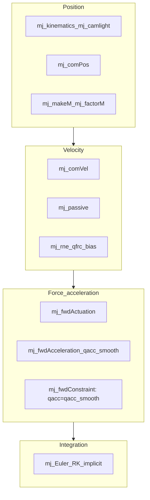
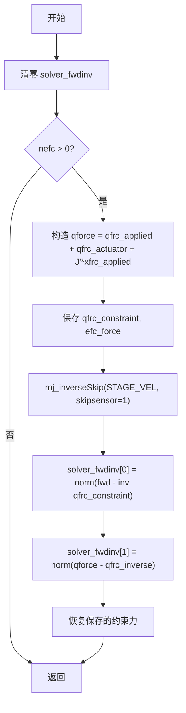
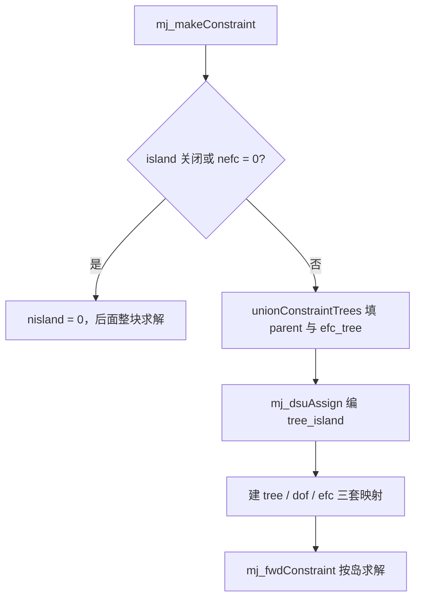
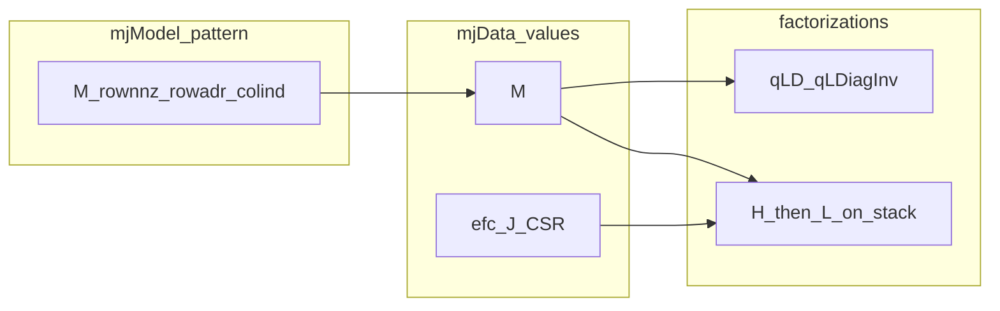

# MuJoCo 程序实现整理

---

## 摘要

介绍mujoco的程序结构和计算流程。

## 1 Mujoco计算流程总览
### 1.1 Simulate.exe 启动
模拟从simulate.exe启动，Main→PhysicsThread→PhysicsLoop

- Main：可视化设置，主线程进行renderloop，单开线程处理物理仿真流程PhysicsThread

- PhysicsThread：loadModel 创建模型 `mjModel`，`mj_makeData` 创建仿真数据 `mjData`，初始化完成后，1. `mj_forward` 更新数据，2. PhysicsLoop 仿真循环

- PhysicsLoop：时间同步机制、确保模拟时间与实际时间匹配，支持暂停、降速控制，调用[mj_step](https://mujoco.readthedocs.io/en/stable/APIreference/APIfunctions.html#mj-step)进行仿真

这里的 `mjModel` 和 `mjData` 是 MuJoCo 仿真中主要涉及的数据结构。`mjModel` 包含模型描述，在运行时保持不变，内容有

- **运动学结构**：身体层次、关节定义、自由度

- **几何数据**：碰撞几何体、视觉元素、惯性属性

- **物理参数**：质量、阻尼系数、约束参数

- **资产数据**：从外部文件加载的网格、纹理、材料

- **仿真选项**：求解器设置、积分参数、功能标志

- **mjData - 动态仿真状态**

`mjData`包含时变动态变量和中间计算结果：

- **状态变量**：位置(`qpos`)、速度(`qvel`)、加速度(`qacc`)

- **控制输入**：执行器控制(`ctrl`)、施加力(`qfrc_applied`,`xfrc_applied`)

- **中间计算量**：接触力、约束雅可比矩阵、惯性矩阵

计算流程的一般形式为：1. 获取必要的 `mjData` 和 `mjModel` 的数据；2. 计算；3. 更新到 `mjData`。

这种模型与数据分离的设计的优点：

- **线程安全**：多个 `mjData` 实例可以并发仿真同一模型
- **状态隔离**：每个仿真维护独立状态
- **内存效率**：静态模型数据在所有仿真间共享
- **清晰易懂**

### 1.2 解析与模型构建
### 1.3 mujoco 库内部计算流程
mujoco的内部计算流程，在官方文档的Computation/Simulation
pipeline下提供了相当清晰的说明。本节内容主要依托该页面的思路，补充了一些细化内容

### 1.4 Forward dynamics
源文件[engine_forward.c](https://github.com/google-deepmind/mujoco/blob/main/src/engine/engine_forward.c) 中包含了high-level
的forward dynamics 流程函数，**其中有**如下几个FD所需的top level
api，他们又分别调用了25个有序的流程函数的一部分或全部，供用户实现特定的仿真流程

- The top-level
  function [mj_step](https://mujoco.readthedocs.io/en/stable/APIreference/APIfunctions.html#mj-step) invokes
  the entire sequence of computations below.

[mj_step](https://mujoco.readthedocs.io/en/stable/APIreference/APIfunctions.html#mj-step) ：调用全部25个流程

- [mj_forward](https://mujoco.readthedocs.io/en/stable/APIreference/APIfunctions.html#mj-forward) invokes
  only stages **2-22**, computing the continuous-time forward dynamics,
  ending with the acceleration `mjData.qacc`.

[mj_forward](https://mujoco.readthedocs.io/en/stable/APIreference/APIfunctions.html#mj-forward) ：调用2-22，

- [mj_step1](https://mujoco.readthedocs.io/en/stable/APIreference/APIfunctions.html#mj-step1) invokes
  stages **1-18** and [mj_step2](https://mujoco.readthedocs.io/en/stable/APIreference/APIfunctions.html#mj-step2) invokes
  stages **19-25**,
  breaking [mj_step](https://mujoco.readthedocs.io/en/stable/APIreference/APIfunctions.html#mj-step) into
  two distinct phases. This allows the user to write controllers that
  depend on quantities derived from the positions and velocities (but
  not forces, since those have not yet been computed). Note that
  the [mj_step1](https://mujoco.readthedocs.io/en/stable/APIreference/APIfunctions.html#mj-step1) → [mj_step2](https://mujoco.readthedocs.io/en/stable/APIreference/APIfunctions.html#mj-step2) pipeline
  does not support the Runge Kutta integrator.

[mj_step1](https://mujoco.readthedocs.io/en/stable/APIreference/APIfunctions.html#mj-step1) 调用 **1-18；** [mj_step2](https://mujoco.readthedocs.io/en/stable/APIreference/APIfunctions.html#mj-step2)调用stages **19-25**

- [mj_fwdPosition](https://mujoco.readthedocs.io/en/stable/APIreference/APIfunctions.html#mj-fwdposition) invokes
  stages **2-11**, the position-dependent part of the pipeline.

[mj_fwdPosition](https://mujoco.readthedocs.io/en/stable/APIreference/APIfunctions.html#mj-fwdposition) 调用stages **2-11**

**除了官网文档描述的这些，其实还有mj_fwdVelocity；mj_fwdActuation；mj_fwdAcceleration；mj_fwdConstraint和其他一些实现integrator或check的API，似乎也可能被用户使用。**

**以上**几种FD api**调用的25个有序Stages**

#### Stage 1: Check the positions and velocities for invalid or unacceptably large real values indicating divergence. If divergence is detected, the state is automatically reset and the corresponding warning is raised: [mj_checkPos](https://mujoco.readthedocs.io/en/stable/APIreference/APIfunctions.html#mj-checkpos), [mj_checkVel](https://mujoco.readthedocs.io/en/stable/APIreference/APIfunctions.html#mj-checkvel)

#### Position

The stages below compute quantities that depend on the generalized
positions `mjData.qpos`.

#### Stage 2: Compute the forward kinematics. This yields the global positions and orientations of all bodies, geoms, sites, cameras and lights. It also normalizes all quaternions: [mj_kinematics](https://mujoco.readthedocs.io/en/stable/APIreference/APIfunctions.html#mj-kinematics), [mj_camlight](https://mujoco.readthedocs.io/en/stable/APIreference/APIfunctions.html#mj-camlight)

- mj_kinematics，正向传递，计算body
  frame的位置姿态，及惯性轴姿态，d→xpos、xquat、xipos、xmat、ximat

- 直接遍历，无递归，m和d中的数据都是递归编号过的

- 分铰类型计算：？

> (X,A)=F(q,qd,qdd)

#### Stage 3: Compute the body inertias and joint axes, in global frames centered at the centers of mass of the corresponding kinematic subtrees: [mj_comPos](https://mujoco.readthedocs.io/en/stable/APIreference/APIfunctions.html#mj-compos)

- 逆向传递，计算子树质心、子树惯性（子树质量和相对子树质心的惯性张量）

后续用于质量阵计算

#### Stage 4: Compute quantities related to [flex](https://mujoco.readthedocs.io/en/stable/XMLreference.html#deformable-flex) objects: [mj_flex](https://mujoco.readthedocs.io/en/stable/APIreference/APIfunctions.html#mj-flex)

#### Stage 5: Compute the tendon lengths and moment arms. This includes the computation of minimal-length paths for spatial tendons: [mj_tendon](https://mujoco.readthedocs.io/en/stable/APIreference/APIfunctions.html#mj-tendon)

#### Stage 6: Compute the composite rigid body inertias and joint-space inertia matrix: [mj_makeM](https://mujoco.readthedocs.io/en/stable/APIreference/APIfunctions.html#mj-makem)

- 分3个函数流程：mj_crb，composite rigid
  body惯性计算；mj_tendonArmature，计算tendon的惯性；
  mju_scatter，从M（reduced inertia）生成qM（inertia）

mj_crb 内的composite rigid body算法

#### Stage 7: Compute the sparse factorization of the joint-space inertia matrix: [mj_factorM](https://mujoco.readthedocs.io/en/stable/APIreference/APIfunctions.html#mj-factorm)

#### Stage 8: Construct the list of active contacts. This includes both broad-phase and near-phase collision detection: [mj_collision](https://mujoco.readthedocs.io/en/stable/APIreference/APIfunctions.html#mj-collision)

#### Stage 9: Construct the constraint Jacobian and compute the constraint residuals: [mj_makeConstraint](https://mujoco.readthedocs.io/en/stable/APIreference/APIfunctions.html#mj-makeconstraint)

本地 [`mj_fwdPosition`](../src/engine/engine_forward.c) 在 `mj_makeConstraint` 之后、`mj_projectConstraint` 之前调用 `mj_island`，按树把约束划成岛。流程见 §2.10。官网 25 个 stage 的编号不变。

#### Stage 10: Compute the actuator lengths and moment arms: [mj_transmission](https://mujoco.readthedocs.io/en/stable/APIreference/APIfunctions.html#mj-transmission)

#### Stage 11: Compute the matrices and vectors needed by the constraint solvers: [mj_projectConstraint](https://mujoco.readthedocs.io/en/stable/APIreference/APIfunctions.html#mj-projectconstraint)

#### Stage 12: Compute sensor data that only depends on position, and the potential energy if enabled: [mj_sensorPos](https://mujoco.readthedocs.io/en/stable/APIreference/APIfunctions.html#mj-sensorpos), [mj_energyPos](https://mujoco.readthedocs.io/en/stable/APIreference/APIfunctions.html#mj-energypos)

#### Velocity

The stages below compute quantities that depend on the generalized
velocity `mjData.qvel`. Due to the sequential dependence structure of the
pipeline, the actual dependence is on both qpos and qvel.

#### Stage 13: Compute the tendon, flex edge and actuator velocities: [mj_fwdVelocity](https://mujoco.readthedocs.io/en/stable/APIreference/APIfunctions.html#mj-fwdvelocity)

#### Stage 14: Compute the body velocities and rates of change of the joint axes, again in the global coordinate frames centered at the subtree centers of mass: [mj_comVel](https://mujoco.readthedocs.io/en/stable/APIreference/APIfunctions.html#mj-comvel)

#### Stage 15: Compute passive forces – spring-dampers in joints and tendons, and fluid forces: [mj_passive](https://mujoco.readthedocs.io/en/stable/APIreference/APIfunctions.html#mj-passive)

- 弹簧阻尼力，mj_springdamper

- 重力补偿力，mj_gravcomp

- 流体力，mj_fluid

- 用户自定义被动力，mjcb_passive

- 插件定义被动力

#### Stage 16: Compute sensor data that depends on velocity, and the kinetic energy if enabled (if required by sensors, call [mj_subtreeVel](https://mujoco.readthedocs.io/en/stable/APIreference/APIfunctions.html#mj-subtreevel)): [mj_sensorVel](https://mujoco.readthedocs.io/en/stable/APIreference/APIfunctions.html#mj-sensorvel)

#### Stage 17: Compute the reference constraint acceleration: [mj_referenceConstraint](https://mujoco.readthedocs.io/en/stable/APIreference/APIfunctions.html#mj-referenceconstraint)

- 计算约束相关数组：`efc_vel`（约束空间速度）和`efc_aref`（参考伪加速度）。

#### Stage 18: Compute the vector of Coriolis, centrifugal and gravitational forces: [mj_rne](https://mujoco.readthedocs.io/en/stable/APIreference/APIfunctions.html#mj-rne)

- RNE(Recursive Newton-Eulor algorithm)是逆向动力学的核心流程，

$$
\mathbf{\tau} = ID(model,\mathbf{q},\dot{\mathbf{q}},\ddot{\mathbf{q}},\mathbf{f}^{x})
$$

给定系统状态和外力$(model,\mathbf{q},\dot{\mathbf{q}},\ddot{\mathbf{q}},\mathbf{f}^{x})$，从根开始逐步计算每个体的位置、速度、加速度，

$$
\mathbf{v}_{i} = \mathbf{v}_{\lambda(i)} + \mathbf{S}_{i}{\dot{\mathbf{q}}}_{i}
$$

$$
a_{i} = a_{\lambda(i)} + S_{i}{\ddot{q}}_{i} + {\dot{S}}_{i}{\dot{q}}_{i}
$$

从叶开始逐步反向计算铰空间广义力。

$$
f_{i} = f_{i}^{B} - f_{i}^{x} + \sum_{j \in \mu(i)} f_{j}
$$

$$
\tau_{i} = S_{i}^{T}f_{i}
$$

- RNE计算C，

$$
\tau = \mathbf{H}(\mathbf{q})\ddot{\mathbf{q}} + \mathbf{C}(\mathbf{q},\dot{\mathbf{q}},\mathbf{f}^{x})
$$

$$
\mathbf{C} = ID(model,\mathbf{q},\dot{\mathbf{q}},\mathbf{0},\mathbf{f}^{x})
$$

**1. 初始化阶段**

函数首先分配临时存储空间并初始化世界坐标系的加速度：

- 分配`loc_cacc`（物体加速度）和`loc_cfrc_body`（物体力）的存储空间

- 将世界坐标系的加速度设置为负重力加速度（如果重力未被禁用） 

**2. 前向传递（Forward Pass）**

对所有物体进行前向遍历，计算每个物体的加速度和作用力：

**步骤2.1：计算物体加速度**

- `cacc = cacc_parent + cdofdot * qvel`：将父物体的加速度加上由关节速度引起的加速度项（`engine_core_smooth.c` 2107–2109 行）

**步骤2.2：添加关节加速度项（如果启用）**

- 当 `flg_acc=1` 时，添加 `cdof * qacc` 项到物体加速度中

**步骤2.3：计算物体受力**

- `cfrc_body = cinert * cacc + cvel × (cinert * cvel)`：计算惯性力和科里奥利力/离心力

- 使用`mju_mulInertVec`计算惯性矩阵与加速度的乘积

- 使用`mju_crossForce`计算速度相关的交叉乘积项

**3. 后向传递（Backward Pass）**

从叶节点向根节点反向传递，将子物体的力传递给父物体：

- 对每个物体，将其受力累加到其父物体上 

**4. 结果计算**

最终计算关节空间的广义力：

- `result[i] = cdof * cfrc_body`：将物体受力通过关节雅可比矩阵投影到关节空间

#### Force/acceleration

The stages below compute quantities that depend on [user
inputs](https://mujoco.readthedocs.io/en/stable/computation/#geinput).
Due to the sequential nature of the pipeline, the actual dependence is
on the entire [integration
state](https://mujoco.readthedocs.io/en/stable/computation/#geintegrationstate).

#### Stage 19: Compute the actuator forces and activation dynamics if defined: [mj_fwdActuation](https://mujoco.readthedocs.io/en/stable/APIreference/APIfunctions.html#mj-fwdactuation)

#### Stage 20: Compute the joint acceleration resulting from all forces except for the (still unknown) constraint forces: [mj_fwdAcceleration](https://mujoco.readthedocs.io/en/stable/APIreference/APIfunctions.html#mj-fwdacceleration)

#### Stage 21: Compute the constraint forces with the selected solver, and update the joint acceleration so as to account for the constraint forces. This yields the vector `mjData.qacc` which is the main output of forward dynamics: [mj_fwdConstraint](https://mujoco.readthedocs.io/en/stable/APIreference/APIfunctions.html#mj-fwdconstraint)

约束求解：

1 warmstart，约束求解初始化操作，决定预估值

2 第一步迭代，update，计算hessian，计算grad

#### Stage 22: Compute sensor data that depends on force and acceleration if enabled (if required by sensors, call [mj_rnePostConstraint](https://mujoco.readthedocs.io/en/stable/APIreference/APIfunctions.html#mj-rnepostconstraint)): [mj_sensorAcc](https://mujoco.readthedocs.io/en/stable/APIreference/APIfunctions.html#mj-sensoracc)

#### Stage 23: Check the acceleration for invalid or unacceptably large real values. If divergence is detected, the state is automatically reset and the corresponding warning is raised: [mj_checkAcc](https://mujoco.readthedocs.io/en/stable/APIreference/APIfunctions.html#mj-checkacc)

#### Stage 24: Compare the results of forward and inverse dynamics, so as to diagnose poor solver convergence in the forward dynamics. This is an optional step, and is performed only when enabled: [mj_compareFwdInv](https://mujoco.readthedocs.io/en/stable/APIreference/APIfunctions.html#mj-comparefwdinv)（正向动力学完成后、积分器之前调用；实现细节见 §2.9）

#### Stage 25: Advance the simulation state by one time step, using the selected integrator. Note that the Runge-Kutta integrator repeats the above sequence three more times, except for the optional computations which are performed only once: one of [mj_Euler](https://mujoco.readthedocs.io/en/stable/APIreference/APIfunctions.html#mj-euler), [mj_RungeKutta](https://mujoco.readthedocs.io/en/stable/APIreference/APIfunctions.html#mj-rungekutta), [mj_implicit](https://mujoco.readthedocs.io/en/stable/APIreference/APIfunctions.html#mj-implicit)

### 1.5 无约束铰接体系统正向动力学（不考虑约束或接触的流程，不考虑flex的流程）

本节聚焦**无碰撞、无约束、无柔性体**的铰接刚体树正向动力学，帮助从完整 §1.4 管线中剥离核心路径。适用场景：模型无碰撞几何/接触、无等式/摩擦等约束（`d->nefc == 0`），仅保留铰接刚体树，以及可选的被动力、执行器与外力。

本节**跳过**的 Stage：4–5（flex/tendon 位置）、8–11（碰撞/约束/传动）、17（约束参考加速度）、21（约束迭代求解）。主输出仍为 `mjData.qacc`，经积分器推进 `qpos`/`qvel`。

连续时间核心方程（[`mj_fwdAcceleration`](src/engine/engine_forward.c)）：

$$
M\ddot{q} = \underbrace{-\mathbf{c}}_{\texttt{qfrc\_bias}} + \underbrace{\mathbf{f}_p}_{\texttt{qfrc\_passive}} + \underbrace{\mathbf{f}_a}_{\texttt{qfrc\_applied}} + \underbrace{\boldsymbol{\tau}_{act}}_{\texttt{qfrc\_actuator}} + \text{project}(\mathbf{f}^x)
$$

无约束时 [`mj_fwdConstraint`](src/engine/engine_forward.c) 直接令 `qacc = qacc_smooth`、`qfrc_constraint = 0`（889–894 行），无需 CG/Newton 迭代。

**推荐 API**：在零约束模型上可直接调用 [`mj_forward`](https://mujoco.readthedocs.io/en/stable/APIreference/APIfunctions.html#mj-forward) / [`mj_step`](https://mujoco.readthedocs.io/en/stable/APIreference/APIfunctions.html#mj-step)；若手写管线，等价于 `mj_fwdKinematics` → `mj_makeM`/`mj_factorM` → `mj_fwdVelocity`（纯铰接树可裁剪 tendon/flex 部分）→ `mj_fwdActuation` → `mj_fwdAcceleration` → 积分器。



#### Position

The stages below compute quantities that depend on the generalized positions `mjData.qpos`（在 [`mj_fwdKinematics`](src/engine/engine_forward.c) 与 [`mj_fwdPosition`](src/engine/engine_forward.c) 中完成）。

#### Stage 2: Compute the forward kinematics.: [mj_kinematics](https://mujoco.readthedocs.io/en/stable/APIreference/APIfunctions.html#mj-kinematics), [mj_camlight](https://mujoco.readthedocs.io/en/stable/APIreference/APIfunctions.html#mj-camlight)（同 FD Stage 2）

- `mj_kinematics`：正向传递，更新 `xpos`、`xquat`、`xipos`、`xmat`、`ximat` 等
- `mj_camlight`：更新相机与灯光位姿
- 算法细节见 §1.4 Stage 2

#### Stage 3: Compute the body inertias and joint axes.: [mj_comPos](https://mujoco.readthedocs.io/en/stable/APIreference/APIfunctions.html#mj-compos)（同 FD Stage 3）

- 在 `mj_fwdKinematics` 内、`mj_kinematics` 之后调用（非独立 top-level 调用顺序）
- 逆向传递，计算子树质心、子树惯性；为 `mj_makeM` 准备
- 算法细节见 §1.4 Stage 3

#### Stage 6: Compute the composite rigid body inertias and joint-space inertia matrix.: [mj_makeM](https://mujoco.readthedocs.io/en/stable/APIreference/APIfunctions.html#mj-makem)（同 FD Stage 6）

- 在 `mj_fwdPosition` 内、`mj_fwdKinematics` 之后调用
- CRB 算法组装关节空间质量阵 `M`（`qM`）
- 算法细节见 §1.4 Stage 6

#### Stage 7: Compute the sparse factorization of the joint-space inertia matrix.: [mj_factorM](https://mujoco.readthedocs.io/en/stable/APIreference/APIfunctions.html#mj-factorm)（同 FD Stage 7）

- 对 `M` 做 $L^T D L$ 稀疏分解，供后续 `mj_solveM` / `mj_solveLD` 使用
- 算法细节见 §1.4 Stage 7

#### Velocity

The stages below compute quantities that depend on the generalized velocity `mjData.qvel`（主要在 [`mj_fwdVelocity`](src/engine/engine_forward.c) 中完成）。

#### Stage 13（可选）: Compute the tendon, flex edge and actuator velocities.: [mj_fwdVelocity](https://mujoco.readthedocs.io/en/stable/APIreference/APIfunctions.html#mj-fwdvelocity)（同 FD Stage 13）

- 若模型含肌腱/执行器，`mj_fwdVelocity` 前半段计算 tendon/actuator 速度
- 纯铰接刚体树、无肌腱/执行器时可忽略

#### Stage 14: Compute the body velocities and rates of change of the joint axes.: [mj_comVel](https://mujoco.readthedocs.io/en/stable/APIreference/APIfunctions.html#mj-comvel)（同 FD Stage 14）

- 在 `mj_fwdVelocity` 内调用；计算子树质心坐标系下的体速度与关节轴变化率
- 算法细节见 §1.4 Stage 14

#### Stage 15: Compute passive forces.: [mj_passive](https://mujoco.readthedocs.io/en/stable/APIreference/APIfunctions.html#mj-passive)（同 FD Stage 15）

- 在 `mj_fwdVelocity` 内调用；关节/肌腱弹簧阻尼、重力补偿、流体等
- 结果写入 `qfrc_passive`
- 算法细节见 §1.4 Stage 15

#### Stage 18: Compute the vector of Coriolis, centrifugal and gravitational forces.: [mj_rne](https://mujoco.readthedocs.io/en/stable/APIreference/APIfunctions.html#mj-rne)（同 FD Stage 18）

- 在 `mj_fwdVelocity` 末尾调用：`mj_rne(m, d, 0, qfrc_bias)`，`flg_acc=0`，只求 bias 力（科氏/离心/重力），不含 $M\ddot{q}$ 项
- 若有肌腱，`mj_tendonBias` 叠加到 `qfrc_bias`
- RNE 算法详解见 §1.4 Stage 18

**跳过**：Stage 17 `mj_referenceConstraint`（无约束时 `nefc=0`，无实际作用）。

#### Force/acceleration

The stages below compute quantities that depend on user inputs; 无约束情形下主输出为 `qacc`。

#### Stage 19: Compute the actuator forces and activation dynamics if defined.: [mj_fwdActuation](https://mujoco.readthedocs.io/en/stable/APIreference/APIfunctions.html#mj-fwdactuation)（同 FD Stage 19）

- 计算执行器力与激活动力学，结果写入 `qfrc_actuator`
- 无执行器时可跳过

#### Stage 20: Compute the joint acceleration resulting from all forces except constraint forces.: [mj_fwdAcceleration](https://mujoco.readthedocs.io/en/stable/APIreference/APIfunctions.html#mj-fwdacceleration)（同 FD Stage 20）

- 组装平滑广义力：

$$
\texttt{qfrc\_smooth} = \texttt{qfrc\_passive} - \texttt{qfrc\_bias} + \texttt{qfrc\_applied} + \texttt{qfrc\_actuator}
$$

- `mj_xfrcAccumulate` 将体坐标外力 `xfrc_applied` 投影累加到 `qfrc_smooth`
- 求解无约束加速度：`qacc_smooth = M \ qfrc_smooth`（`mj_solveLD`，见 `engine_forward.c` 756–783 行）

#### Stage 21（无约束等价）: Constraint-free acceleration.: [mj_fwdConstraint](https://mujoco.readthedocs.io/en/stable/APIreference/APIfunctions.html#mj-fwdconstraint)

- 当 `nefc == 0` 时，`mj_fwdConstraint` 直接 `qacc = qacc_smooth`，`qfrc_constraint = 0`，不进入迭代求解
- 与 §1.6 ID 中「已知 $\ddot{q}$ 解析求力」形成对照：FD 侧由力求加速度，ID 侧由加速度求力

#### Integration

#### Stage 25: Advance the simulation state by one time step.: [mj_Euler](https://mujoco.readthedocs.io/en/stable/APIreference/APIfunctions.html#mj-euler), [mj_RungeKutta](https://mujoco.readthedocs.io/en/stable/APIreference/APIfunctions.html#mj-rungekutta), [mj_implicit](https://mujoco.readthedocs.io/en/stable/APIreference/APIfunctions.html#mj-implicit)（同 FD Stage 25）

- 用 `qacc` 推进 `qpos`/`qvel`（`mj_advance`）
- **Euler**：无阻尼时显式 $v \leftarrow v + h\dot{v}$；有 dof 阻尼时隐式解 $(M + hB)\dot{v} = M\dot{v}_d$（`mj_EulerSkip`，`engine_forward.c` 1108–1181 行）
- **RK4**：除可选计算外，重复 position/velocity 子流程三次
- **Implicit**：全隐式速度积分（`mj_implicit`）

**与 §1.6 逆动力学互逆**：给定同一 $(q,\dot{q},\ddot{q})$，无约束时 ID 的 `qfrc_inverse` 应等于使该加速度成立的外力与执行器力之和；数据流主路径为 `qacc` → 积分器 → 下一时刻 `qpos`/`qvel`。

### 1.6 Inverse dynamics

源文件 [engine_inverse.c](https://github.com/google-deepmind/mujoco/blob/main/src/engine/engine_inverse.c) 包含 high-level 的 inverse dynamics 流程。逆动力学在已知 $(q,\dot{q},\ddot{q})$ 时，求使该加速度成立的广义外力，主输出为 `mjData.qfrc_inverse`（等于外力与执行器力之和）。

**调用前须设置** `mjData.qacc`。与正向动力学互逆：连续时间下 $\tau = M\dot{v} + c - J^T f$（见 [computation](https://mujoco.readthedocs.io/en/stable/computation/#piInverse)）。

Top-level API：

- [`mj_inverse`](https://mujoco.readthedocs.io/en/stable/APIreference/APIfunctions.html#mj-inverse)：调用完整逆动力学流程，等价于 `mj_inverseSkip(m, d, mjSTAGE_NONE, 0)`
- [`mj_inverseSkip`](https://mujoco.readthedocs.io/en/stable/APIreference/APIfunctions.html#mj-inverseskip)：`skipstage` 可跳过已计算的 position/velocity 阶段；`skipsensor` 控制是否重算传感器
- [`mj_compareFwdInv`](https://mujoco.readthedocs.io/en/stable/APIreference/APIfunctions.html#mj-comparefwdinv)：在**已完成正向动力学**（通常刚执行过 `mj_forward` / `mj_step`）的前提下，复用已有 position/velocity 中间量，内部调用 `mj_inverseSkip(m, d, mjSTAGE_VEL, 1)`——即**跳过** ID Stage 1–14（`mj_invPosition`、`mj_invVelocity` 及传感器/能量），仅重算加速度相关部分（`mj_discreteAcc`（可选）→ `mj_invConstraint` → RNE 组装 → `qfrc_inverse`）；`skipsensor=1` 不重算传感器。比较结果写入 `solver_fwdinv[0/1]`，并在比较前后保存/恢复正向的 `qfrc_constraint`、`efc_force`。启用 `mjENBL_FWDINV` 时于正向动力学完成后、积分器之前由 `mj_step`/`mj_step2` 自动调用（FD Stage 24）。实现细节见 §2.9。

与正向动力学的主要差异：无 `mj_fwdActuation` / `mj_fwdAcceleration` / 积分器；约束力由 `mj_invConstraint` **解析**求取（非 §2.3 的 CG/Newton 迭代）；`mj_invVelocity` 直接复用 `mj_fwdVelocity`。

以下 19 个有序 Stage 与官方 [Simulation pipeline — Inverse dynamics](https://mujoco.readthedocs.io/en/stable/computation/#piInverse) 一致；关于 [consistency](https://mujoco.readthedocs.io/en/stable/computation/#piconsistency) 与 [reproducibility](https://mujoco.readthedocs.io/en/stable/computation/#pireproducibility) 的说明同样适用。

#### Position

The stages below compute quantities that depend on the generalized positions `mjData.qpos`（主要在 `mj_invPosition` 内完成，与 FD Stage 2–11 大量共用）。注意：官方 ID 管线无 FD Stage 1（divergence check），故 **ID Stage 编号与 FD 不完全对齐**（例如 ID Stage 1 对应 FD Stage 2）。

#### Stage 1: Compute the forward kinematics.: [mj_kinematics](https://mujoco.readthedocs.io/en/stable/APIreference/APIfunctions.html#mj-kinematics), [mj_camlight](https://mujoco.readthedocs.io/en/stable/APIreference/APIfunctions.html#mj-camlight)（同 FD Stage 2）

- `mj_kinematics`：在 `mj_invPosition` 内首先调用；正向传递，计算 `xpos`、`xquat`、`xipos`、`xmat`、`ximat` 等
- `mj_camlight`：更新相机与灯光位姿

#### Stage 2: Compute the body inertias and joint axes.: [mj_comPos](https://mujoco.readthedocs.io/en/stable/APIreference/APIfunctions.html#mj-compos)（同 FD Stage 3）

- 逆向传递，计算子树质心、子树惯性；为 `mj_makeM` 准备

#### Stage 3: Compute the tendon lengths and moment arms.: [mj_tendon](https://mujoco.readthedocs.io/en/stable/APIreference/APIfunctions.html#mj-tendon)（同 FD Stage 5）

- 计算肌腱长度与力臂；`mj_invPosition` 中在 `mj_flex` 之后调用

#### Stage 4: Compute the actuator lengths and moment arms.: [mj_transmission](https://mujoco.readthedocs.io/en/stable/APIreference/APIfunctions.html#mj-transmission)（同 FD Stage 10）

- 计算执行器传动比与长度；在 `mj_invPosition` 末尾、`mj_makeConstraint` 之后调用

#### Stage 5: Compute the composite rigid body inertias and form the joint-space inertia matrix.: [mj_makeM](https://mujoco.readthedocs.io/en/stable/APIreference/APIfunctions.html#mj-makem)（同 FD Stage 6）

- CRB 算法组装关节空间质量阵 `M`（`qM`）

#### Stage 6: Compute the sparse factorization of the joint-space inertia matrix.: [mj_factorM](https://mujoco.readthedocs.io/en/stable/APIreference/APIfunctions.html#mj-factorm)（同 FD Stage 7）

- 对 `M` 做 $L^T D L$ 稀疏分解，供后续 `mj_mulM` / `mj_solveM` 使用

#### Stage 7: Construct the list of active contacts.: [mj_collision](https://mujoco.readthedocs.io/en/stable/APIreference/APIfunctions.html#mj-collision)（同 FD Stage 8）

- 宽相/窄相碰撞检测，生成活动接触列表

#### Stage 8: Construct the constraint Jacobian and compute the constraint residuals.: [mj_makeConstraint](https://mujoco.readthedocs.io/en/stable/APIreference/APIfunctions.html#mj-makeconstraint)（同 FD Stage 9）

- 构建约束 Jacobian `efc_J` 与位置残差 `efc_pos`
- 若启用 `mjENBL_DIAGEXACT`，随后调用 `mj_projectConstraint`（FD Stage 11 在正向流程中总是执行，逆动力学仅在 DIAGEXACT 时执行）

#### Stage 9: Compute sensor data that only depends on position, and the potential energy if enabled.: [mj_sensorPos](https://mujoco.readthedocs.io/en/stable/APIreference/APIfunctions.html#mj-sensorpos), [mj_energyPos](https://mujoco.readthedocs.io/en/stable/APIreference/APIfunctions.html#mj-energypos)（同 FD Stage 12）

- 在 `mj_inverseSkip` 中、`mj_invPosition` 之后调用
- `mj_energyPos` 仅在 `mjENBL_ENERGY` 开启且尚未计算时执行

#### Velocity

The stages below compute quantities that depend on the generalized velocity `mjData.qvel`（通过 `mj_invVelocity` → `mj_fwdVelocity` 完成，与 FD Stage 13–17 共用）。

#### Stage 10: Compute the tendon and actuator velocities.: [mj_fwdVelocity](https://mujoco.readthedocs.io/en/stable/APIreference/APIfunctions.html#mj-fwdvelocity)（同 FD Stage 13）

- `mj_invVelocity` 内部调用 `mj_fwdVelocity` 的前半段：flex edge / tendon / actuator 速度

#### Stage 11: Compute the body velocities and joint axes rates of change.: [mj_comVel](https://mujoco.readthedocs.io/en/stable/APIreference/APIfunctions.html#mj-comvel)（同 FD Stage 14）

- 在 `mj_fwdVelocity` 内调用；计算体速度与关节轴变化率

#### Stage 12: Compute sensor data that depends on velocity, and the kinetic energy if enabled. If required by sensors, call [mj_subtreeVel](https://mujoco.readthedocs.io/en/stable/APIreference/APIfunctions.html#mj-subtreevel).: [mj_sensorVel](https://mujoco.readthedocs.io/en/stable/APIreference/APIfunctions.html#mj-sensorvel), [mj_energyVel](https://mujoco.readthedocs.io/en/stable/APIreference/APIfunctions.html#mj-energyvel)（同 FD Stage 16）

- 在 `mj_inverseSkip` 中、`mj_invVelocity` 之后调用
- 部分传感器需要时懒求值 `mj_subtreeVel`

#### Stage 13: Compute all passive forces.: [mj_passive](https://mujoco.readthedocs.io/en/stable/APIreference/APIfunctions.html#mj-passive)（同 FD Stage 15）

- 在 `mj_fwdVelocity` 内调用；关节/肌腱弹簧阻尼、重力补偿、流体等；结果写入 `qfrc_passive`

#### Stage 14: Compute the reference constraint acceleration.: [mj_referenceConstraint](https://mujoco.readthedocs.io/en/stable/APIreference/APIfunctions.html#mj-referenceconstraint)（同 FD Stage 17）

- 在 `mj_fwdVelocity` 内调用；计算 `efc_vel`、`efc_aref`

#### Acceleration

The stages below depend on `mjData.qacc` and user inputs; ID 独有组装逻辑在 `mj_inverseSkip` 后半段。

#### Stage 15: If the [invdiscrete](https://mujoco.readthedocs.io/en/stable/XMLreference.html#option-flag-invdiscrete) flag is set and the [integrator](https://mujoco.readthedocs.io/en/stable/XMLreference.html#option-integrator) is not RK4, convert input accelerations from discrete to continuous time.（ID 独有）

```c
if (mjENABLED(mjENBL_INVDISCRETE)) {
  mju_copy(qacc, d->qacc, nv);   // 保存用户写入的离散加速度
  mj_discreteAcc(m, d);          // 原地：离散 qacc → 连续等效 qacc
}

...                               // 逆动力学stage16-19

if (mjENABLED(mjENBL_INVDISCRETE)) {
  mju_copy(d->qacc, qacc, nv);   // 对外恢复用户原始 qacc
}
```

- 如果开启了invdiscrete="enable"，按**离散时间**理解——通常即 $(v_{t+h}-v_t)/h$，而非连续 $\ddot{q}$
- **为何要对齐**：一步积分器（Euler / implicit / implicitfast）正向把有效动力学写成含 $M-hD$（或 $M-h\,\partial(\cdot)/\partial\dot{v}$）的形式；若把差分速度赋给 `d->qacc` 却不开启此 flag，`mj_inverse` 仍按连续 $\ddot{q}$ 解释，FD/ID 会对不上
- **与官方 stage 文案的细差**：官方写 “flag 开 **且** 非 RK4”；实现外层只看 `mjENBL_INVDISCRETE`。RK4 在 `mj_discreteAcc` 内 `mjERROR`；`mjINT_DISCRETE` 时函数直接 return（invdiscrete 已隐含）。积分器转换公式见 §2.6

#### Stage 16: Compute the constraint force. This is done analytically, without using a numerical solver.: [mj_invConstraint](https://mujoco.readthedocs.io/en/stable/APIreference/APIfunctions.html#mj-invconstraint)（ID独有，对比 FD Stage 21）

- 残差：$\texttt{jar} = J\dot{v} - a_{\mathrm{ref}}$（`efc_aref`）
- 软约束解析力（无数值求解器）：

$$
f = -\nabla s(\texttt{jar}),\qquad \texttt{qfrc\_constraint}=J^T f
$$

二次区（等式、以及未饱和的摩擦/接触）即代码 `force[i] = -D[i]*jar[i]`（`D = efc_D = 1/R`）：

$$
f = -D\odot \texttt{jar} = -R^{-1}(J\dot{v}-a_{\mathrm{ref}})
$$

- 不等式/摩擦再把上述无约束力投影到 $\Omega$（限位/棱锥：`jar>=0` 则 $f=0$；摩擦盒饱和 $\pm\eta$；椭圆锥分区）。分段见 §2.7
- 对比：FD `mj_fwdConstraint` 迭代求 $\dot{v}$；ID 已知 `qacc`，直接求 $f$

#### Stage 17: Compute the inverse dynamics for the unconstrained system.: [mj_rne](https://mujoco.readthedocs.io/en/stable/APIreference/APIfunctions.html#mj-rne)（部分同 FD Stage 18）

- `mj_rne(m, d, 0, qfrc_inverse)`：`flg_acc=0`，只求 bias 力（科氏/离心/重力），不含 $M\ddot{q}$ 项
- `mj_tendonBias` 叠加肌腱 bias；RNE 算法详解见上文 FD Stage 18

#### Stage 18: Compute sensor data that depends on force and acceleration if enabled. If required by sensors, call [mj_rnePostConstraint](https://mujoco.readthedocs.io/en/stable/APIreference/APIfunctions.html#mj-rnepostconstraint).: [mj_sensorAcc](https://mujoco.readthedocs.io/en/stable/APIreference/APIfunctions.html#mj-sensoracc)（同 FD Stage 22）

- 在 `mj_inverseSkip` 中、组装 `qfrc_inverse` 之前调用
- 部分传感器懒求值 `mj_rnePostConstraint`

#### Stage 19: Compute the vector `mjData.qfrc_inverse` by combining all results. This is the main output of inverse dynamics. It equals the sum of external and actuation forces.（ID 独有）

- 最终组装（`mj_inverseSkip` 末尾）：

$$
\tau = \underbrace{M\dot{v}}_{\texttt{Ma}} + \underbrace{c}_{\texttt{mj\_rne}(0)+\texttt{tendonBias}} - \texttt{qfrc\_passive} - \texttt{qfrc\_constraint}
$$

- 代码：`mj_mulM` 得 `Ma`，再 `qfrc_inverse += Ma - qfrc_passive - qfrc_constraint`
- 物理含义：使当前 $(q,\dot{q},\ddot{q})$ 成立所需的外力 + 执行器力（不含被动力与约束力本身）

## 2 Mujoco计算流程细节
介绍类、函数及变量相关计算细节，涵盖**正向约束求解器**（§2.3）与**逆动力学**（§2.4–2.9）的实现要点。

### 2.1 Set0
在模型的参考配置（`qpos0`）下计算和设置各种依赖于位置的常量，这些常量在后续的物理仿真中用于优化计算 。

**刚体逆惯性** `body_invweight0`：

**自由度逆惯性** `dof_invweight0`：

先计算inverse joint inertia: A = J*inv(M)*J'，

逐joint循环，这里的J对每一个joint，尺寸均为$6 \times nv$，其中joint对应的自由度为1，其余为0，若为6自由度mJJNT_FREE，J=

$$
\begin{matrix}
0 & \ldots & 1 & 0 & 0 & 0 & 0 & 0 & \ldots & 0 \\
0 & \ldots & 0 & 1 & 0 & 0 & 0 & 0 & \ldots & 0 \\
0 & \ldots & 0 & 0 & 1 & 0 & 0 & 0 & \ldots & 0 \\
0 & \ldots & 0 & 0 & 0 & 1 & 0 & 0 & \ldots & 0 \\
0 & \ldots & 0 & 0 & 0 & 0 & 1 & 0 & \ldots & 0 \\
0 & \ldots & 0 & 0 & 0 & 0 & 0 & 1 & \ldots & 0
\end{matrix}
$$

若为1自由度，J=

$$
\begin{matrix}
0 & \ldots & 1 & 0 & 0 & 0 & 0 & 0 & \ldots & 0
\end{matrix}
$$

那么，$A = JM^{- 1}J^{T}$就相当于取$M^{- 1}$的对应joint自由度的对角元：

$$
A = \begin{bmatrix}
M_{ii}^{- 1} & 0 & 0 & 0 & 0 & 0 \\
0 & M_{(i + 1)(i + 1)}^{- 1} & 0 & 0 & 0 & 0 \\
0 & 0 & M_{(i + 2)(i + 2)}^{- 1} & 0 & 0 & 0 \\
0 & 0 & 0 & M_{(i + 3)(i + 3)}^{- 1} & 0 & 0 \\
0 & 0 & 0 & 0 & M_{(i + 4)(i + 4)}^{- 1} & 0 \\
0 & 0 & 0 & 0 & 0 & M_{(i + 5)(i + 5)}^{- 1}
\end{bmatrix}
$$

继续计算dof_invweight0，是分joint、分平动/旋转对对角元进行平均

$$
dof_{invweight0(单个6自由度joint对应的块)} = \left\lbrack \begin{array}{r}
\frac{M_{ii}^{- 1} + M_{(i + 1)(i + 1)}^{- 1} + M_{(i + 2)(i + 2)}^{- 1}}{3} \\
\frac{M_{ii}^{- 1} + M_{(i + 1)(i + 1)}^{- 1} + M_{(i + 2)(i + 2)}^{- 1}}{3} \\
\frac{M_{ii}^{- 1} + M_{(i + 1)(i + 1)}^{- 1} + M_{(i + 2)(i + 2)}^{- 1}}{3} \\
\frac{M_{(i + 3)(i + 3)}^{- 1} + M_{(i + 4)(i + 4)}^{- 1} + M_{(i + 5)(i + 5)}^{- 1}}{3} \\
\frac{M_{(i + 3)(i + 3)}^{- 1} + M_{(i + 4)(i + 4)}^{- 1} + M_{(i + 5)(i + 5)}^{- 1}}{3} \\
\frac{M_{(i + 3)(i + 3)}^{- 1} + M_{(i + 4)(i + 4)}^{- 1} + M_{(i + 5)(i + 5)}^{- 1}}{3}
\end{array} \right\rbrack
$$

### 2.2 Mj_solveM()
### 2.3 Mj_solCGNewton()
Newton或者cg求解带约束的前向动力学

计算了scale，用于线搜索的高斯项的（相对步长$\alpha$的）梯度的容差的计算。Scale取的是质量阵M的对角元的和的倒数：

$$
scale = \frac{1}{M(1,1) + \ldots + M(nv,nv)}
$$

后续在CGsearch部分计算线搜索的针对一阶导数的容差：

$$
gtol = tolerance*lstolerance*\frac{|search|}{scale}
$$

$tolerance$和$lstolerance$又option设置，一般为$tolerance = 1e^{- 8}$或$lstolerance = 1e^{- 2}$，代入scale：

$$
\ gtol = 1e^{- 11}*|search|*\left( M(1,1) + \ldots + M(nv,nv) \right)
$$

考虑：对$\alpha$的一阶导的量纲与高斯项量纲一致，那么加速度增量search越大、或者质量越大，迭代容差也越大，这似乎是合理的。

### 2.3.1 CGupdateGradient 

负责更新约束求解器的梯度信息

### 2.3.2 CGupdateConstraint
更新

更新约束力，代码中的更新为

$$
J^{T}R^{- 1}\left( J\dot{v} + \dot{J}v - a_{ref} \right)
$$

为什么少了这一项？？

$$
J^{T}R^{- 1}\left( J\dot{v} - a_{ref} \right)
$$

计算quadGauss

### 2.3.3 CGsearch
线搜索，一维优化。

计算流程：

**1. 初始化与预计算**

- 检查搜索向量search的模是否足够小，search即为加速度增量，如果接近0，表明迭代收敛

- 计算缩放后的梯度容差 `gtol` （用于判定梯度是否足够接近0）和斜率缩放因子 `slopescl`

- 计算 `Mv = M * search` 和 `Jv = J * search`，为后续 cost 评估做准备

**2. 初始 Newton 步**

- 在 `alpha=0` 处评估代价和导数

- 尝试一次 Newton 步：`alpha = -deriv[0]/deriv[1]`

- 如果导数已足够小（满足 `gtol`），提前返回（`engine_solver.c` 1370–1393 行）

**3. 单侧搜索(One-sided search)**

- 沿着导数下降方向(`dir`)进行 Newton 步迭代

- 持续移动直到导数改变符号或满足收敛条件

- 这个阶段建立了包围最优点的区间 `[p1, p2]`（`engine_solver.c` 1429–1459 行）

**4. 区间搜索(Bracketed search)**

- 一旦找到包围区间,评估三个候选点:`p1next`、`p2next` 和中点 `pmid`

- 检查候选点是否满足收敛条件(导数 \< `gtol`)

- 使用 `updateBracket` 更新区间边界,选择能缩小区间的点

- 如果无法更新区间，返回中点作为最佳近似（`engine_solver.c` 1466–1505 行）

**5. 终止条件**

函数通过 `ctx->LSresult` 返回不同的状态码：

- **0**: 成功找到满足容差的解

- **1**: 搜索向量太小

- **2**: 初始点已收敛

- **3**: 无法建立包围区间

- **4**: 有改进但未完全收敛

- **5**: 无改进

- **6**: 内部错误(未更新 p2)

- **7**: 达到数值精度极限（`engine_solver.c` 1507–1519 行）

#### 2.3.3.1 CGprepare()

Prepare，预先计算高斯项的常数部分，高斯项为二次多项式，并分为惯性项和约束项：

在 `quadGauss[3]` 中存储高斯惯性项的常数项、一次项系数、二次项系数；

在 `quad[3]` 中存储高斯约束项的常数项、一次项系数、二次项系数；

#### 2.3.3.2 CGeval()
在给定点，计算

Cost和。。

### 2.4 逆动力学：`mj_invPosition`

`mj_invPosition`（`engine_inverse.c` 39–74 行）汇总所有**位置相关**计算，对应 §1.6 ID Stage 1–8 的主体部分。调用顺序：

1. `mj_kinematics` → `mj_comPos` → `mj_camlight` → `mj_flex` → `mj_tendon`
2. `mj_makeM` → `mj_factorM`
3. `mj_collision` → `mj_makeConstraint`
4. （可选）`mjENBL_DIAGEXACT` 时 `mj_projectConstraint`
5. `mj_transmission`

与 FD `mj_fwdPosition` 的差异：ID 不在此阶段调用 `mj_sensorPos` / `mj_energyPos`（改在 `mj_inverseSkip` 中单独调用）；`mj_projectConstraint` 仅在 DIAGEXACT 时执行，而正向流程中通常总会执行。

主要写入字段：`xpos`、`xquat`、`M`/`qM`、`contact`、`efc_J`、`efc_pos`、`actuator_moment` 等。

### 2.5 逆动力学：`mj_invVelocity`

`mj_invVelocity` 直接调用 `mj_fwdVelocity`（`engine_inverse.c` 78–80 行），内部流程：

- flex edge / tendon / actuator 速度（`flexedge_velocity`、`ten_velocity`、`actuator_velocity`）
- `mj_comVel`：体速度与关节轴变化率
- `mj_passive` → `qfrc_passive`
- `mj_referenceConstraint` → `efc_vel`、`efc_aref`
- `mj_rne(m, d, 0, qfrc_bias)` + `mj_tendonBias` → `qfrc_bias`

注意：`mj_fwdVelocity` 将 bias 写入 `qfrc_bias`；逆动力学最终组装用的是 `qfrc_passive`（被动力）与 `qfrc_inverse`（RNE 输出），二者语义不同，勿混淆。

### 2.6 逆动力学：`mj_discreteAcc`（离散时间）

仅当模型开启 `invdiscrete`（离散时间逆动力学模式）时执行；含义见 §1.6 ID Stage 15。

静态函数 `mj_discreteAcc`（`engine_inverse.c` 87–192 行），在 `mjENBL_INVDISCRETE` 开启时由 `mj_inverseSkip` 调用（保存 262–269 行，恢复 316–319 行）。

| 积分器 | 行为 |
|--------|------|
| **Euler** | 若存在 dof 阻尼、`dof_dampingpoly` 或关节执行器阻尼，构造 $(M + h\,\mathrm{diag}(B'))\dot{v}$（$B'$ 含多项式/执行器阻尼导数），`mj_solveM` 解出连续 $\dot{v}$ 写回 `qacc`；无阻尼则 noop |
| **Implicit** | `mjd_smooth_vel` 得 `qDeriv`，$q_{LU} = M - h\,qDeriv$，再 `mj_solveM` 反解 |
| **ImplicitFast** | 类似，用 $M - h\,qDeriv$ 的稀疏对称乘 |
| **discrete** | noop：`qacc` 已是离散 step map，有效度量由 `mj_inverseSkip` 后半段处理（invdiscrete 已隐含） |
| **RK4** | 报错退出，不支持 |

调用前保存 `qacc`，转换后用于后续 ID 计算，末尾恢复原始离散 `qacc`。

[`engine_inverse_test.cc`](../test/engine/engine_inverse_test.cc) 中 `DiscreteInverseMatch` 验证：开启 `invdiscrete` 时 FD/ID 一致；关闭时两者应明显不一致。

### 2.7 逆动力学：`mj_invConstraint`

`mj_invConstraint`（`engine_inverse.c` 196–219 行）解析求约束力：

1. `jar = J * qacc - efc_aref`（约束空间加速度残差）
2. `mj_constraintUpdate(m, d, jar, NULL, 0)`：按软约束模型解析更新 `efc_force`，再 `mj_mulJacTVec` 投影到 `qfrc_constraint`

`mj_constraintUpdate_impl`（`engine_core_constraint.c` 3497 行起）先写无约束二次力 `force[i] = -D[i]*jar[i]`（$D=\texttt{efc\_D}=R^{-1}$），再按类型投影到 $\Omega$：

- **等式**（`i < ne`）：始终 $f_i=-D_i\,jar_i$
- **摩擦损耗**（`ne <= i < ne+nf`）：$|jar_i|<R_i\eta_i$ 时二次；否则饱和 $f_i=\pm\eta_i$（`efc_frictionloss`）
- **限位 / 无摩擦或棱锥接触**：`jar_i>=0` 则 $f_i=0$（已满足）；否则二次
- **椭圆锥**：top 区力为零、bottom 区全二次、中间区沿对偶锥边界

末尾 `mj_mulJacTVec`：`qfrc_constraint = J^T efc_force`。含义见 §1.6 ID Stage 16。

与 §2.3 正向 `mj_fwdConstraint` 对比：

| | 正向 `mj_fwdConstraint` | 逆动力学 `mj_invConstraint` |
|--|-------------------------|-------------------------------|
| 未知量 | 约束加速度 / 力（迭代求） | 已知 `qacc`，直接求力 |
| 求解方式 | warmstart + CG/Newton + 线搜索 | `mj_constraintUpdate` 解析公式 |
| 代价 | 可能提前终止，与 ID 有误差 | 与软约束模型严格一致 |

### 2.8 逆动力学：最终组装

**组装**（`mj_inverseSkip` 238–257 行）：

```c
mj_rne(m, d, 0, d->qfrc_inverse);
mj_tendonBias(m, d, d->qfrc_inverse);
mj_mulM(m, d, Ma, d->qacc);
qfrc_inverse[i] += Ma[i] - qfrc_passive[i] - qfrc_constraint[i];
```

对应连续时间方程 $\tau = M\dot{v} + c - J^T f$，其中 $c$ 由 RNE bias 给出，$J^T f$ 已含在 `qfrc_constraint` 中。

### 2.9 `mj_compareFwdInv`：正向/逆动力学对比

**功能定位**：正向约束力由 §2.3 的数值迭代（warmstart + CG/Newton + 线搜索）求得，逆动力学约束力由 §2.7 的解析公式给出。`mj_compareFwdInv`（`engine_inverse.c` 278–318 行）在**同一** $(q,\dot{q},\ddot{q})$ 下对比两者，用于诊断正向约束求解器是否充分收敛，也可验证 §2.8 组装是否正确（官方 [consistency](https://mujoco.readthedocs.io/en/stable/computation/#piconsistency) 亦有说明）。

**调用前提**：

- 须先完成正向动力学（`mj_forward` / `mj_step` / `mj_step2` 的 constraint 段），`qacc` 已由 `mj_fwdConstraint` 确定。
- 复用 FD 已算好的 position/velocity 中间量（`M`、`efc_J`、`efc_aref`、`qfrc_passive` 等），故内部调用 `mj_inverseSkip(m, d, mjSTAGE_VEL, 1)`——跳过 position/velocity 段及传感器，仅重算加速度相关逆动力学（`mj_discreteAcc`（可选）→ `mj_invConstraint` → RNE 组装）。
- `nefc == 0` 时直接返回，`solver_fwdinv` 保持为 0。

**算法步骤**：

1. 清零 `solver_fwdinv[0/1]`；若 `nefc == 0` 则返回。
2. 构造 $qforce = qfrc\_applied + qfrc\_actuator + J^T xfrc\_applied$（`mj_xfrcAccumulate` 将笛卡尔外力 `xfrc_applied` 投影到关节空间）。
3. 保存正向的 `qfrc_constraint`、`efc_force`。
4. 调用 `mj_inverseSkip(m, d, mjSTAGE_VEL, 1)` 重算逆动力学。
5. 计算两项 L2 范数写入 `solver_fwdinv`。
6. 恢复步骤 3 保存的约束力，**不修改正向结果**。



**输出指标**：

| 字段 | 含义 | 物理解读 |
|------|------|----------|
| `solver_fwdinv[0]` | $\|qfrc\_constraint^{fwd} - qfrc\_constraint^{inv}\|_2$ | 正向迭代约束力 vs 解析逆约束力；**小**表示约束求解器收敛良好 |
| `solver_fwdinv[1]` | $\|qforce - qfrc\_inverse\|_2$，$qforce = qfrc\_applied + qfrc\_actuator + J^T xfrc\_applied$ | 正向总施加力 vs 逆动力学反求外力；**小**表示 FD/ID 在整体动力学方程上一致 |

- `solver_fwdinv[0]` 直接对比 §2.3 与 §2.7 的约束力路径。
- `solver_fwdinv[1]` 检验 §2.8 组装得到的 `qfrc_inverse` 是否等于使当前 `qacc` 成立的总外力（连续时间 $\tau = M\dot{v} + c - J^T f$ 的“已知 $\ddot{q}$ 反求 $\tau$”形式）。

**副作用**：比较前保存、比较后恢复 `qfrc_constraint`、`efc_force`；`qacc` 等在 `mj_inverseSkip` 内可能被临时改写（`mjENBL_INVDISCRETE` 时末尾会恢复），但约束力等 FD 主输出保持不变。

**启用与调用时机**：

- XML `<flag fwdinv="enable"/>` 或 `model->opt.enableflags |= mjENBL_FWDINV`。
- 启用后于正向动力学完成后、积分器之前自动调用（FD Stage 24）：`mj_step` 在 `mj_forward` → `mj_checkAcc` 之后；`mj_step2` 在 `mj_fwdConstraint` → `mj_checkAcc` 之后。
- 测试/调试中也可在 `mj_forward` 后手动调用（见 [`engine_inverse_test.cc`](../test/engine/engine_inverse_test.cc) 中 `InverseTest`、`DiscreteInverseMatch`）。

**典型容差**（`InverseTest`）：PGS $\sim 10^{-6}$、CG $\sim 10^{-9}$、Newton $\sim 10^{-10}$；`solver_fwdinv[0/1]` 均应低于对应 `epsilon`。

### 2.10 `mj_island`：按树划分约束岛

源文件 [`engine_island.c`](../src/engine/engine_island.c)。调用点在 [`mj_fwdPosition`](../src/engine/engine_forward.c)：`mj_makeConstraint` 生成当前步的约束行之后、`mj_projectConstraint` 之前。这一步不求解，只回答哪些运动树必须放进同一个 island 一起求。真正按岛求解在后面的 `mj_fwdConstraint`（Stage 21），CG / Newton 迭代仍见 §2.3。

Island 是“互相有约束或隐式度量耦合、必须一起求解”的树的集合。没有被任何耦合碰到的树不进 island，加速度直接用无约束解 `qacc_smooth`。



**树从哪来。** `m->ntree` 在编译期确定，仿真中不变。一棵树从一个“直到 world 的祖先都没有关节”的关节开始，这个关节及其子孙 body 的自由度都属于它。world 下不写 `<joint>` 的 body 没有自由度，`body_treeid = -1`，不占 `ntree`；它可以被撞，但没有 `qpos`、`qvel`。合法的 free joint 必须单独出现在 world 的直接子 body 上，所以每一具 free 体恰好占 1 棵树，6 个自由度共用这个树号。两个水平双摆是 2 棵树：每套摆的第一根铰链连在 world 上，第二根铰链是子孙，不另开树。

**入口。** `mjDSBL_ISLAND` 或当前 `nefc == 0` 时，`nisland = nidof = 0`，直接返回，后面走整块求解。

**`unionConstraintTrees`。** 在栈上填两个临时数组，函数结束即释放：

| 数组 | 长度 | 含义 |
|------|------|------|
| `parent` | `ntree` | 并查集，下标是树号。初值全是 `-1`，表示这棵树还没被任何约束碰到 |
| `efc_tree` | `nefc` | 下标是约束行号。填这一行用来查岛号的那一棵动态树。两棵树要合并记在 `parent` 里，不记在这里 |

它按三类边调用 `mj_dsuMerge`。出错时返回字符串，`err_i` 是出错的约束行，`mj_island` 报错退出。

1. **约束行碰到的树。** 遍历全部有效约束行。同一条约束的多行（`efc_type` 和 `efc_id` 都相同）只扫一次，后面的行直接抄 `efc_tree`。flex 等式例外，每一行碰到的树可能不同，逐行扫。`treeNext` 找出这一行雅可比落在哪些树上：
   - 关节摩擦、关节限位：只有一棵树。`mj_dsuMerge(parent, tree, -1)` 只把这棵树激活，它自己成为一个 island。双摆每根铰链的 `frictionloss` 就是这种边，外杆还没碰上时是两个 island。
   - geom-geom 接触、connect、weld：最多两棵树。静态端树号是 `-1`，不单独成岛，只激活另一端。两端都是动态树就合并。双摆外杆碰上时，接触把两棵树并成一个 island。
   - 腱、一般等式、flex 接触：沿该行雅可比非零列，把出现过的树依次合并。
   - 两端都是静态体，或这一行找不到树，返回错误。

   一行同时碰到两棵动态树时，`efc_tree[i]` 只留 `treeNext` 第一次返回的那棵。赋值发生在后面的循环改写 `tree1` 之前。geom-geom 接触的这个顺序是 `contact.geom[0]` 的树，然后才是 `geom[1]`；沿雅可比扫描的约束，则是非零列里先碰到的树。若第一棵是静态（`-1`），则改记第二棵动态树。两棵树的合并仍由 `mj_dsuMerge` 完成。之后 `efc_island[i] = tree_island[efc_tree[i]]`：两棵树已在同一连通块，查哪一棵得到的岛号相同。

2. **带度量项的 flex。** 刚度或被动接触把一块布的顶点耦在一起，但没有约束行代表这条边。`mj_effFlexStiffPossible` 或 `mj_effFlexContactPossible` 时，将该 flex 上所有清醒树并成一组（插值 flex 用 node）。睡着的树跳过。两块不同 flex 之间的被动接触目前没有在这里合并；带度量项的 flex 仍会强制整块求解，所以这条缺口到不了分岛路径。

3. **离散积分下的腱和执行器。** 仅当 `mj_effCouplings` 为真。PGS 不算这类耦合，不加这些边。腱的刚度、阻尼和执行器增益会在多棵树之间产生力，同样没有对应约束行：
   - 跨过至少两棵树、并且确实有度量项的腱：按静态 `ten_J` 的非零列合并清醒树。
   - 执行器：腱传动沿用腱的合并；site、slider-crank、SO(3) 合并两端 body 所在的清醒树。关节传动、body 传动只在一棵树上，不加边。

睡眠中的树不参与后两类合并。唤醒仍由 sleep 机制负责。双摆算例没有 flex、腱和执行器，这个函数实际只走第 1 类。

`parent` 填完后的三种值：

- `-1`：这棵树没有任何约束，最后 `tree_island` 也是 `-1`，不进 island。
- `parent[i] == i`：这棵树是某个连通块的根。
- `parent[i] == j`：树 `i` 已经并到树 `j` 那一组。编号更小的根当代表。双摆碰上后是 `parent[0] = 0`、`parent[1] = 0`，只剩一个 island。

**编号与映射。** `mj_dsuAssign` 按规范根的升序给连通块编 `tree_island`，未激活的树为 `-1`。`nidof` 是所有入岛自由度的个数。然后在 arena 上分配 island 数组，建三套映射。无约束的 tree 和 dof 排在各岛块之后：

- 树：`island_ntree`、`island_itreeadr`、`map_itree2tree`
- 自由度：`dof_island`、`island_nv`、`island_idofadr`、`map_dof2idof` / `map_idof2dof`
- 约束：`efc_island`、`island_ne` / `island_nf` / `island_nefc`、`island_iefcadr`、`map_efc2iefc` / `map_iefc2efc`。只依赖位置的 `type`、`id`、`frictionloss`、`D`、`R` 在这里拷进 `iefc_*`（字段表见 §3.3）

`mj_floodFill` 是另一套按稀疏邻接矩阵找连通块的工具，当前 `mj_island` 主路径用的是并查集，不是 flood fill。

**求解只点到为止。** `mj_fwdConstraint` 里，分岛条件是 island 未关闭、`nisland > 0`，并且不是“离散度量打开且存在带度量项的 flex”。满足时：

- PGS：不 gather。`mj_solPGS_island` 用 `efclist = map_iefc2efc + island_iefcadr` 在全局数组上只碰本岛下标。
- CG / Newton：先把 `qfrc_smooth`、`qacc_smooth`、`qacc`、`efc_force`、`efc_aref` 收到连续的 `i*` / `iefc_*` 缓冲，再调用 `mj_solCG_island` 或 `mj_solNewton_island`，然后 scatter 回全局 `qacc`、`qfrc_constraint`、`efc_force`。

`noslip_iterations > 0` 时每个岛再跑一遍 `mj_solNoSlip_island`。PGS 或开了 noslip 时，`mj_dualFinish` 仍整块把 `efc_force` 映回 `qfrc_constraint`。不满足分岛条件时走 `mj_solPGS` / `mj_solCG` / `mj_solNewton`，island 参数为 `-1`。

## 3 Mujoco数据结构细节

本章介绍mujoco中的数据结构细节

### 3.1 `mjModel` 与 `mjData`

编译期把拓扑与稀疏 *pattern* 写进 `mjModel`；每步把时变 *数值* 写进 `mjData`。

...待补充

### 3.2 稀疏矩阵存储

MuJoCo 稀疏阵按行存储，接口是四元组 `(val, rownnz, rowadr, colind)`。压缩时与标准 CSR `(val, colind, rowptr)` 等价；装配时常常**不压紧**，行间留空槽。质量阵、约束 Jacobian、Newton Hessian 都落在这套约定上。

#### 3.2.1 稀疏按行存储：标准 CSR 与 MuJoCo 的非压缩变体

**标准 Compressed sparse row （CSR） 是怎样存储的？**

对于 $n \times nc$ 的稀疏矩阵，其非零元总数为 `nnz`。其标准 CSR 格式包含以下数组：

| 数组 | 长度 | 含义 |
|------|------|------|
| `val` | `nnz` | 矩阵非零元，按行索引存储 |
| `colind` | `nnz` | 非零元列号，与 `val` 一一对应 |
| `rowptr` | **`n+1`** | 矩阵第 `i` 行在 `val`/`colind` 的起点。`rowptr[0] = 0`，`rowptr[n] = nnz`；矩阵第 `i` 行对应 `[rowptr[i], rowptr[i+1])` |

例如，对于以下 $3\times 3$ 阵 **`n = 3`，`nnz = 5`**，故 `rowptr` 长度 4：

$$
\begin{bmatrix}1&0&2\\0&3&0\\4&0&5\end{bmatrix}
$$

对应 `val = [1, 2, 3, 4, 5]`，`colind = [0, 2, 1, 0, 2]`，`rowptr = [0, 2, 3, 5]`。即第 0 行是 `val[0], val[1]`（列 0, 2），第 1 行是 `val[2]`（列 1），第 2 行是 `val[3], val[4]`（列 0, 2）。

**MuJoCo：把 `rowptr` 拆成 `rownnz` + `rowadr`**

这是职责拆分，**不是同一个数组**。`rowadr[i]` 与 `rowptr[i]` 语义同为第 `i` 行起点，但 `rowptr` 长 `n+1`（末项哨兵 `rowptr[n] = nnz`），`rowadr` 与 `rownnz` 都只长 **`n`**；压缩时哨兵改由 `rowadr[n-1] + rownnz[n-1]` 还原。

| 标准 CSR | 长度 | MuJoCo | 长度 |
|----------|------|--------|------|
| `val` | `nnz` | `val` | 压缩时 `nnz`；非压缩时 ≥ `nnz`（含空槽） |
| `colind` | `nnz` | `colind` | 同 `val` |
| `rowptr[i]`（`i < n`） | `n+1`（整段） | `rowadr[i]` | `n` |
| `rowptr[i+1] - rowptr[i]` | （由 `rowptr` 推出） | `rownnz[i]` | `n` |

访问公式（压缩、非压缩都成立）：第 `i` 行有效段是 `[rowadr[i], rowadr[i] + rownnz[i])`，即 `val[rowadr[i]+k]` 位于列 `colind[rowadr[i]+k]`，其中 `k < rownnz[i]`。

**压缩时** `rowadr[i+1] = rowadr[i] + rownnz[i]`，与标准 CSR 一一对应。质量阵 `M_*` / `nC` 就是这种紧格式。上例 `rownnz`/`rowadr` 长度均为 3：`rownnz = [2, 1, 2]`，`rowadr = [0, 2, 3]` 等于 `rowptr` 的**前 n 项**，缺的末项 `5` 即 `rowadr[2] + rownnz[2]`。

**非压缩时** `rowadr` 只标每行起点，行与行之间可以留空槽；`rownnz[i]` 只计当前真正用到的非零。插入新列只改本行，不必 `memmove` 后面所有行。官方称为 uncompressed layout。同一矩阵若每行预留 4 个槽（`·` 为空槽，不参与访问、不必是 0）：

```
下标:    0  1  2  3 |  4  5  6  7 |  8  9 10 11
val:     1  2  ·  · |  3  ·  ·  · |  4  5  ·  ·
colind:  0  2  ·  · |  1  ·  ·  · |  0  2  ·  ·
```

对应 `rownnz = [2, 1, 2]`（与压缩相同，只计有效非零），`rowadr = [0, 4, 8]`（每行起点，行间可空）。此时不能把 `rowadr` 当 `rowptr` 用：`[rowadr[i], rowadr[i+1])` 会把空槽算进去。第 `i` 行有效段仍是 `[rowadr[i], rowadr[i] + rownnz[i])`：第 0 行读 `val[0:2]`、列 `0,2`；第 1 行读 `val[4:5]`、列 `1`；第 2 行读 `val[8:10]`、列 `0,2`。同一矩阵压缩时 `val`/`colind` 紧挨、`rowadr = [0, 2, 3]`，数值含义不变。

极端预留是每行整行宽度：`rowadr[r] = r * n`，见 [`mju_sqrMatTDUncompressedInit`](../src/engine/engine_util_sparse.c)。更常见是按需留槽，不是每行都留满 `n`。

**为何要非压缩**

装配 \(H = J^\top D J + M\) 时，先按 \(J^\top J\) 排好每行起点，再把后续 `H_rowadr` 按 \(M\)（及离散 metric）的每行 nnz 往后挪，给 `mju_addToMatSparse` 留列。`MakeHessian` 里 `nH += M_rowadr[nv-1] + M_rownnz[nv-1]` 是**缓冲区过估计**（此时还不知道哪些 \(M\) 的列已在 \(J^\top J\) 里），和「行间留槽」相关但不是同一件事。装配循环见 **§3.2.4**。

**叠在这套格式上的约定**

这些不是 CSR vs 非压缩的区别。

对称阵只存下三角时，第 `i` 行的最后一列是对角元：

$$
\texttt{colind}[\texttt{rowadr}[i] + \texttt{rownnz}[i] - 1] = i
$$

`mj_factorI` 用 `diag = rownnz[k] - 1` 取该元。树编号保证祖先自由度下标更小，故行 `i` 的列号均 \(\le i\)，对角自然在行尾。

分解若产生原 pattern 没有的非零，称为 fill-in，必须在 CSR 里预先留出位置。\(M\) 由运动学树诱导，\(L^\top D L\) **没有额外 fill-in**；\(H = M + J^\top D J\) 会在非祖先自由度之间耦合，**会有 fill-in**。细节见 §3.2.5。

同一套四元组按列解释就是 CSC。`mju_cholFactorSymbolic` 同时产出因子 `L` 的 CSR 与 `LT` 的 CSC，`LT_map[k]` 把 CSC 位置映回 CSR，供数值分解随机访问。

#### 3.2.2 质量阵 \(M\)

稀疏由运动学树诱导：只有祖先—后代自由度互相耦合。CRB（`mj_crb`，FD Stage 6）按这套 pattern 把复合惯性写入 `d->M`。

**`mjModel` 尺寸与 pattern**（[`mjmodel.h`](../include/mujoco/mjmodel.h) 261–262、923–931 行）：

```c
mjtSize nC;                     // number of non-zeros in sparse reduced dof-dof matrix
mjtSize nD;                     // number of non-zeros in sparse dof-dof matrix

int*    M_rownnz;               // reduced inertia: non-zeros in each row   (nv x 1)
int*    M_rowadr;               // reduced inertia: row addresses           (nv x 1)
int*    M_colind;               // reduced inertia: column indices          (nC x 1)
int*    D_rownnz;               // full inertia: non-zeros in each row      (nv x 1)
int*    D_rowadr;               // full inertia: row addresses              (nv x 1)
int*    D_diag;                 // full inertia: index of diagonal element  (nv x 1)
int*    D_colind;               // full inertia: column indices             (nD x 1)
```

**`mjData` 数值**（[`mjdata.h`](../include/mujoco/mjdata.h) 270–276 行）：

```c
// computed by mj_fwdPosition/mj_makeM
mjtNum* M;                      // inertia (sparse)                   (nC x 1)  // 无分支时，M存储下三角

// computed by mj_fwdPosition/mj_factorM
mjtNum* qLD;                    // L'*D*L factorization of M (sparse) (nC x 1)
mjtNum* qLDiagInv;              // 1/diag(D)                          (nv x 1)
```

| 字段 | 长度 | 何时计算 | 内容 |
|------|------|----------|------|
| `nC` | 标量 | 编译期 `ComputeSparseSizes` | reduced 下三角 CSR 的 nnz |
| `nD` | 标量 | 编译期 `ComputeSparseSizes`（`nD = 2 nM - nv`） | 满对称 dof-dof CSR 的 nnz |
| `M_rownnz` | `nv` | 编译期 `mj_makeDofDofSparse` | reduced 每行 nnz |
| `M_rowadr` | `nv` | 编译期 `mj_makeDofDofSparse` | reduced 行起点（压缩：`rowadr[i+1]=rowadr[i]+rownnz[i]`） |
| `M_colind` | `nC` | 编译期 `mj_makeDofDofSparse` | 列号，只存 `col <= row`，对角在行末 |
| `D_rownnz` | `nv` | 编译期 `mj_makeDofDofSparse` | 满对称每行 nnz |
| `D_rowadr` | `nv` | 编译期 `mj_makeDofDofSparse` | 满对称行起点 |
| `D_colind` | `nD` | 编译期 `mj_makeDofDofSparse` | 满对称列号 |
| `D_diag` | `nv` | 编译期 `mj_makeDofDofSparse` | 满对称对角元下标 |
| `M` | `nC` | 每步 `mj_makeM`（FD Stage 6） | 质量阵数值，只存下三角（`col <= row`），与 `M_*` 共用 pattern |
| `qLD` | `nC` | 每步 `mj_factorM`（FD Stage 7） | 按与 `M` 相同的 CSR 存 $L-I+D$（行内 $L_{ij}$，行尾 $D_{ii}$；$L_{ii}=1$ 不存）。不是单独的 $L$，也不是 $DL$ |
| `qLDiagInv` | `nv` | 每步 `mj_factorM`（FD Stage 7） | $1/D_{ii}$（LDL 对角，不是 `D_*`） |

对照注释：

- `reduced` + `nC`：树诱导的约化下三角 CSR，即 `d->M` 与 `M_*`。
- `full` + `nD`：满对称另一套 pattern，不是 `d->M` 的存储（给 `qDeriv` 等）。
- `M` 与 `qLD` 都是 `nC x 1`，分解不改 sparsity；`qLDiagInv` 是 `nv x 1` 的 \(1/\mathrm{diag}(D)\)。
- 近奇异主元钳到 `mjMINVAL` 并报 `mjWARN_INERTIA`。回代见 §2.2 `mj_solveM` / `mj_solveLD`。

（开启 sleep 时只处理 awake 自由度，下面摘录省略该分支。）

**组装**（`mj_crb`，[`engine_core_smooth.c`](../src/engine/engine_core_smooth.c) 1946–1965 行）：对角写在行尾，再沿 `dof_parentid` 向祖先递减填入。

```c
int adr = rowadr[i];
int Madr_ij = adr + rownnz[i] - 1;   // M(i,i)
M[Madr_ij] = dof_armature[i] + ...;
for (int j = i; j >= 0; j = dof_parentid[j]) {
  M[Madr_ij--] += mji_dot6(cdof + 6*j, buf);  // M(i,j)
}
```

**分解**（`mj_factorM` / `mj_factorI`，同文件 1991–2003、2025–2040 行）：`qLD` 与 `M` 共用 `M_*`，对角仍取行尾。

```c
mju_copy(d->qLD, d->M, m->nC);
mj_factorI(d->qLD, d->qLDiagInv, nv, m->M_rownnz, m->M_rowadr, m->M_colind, index);
```

```c
int start = rowadr[k];
int diag = rownnz[k] - 1;
int end = start + diag;
mjtNum invD = 1 / mat[end];
if (diaginv) diaginv[k] = invD;
```

对应 FD Stage 6–7：`mj_makeM`（内部 `mj_crb` + `mj_tendonArmature`）→ `mj_factorM`。

#### 3.2.3 约束 Jacobian `efc_J_*`

与 \(M\) 不同，\(J\) 的尺寸与 CSR pattern 都是**每步运行时**量：不进 `mjModel`，由 `mj_makeConstraint`（FD Stage 9）先预计数 `nJ`，再在 arena 上按 `MJDATA_ARENA_POINTERS_SOLVER` 分配并填写。行数是当前有效约束数 `nefc`。

**`mjData` 尺寸**（[`mjdata.h`](../include/mujoco/mjdata.h) 142 行）：

```c
int     nJ;                // number of non-zeros in constraint Jacobian
```

稠密时 `nJ = nefc * nv`，稀疏时 `nJ` 为 CSR 非零个数。

| 字段 | 尺寸 | 含义 |
|------|------|------|
| `efc_J` | `nJ` | 数值 |
| `efc_J_rownnz` / `rowadr` | `nefc` | CSR 行描述 |
| `efc_J_colind` | `nJ` | 列号（关节自由度） |
| `efc_J_rowsuper` | `nefc` | supernode：其后连续多少行与本行 `colind` 相同 |

`efc_J_*` 是压缩 CSR：`rowadr[i+1] = rowadr[i] + rownnz[i]`，校验为 `nJ = rownnz[nefc-1] + rowadr[nefc-1]`（[`engine_core_constraint.c`](../src/engine/engine_core_constraint.c) 2981–2985 行）。分配不在 `mj_makeData` 的固定 buffer，而在 arena：宏 [`MJDATA_ARENA_POINTERS_SOLVER`](../include/mujoco/mjxmacro.h) 951–955 行，由 `arenaAllocEfc` 展开。

**supernode**（[`engine_util_sparse.h`](../src/engine/engine_util_sparse.h) 114–116 行）：

```c
MJAPI void mju_superSparse(int nr, int* rowsuper,
                           const int* rownnz, const int* rowadr, const int* colind);
```

`mj_makeConstraint` 填写 CSR 后调用 `mju_superSparse`（[`engine_core_constraint.c`](../src/engine/engine_core_constraint.c) 3000–3002 行）。比较相邻行的 `colind`，把相同 pattern 的连续行收成 supernode，加速 `J^\top D J` 与 `mju_mulMatVecSparse`。

**符号分析不依赖 \(D\)。** Newton Hessian 的 sparsity 由**全部**约束行的 \(J\) 决定，与激活集无关。`D[i]=0` 只把该行对 \(J^\top D J\) 的数值贡献置零，**不得**按激活集 `prune` 掉 pattern，否则无法复用 \(L\) 的符号分解，也不能做秩一更新（与 §2.3 一致）。

#### 3.2.4 Newton Hessian \(H = M + J^\top D J\)

\(H\) 在装配阶段用 **§3.2.1** 的非压缩 CSR：行间槽给 \(M\)（及可选离散 metric）合并用。

原空间 Newton（`mj_solNewton`，[`engine_solver.c`](../src/engine/engine_solver.c)）在关节空间装配

$$
H = M + J^\top D J
$$

其中 \(D\) 仅对 `efc_state == mjCNSTRSTATE_QUADRATIC` 的行取 `efc_D`，其余为 0。

这些指针在 solver 栈 `mjPrimalContext`（[`engine_solver.c`](../src/engine/engine_solver.c) 1057–1076 行），不进 `mjData`。`H_rownnz` / `H_rowadr` 等行描述在 `PrimalAllocate` 按 `nv` 分配；`H` / `H_colind` / `L_*` 在 `MakeHessian` 算出 `nH`、`nL` 后再 `mjSTACKALLOC`。

**尺寸**（[`engine_solver.c`](../src/engine/engine_solver.c) 1067、1071 行）：

```c
int nH;                 // number of nonzeros in Hessian H
int nL;                 // number of nonzeros in Cholesky factor L
```

`nH` 是 \(J^\top J\) 再并 \(M\)（及离散 metric `nS`）的缓冲区，会过估计；`nL` 含 fill-in，一般不小于 \(H\) 的实际 nnz。

**CSR**（同文件 1057–1074 行）：

```c
int* H_rownnz;          // Hessian row nonzeros                         (nv x 1)
int* H_rowadr;          // Hessian row addresses                        (nv x 1)
int* H_colind;          // Hessian column indices                       (nH x 1)
mjtNum* H;              // Hessian                                      (nH x 1)
int* HT_rownnz;         // Hessian transpose row nonzeros               (nv x 1)
int* HT_rowadr;         // Hessian transpose row addresses              (nv x 1)
int* HT_colind;         // Hessian transpose column indices             (nH x 1)
int* L_rownnz;          // Hessian factor row nonzeros                  (nv x 1)
int* L_rowadr;          // Hessian factor row addresses                 (nv x 1)
int* L_colind;          // Cholesky factor column indices               (nL x 1)
mjtNum* L;              // Cholesky factor                              (nL x 1)
int* LT_rownnz;         // Hessian factor transpose row nonzeros        (nv x 1)
int* LT_rowadr;         // Hessian factor transpose row addresses       (nv x 1)
int* LT_colind;         // Cholesky factor transpose column indices     (nL x 1)
int* LT_map;            // CSC-to-CSR index mapping                     (nL x 1)
```

**Hessian \(H\) / \(H^\top\)**

| 字段 | 长度 | 何时分配 | 内容 |
|------|------|----------|------|
| `H_rownnz` | `nv` | `PrimalAllocate` | 每行 nnz |
| `H_rowadr` | `nv` | `PrimalAllocate` | 行起点（装配时为并入 `M` 往后挪） |
| `H_colind` | `nH` | `MakeHessian` | 列号，只存 `col <= row`，对角在行末 |
| `H` | `nH` | `MakeHessian` | 数值 $H = J^\top D J + M$ |
| `nH` | 标量 | `MakeHessian` | $\mathrm{nnz}(J^\top J)+\mathrm{nnz}(M)$（及 `nS`），允许 overcount |
| `HT_rownnz` | `nv` | `PrimalAllocate` | $H^\top$ 每行 nnz |
| `HT_rowadr` | `nv` | `PrimalAllocate` | $H^\top$ 行起点 |
| `HT_colind` | `nH` | 与 `H_colind` 同一块 `2*nH` | $H^\top$ 列号（上三角） |
| （无 `HT` 数值） | — | — | `mju_transposeSparse(NULL, NULL, ...)` 只写结构，供符号 Cholesky |

**Cholesky \(L\) / \(L^\top\)**

| 字段 | 长度 | 何时分配 | 内容 |
|------|------|----------|------|
| `L_rownnz` | `nv` | `PrimalAllocate` | $L$ 每行 nnz |
| `L_rowadr` | `nv` | `PrimalAllocate` | $L$ 行起点 |
| `L_colind` | `nL` | `MakeHessian` | $L$ 列号 |
| `L` | `nL` | `MakeHessian` | reverse Cholesky 因子数值 |
| `nL` | 标量 | `MakeHessian` | $L$ 的 nnz，含 fill-in |
| `LT_rownnz` | `nv` | `PrimalAllocate` | $L^\top$ 的 CSC 每行 nnz |
| `LT_rowadr` | `nv` | `PrimalAllocate` | $L^\top$ 的 CSC 行起点 |
| `LT_colind` | `nL` | 与 `L_colind` 同一块 `3*nL` | $L^\top$ 列号 |
| `LT_map` | `nL` | 同上 | CSC 位置映回 CSR，供数值分解随机访问 |

装配时（`MakeHessian`）：先 `mju_sqrMatTDSparseSymbolic` 得到紧排的 \(J^\top J\) pattern 与 `nH`；再 `nH += M_rowadr[nv-1] + M_rownnz[nv-1]`（以及离散 metric 的 `nS`）做缓冲区过估计——此时 `H_colind` 未知，无法扣除已与 \(J^\top J\) 重合的列。分配后按每行 `M_rownnz[r]`（及 `S_rownnz[r]`）把后续 `H_rowadr` 往后挪，再 `mju_addToMatSparse` 把 \(M\) 并入。行间留槽与 `nH` 过估计相关但不是同一件事：前者改 `rowadr`，后者只把缓冲区估大。

与 \(M\) 不同，\(H\) 的 Cholesky **有 fill-in**，因此符号/数值分离：

1. **符号**（每帧约束 Jacobian 定型后一次）：`mju_sqrMatTDSparseSymbolic` 得 \(J^\top J\) 的 pattern，并入 \(M\)（及可选离散 metric），再 `mju_cholFactorSymbolic` 得 \(L\) 的 CSR 与 `LT` 的 CSC。注释写明读 **上三角** pattern，分解为 reverse Cholesky \(L^\top L\)。
2. **数值**（迭代内）：`mju_cholFactorNumeric` 填 \(L\) 的值；激活集变化时用 `mju_cholUpdateSparse` 对 \(L^\top L \pm xx^\top\) 做秩一更新，不改 sparsity。

回代 `mju_cholSolveSparse`。算法细节见 **§2.3**，此处只固定存储约定：\(H\)/`L` 活在 solver 栈（`mjPrimalContext`），不进 `mjData` 的长期字段。

#### 3.2.5 \(M\) 分解 vs \(H\) 分解

| | 质量阵 \(M\) | Newton Hessian \(H\) |
|--|-------------|----------------------|
| pattern 来源 | 运动学树，编译期写入 `m->M_*` | \(J^\top J\) 再并 \(M\)，每步符号分析 |
| fill-in | 无，`qLD` 复用 `M_*` | 有，须按符号分析结果预分配 |
| 分解 | `mj_factorI`：\(L^\top D L\) | `mju_cholFactorSymbolic/Numeric`：reverse \(L^\top L\) |
| 数值位置 | `d->qLD`、`d->qLDiagInv` | solver 栈 `ctx->L`（及 `LT_*`） |
| 回代 / 更新 | `mj_solveM` / `mj_solveLD`（§2.2） | `mju_cholSolveSparse` / `mju_cholUpdateSparse`（§2.3） |
| 何时重算 | 位置阶段，随 `qpos` | 约束 Jacobian 定型后符号一次；迭代内数值或秩一更新 |



### 3.3 约束空间（efc）常用数组

下列字段与 CSR 并列，求解过程仍见第 2 章。`nefc` 为当前有效约束行数；island 重排后的副本以 `iefc_*` 为前缀，语义相同。

| 字段 | 写入阶段 | 含义 |
|------|----------|------|
| `efc_type` | Stage 9 | `mjtConstraint`：equality / friction / limit / contact |
| `efc_id` | Stage 9 | 源对象 id：equality 为 `0..neq-1`；关节限位为 joint 索引；接触为 `contact` 序号 |
| `efc_pos` / `efc_margin` | Stage 9 | 约束位置（等式、接触）与接触 inclusion margin |
| `efc_frictionloss` | Stage 9 | 摩擦损失上限 |
| `efc_KBIP` | Stage 9 | `(K, B, I, P)`：刚度、阻尼、阻抗及其导数 |
| `efc_D` / `efc_R` | Stage 9 | 约束质量及其逆（对角）；`R \approx 1/D` |
| `efc_diagA` | Stage 9 | \(A = J M^{-1} J^\top\) 的对角（近似） |
| `efc_vel` / `efc_aref` | Stage 17 | \(J \dot{q}\) 与参考伪加速度 |
| `efc_b` | Stage 21 | 线性代价项 \(J \ddot{q}_{\mathrm{smooth}} - a_{\mathrm{ref}}\) |
| `efc_state` | Stage 21 | `mjtConstraintState`（satisfied / quadratic / linear / cone） |
| `efc_force` | Stage 21 | 约束空间力；投影到关节空间为 `qfrc_constraint` |

与 CSR 的关系：

- `efc_J_*`：约束 Jacobian，决定 \(H\) 的 sparsity。
- `efc_D`：进入 \(H = M + J^\top D J\) 的对角权重；`efc_state` 非 quadratic 时该行 \(D=0\)，**不改变** \(J\) 的 pattern。
